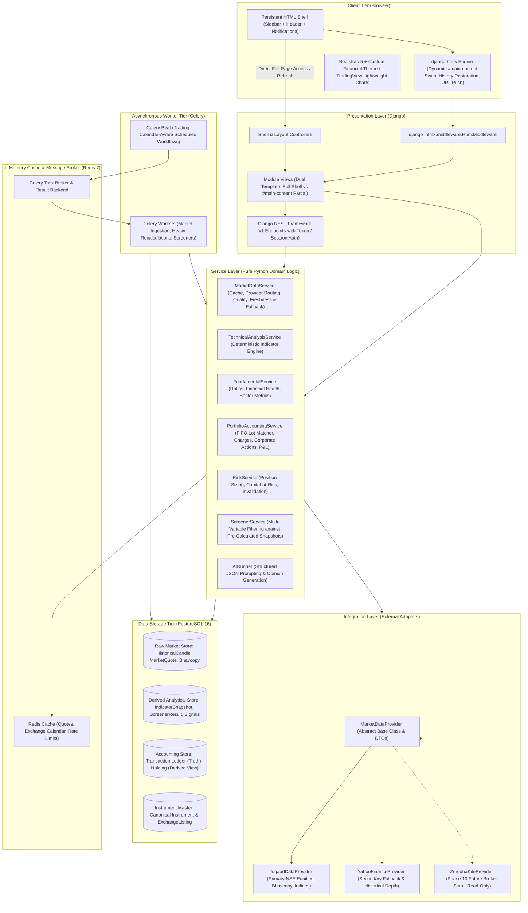
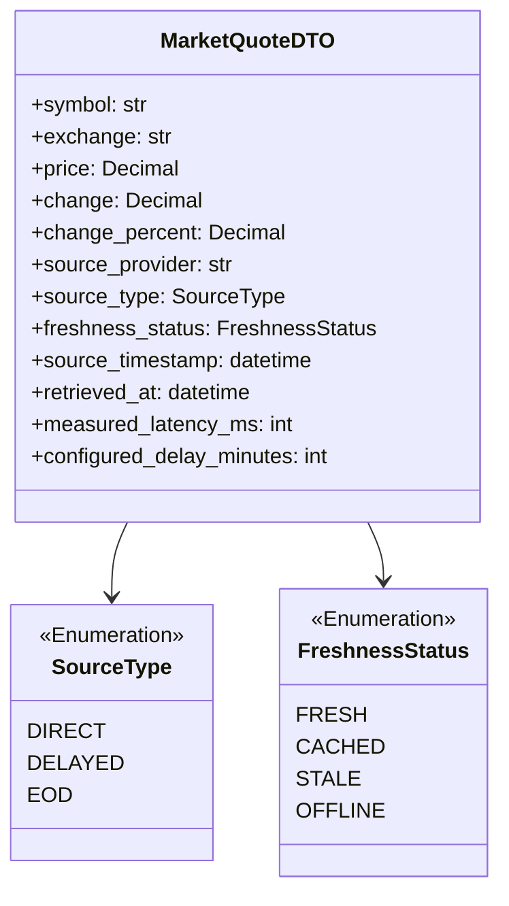
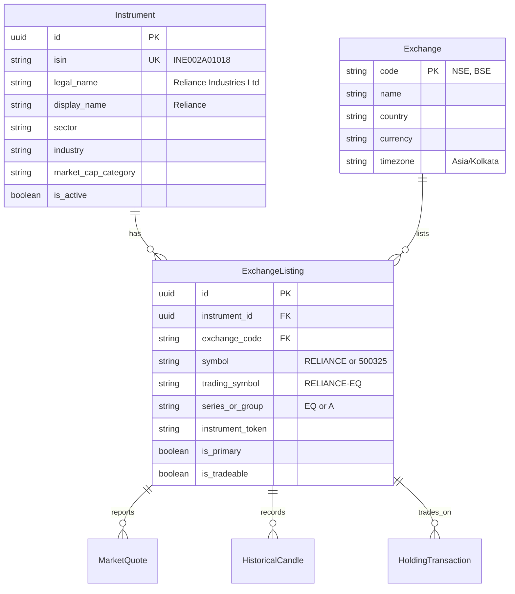
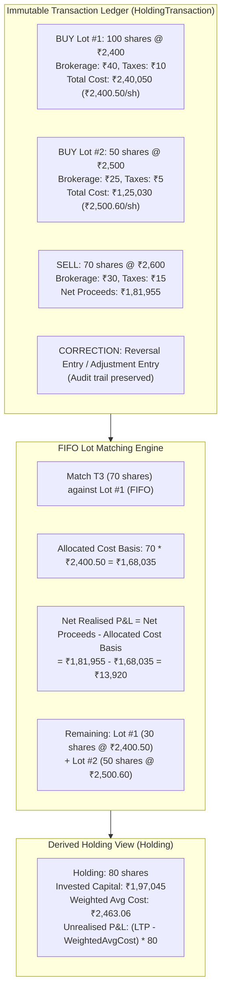
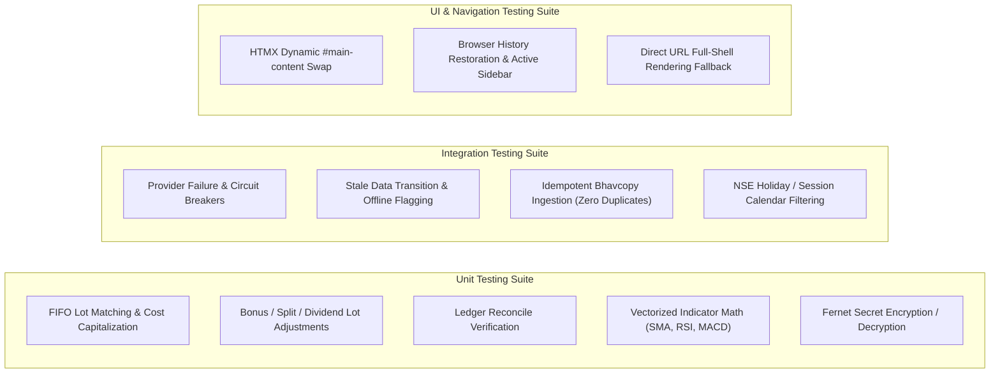

# System Architecture Document

**Project:** Indian Stock Market Research & Intelligence Platform  
**Architecture Style:** Django Modular Monolith  
**Backend:** Python 3.12+ / Django 5.x  
**Frontend:** Django Templates + Bootstrap 5 + HTMX (`django-htmx`)  
**Database:** PostgreSQL 16+  
**Background Tasks:** Celery + Redis  
**Specification Reference:** `MASTER_SPECIFICATION_DJANGO.md`  
**Revision:** 2.1 (Final Architecture Refinements Applied)

---

## 1. Architectural Overview & Design Philosophy

The Indian Stock Market Research & Intelligence Platform is structured as a **Django Modular Monolith**. It enforces strict domain encapsulation, clean layering, and clear boundaries between raw financial data, calculated analytical models, user portfolios, and external data adapters.



### Core Design Rules
1. **Single Source of Truth:** `MASTER_SPECIFICATION_DJANGO.md` governs all architectural choices and financial logic.
2. **Raw vs. Derived Data Separation:** Raw ingested market data is immutable. Technical indicators, scoring, and signals are derived data tagged with calculation version and timestamp, allowing instant recalculation without re-downloading market feeds.
3. **Immutable Transaction Ledger for Portfolios:** All holdings, weighted costs, and P&L figures are derived deterministically from an immutable transaction ledger (`HoldingTransaction`). Corrections are handled through reversal or adjustment entries.
4. **Two-Dimensional Market Data Status:** Market data explicitly separates **`source_type`** (`DIRECT`, `DELAYED`, `EOD`) from **`freshness_status`** (`FRESH`, `CACHED`, `STALE`, `OFFLINE`). A cached quote is never represented as live real-time.
5. **Decoupled Exchange Listings & Canonical Identity:** Companies are represented by canonical instruments (`Instrument`), while their market venues are modeled via distinct exchange listings (`ExchangeListing`).
6. **Provider Terms & Security:** External data providers are queried responsibly with explicit platform identification and rate limits. Secrets are encrypted using symmetric authenticated encryption (Fernet / AES-128-CBC + HMAC) with keys managed strictly in environment variables outside the database.

---

## 2. Directory Structure & App Boundaries

```text
indian_stock_intelligence/
├── manage.py
├── requirements/
│   ├── base.txt
│   ├── local.txt
│   └── production.txt
├── .env.example
├── .gitignore
├── README.md
├── MASTER_SPECIFICATION_DJANGO.md
├── IMPLEMENTATION_STATUS.md
├── ARCHITECTURE.md
├── DATA_SOURCES.md
├── DEVELOPMENT_PLAN.md
│
├── config/
│   ├── __init__.py
│   ├── settings/
│   │   ├── __init__.py
│   │   ├── base.py
│   │   ├── development.py
│   │   └── production.py
│   ├── urls.py
│   ├── celery.py
│   └── wsgi.py
│
├── apps/
│   ├── core/                  # Base models, AuditedModel, calendar utilities, encryption helpers
│   ├── accounts/              # Custom user model, security preferences, session controls
│   ├── dashboard/             # Executive summary dashboard: indices ticker, portfolio snapshot
│   ├── market/                # Market indices, advance/decline stats, trading session state
│   ├── instruments/           # Canonical instruments, exchange listings, ISIN, sector hierarchies
│   ├── stocks/                # Stock profile views, search autocomplete, chart presentations
│   ├── technical_analysis/    # Technical indicator models, signal logs, calculation metadata
│   ├── fundamental_analysis/  # Financial statements, ratios, scoring cards, peer comparisons
│   ├── portfolio/             # Portfolio containers, cash balance, overall valuation, allocation
│   ├── holdings/              # Transaction ledger (source of truth), lot allocations, realized gains
│   ├── trading/               # Swing trading scanner, setup generation, risk-sized trade journal
│   ├── screener/              # Multi-variable screener presets, saved queries, result snapshots
│   ├── watchlists/            # User watchlists, alerts linkage, price targets
│   ├── ai_analysis/           # Structured LLM analysis (Investor, Swing, Risk Manager AI)
│   ├── ml_engine/             # Market regime detection, time-series classification, ranking
│   ├── news/                  # Exchange filings, corporate events, dividend/split tracker
│   ├── alerts/                # Price threshold, technical breakout, and portfolio drawdown alerts
│   ├── backtesting/           # Historical strategy simulation engine, slippage/brokerage models
│   ├── brokers/               # Broker connection manager (Zerodha Kite adapter stub for Phase 10)
│   ├── reports/               # PDF/CSV generation of portfolio tear-sheets and stock memos
│   ├── notifications/         # Notification center (in-app, email alerts)
│   └── settings_app/          # Data provider health dashboard, API key management, cache controls
│
├── integrations/
│   ├── market_data/
│   │   ├── base.py            # MarketDataProvider ABC & standardized DTOs
│   │   ├── exceptions.py      # ProviderConnectionError, RateLimitError, DataQualityError
│   │   ├── registry.py        # Dynamic provider discovery and priority resolver
│   │   ├── normalizer.py      # Universal OHLCV & Quote normalizers
│   │   ├── health.py          # Provider latency & error-rate monitor
│   │   └── providers/
│   │       ├── jugaad/        # Jugaad-Data NSE implementation
│   │       ├── yahoo/         # yfinance secondary implementation
│   │       └── zerodha/       # Kite Connect stub (Phase 10)
│   ├── ai_providers/          # AI client adapters
│   ├── news_providers/        # Scrapers & RSS feeds
│   └── broker_providers/      # Future broker adapters
│
├── services/
│   ├── market_data/           # MarketDataService orchestrator
│   ├── indicators/            # Pure technical calculation engine (vectorized, versioned)
│   ├── fundamentals/          # Fundamental ratio and balance-sheet processing
│   ├── portfolio/             # FIFO lot matcher, charges capitalization, corporate actions
│   ├── risk/                  # Position sizing, Kelly/fixed fractional risk rules
│   ├── recommendations/       # Holder vs New Buyer rule evaluation engine
│   └── calendar/              # NSE Exchange Trading Calendar (Holidays, Muhurat sessions)
│
├── templates/
│   ├── base/
│   │   ├── shell.html         # Persistent shell (sidebar, header, content swap target)
│   │   ├── _header.html       # Persistent top navigation, ticker marquee, search
│   │   ├── _sidebar.html      # Categorized navigation links with active indicators
│   │   └── _footer.html       # System status & data freshness badge
│   ├── components/            # Reusable UI fragments (cards, badges, tables, charts)
│   └── errors/                # 400, 403, 404, 500 error templates
│
├── static/
│   ├── css/                   # Custom financial light/dark theme
│   ├── js/                    # HTMX extensions, charting scripts
│   ├── vendor/                # Bootstrap 5, HTMX, Lightweight Charts JS
│   └── images/
│
├── media/                     # Uploads (reports, user avatars)
├── logs/                      # Application and Celery structured log files
├── scripts/                   # Management and operational utility scripts
└── tests/                     # Unit, integration, and UI test suites
```

---

## 3. UI Navigation & Dynamic Shell Architecture

### 3.1 Persistent Shell Pattern
The user experience is built around a unified HTML application shell (`templates/base/shell.html`). The top header and left sidebar remain permanently mounted in the DOM. Module transitions update only the central `<div id="main-content">` container.

### 3.2 Dual-Mode Rendering with `django-htmx`
Every module view supports two modes:
1. **HTMX Request (`request.htmx == True`):** Returns only the inner partial template (e.g., `stocks/partials/stock_detail_partial.html`).
2. **Direct Browser Request / Full Refresh (`request.htmx == False`):** Returns the full `base/shell.html` with the module partial embedded inside `#main-content`.

```python
# apps/core/mixins.py
from django.views.generic.base import TemplateResponseMixin

class HTMXResponseMixin(TemplateResponseMixin):
    """
    Renders partial template when requested via HTMX, 
    otherwise renders the full base shell template.
    Requires django_htmx.middleware.HtmxMiddleware.
    """
    partial_template_name = None

    def get_template_names(self):
        if getattr(self.request, "htmx", False):
            if not self.partial_template_name:
                raise ValueError(f"partial_template_name not defined on {self.__class__.__name__}")
            return [self.partial_template_name]
        return [self.template_name]
```

### 3.3 Active State & History Restoration
- **History Preservation:** Every HTMX link includes `hx-push-url="true"`.
- **Active Navigation State:** Handled both server-side (passing `active_nav='stocks'` in context for direct page loads) and client-side on `htmx:afterOnLoad` and `htmx:historyRestore`:
```javascript
// static/js/app.js
function updateActiveSidebar(pathname) {
    document.querySelectorAll('#sidebar .nav-link').forEach(link => {
        const href = link.getAttribute('hx-get') || link.getAttribute('href');
        if (href && pathname.startsWith(href)) {
            link.classList.add('active');
        } else {
            link.classList.remove('active');
        }
    });
}

document.addEventListener('htmx:historyRestore', function(event) {
    updateActiveSidebar(window.location.pathname);
});
document.addEventListener('htmx:afterOnLoad', function(event) {
    if (event.detail.target.id === 'main-content') {
        updateActiveSidebar(window.location.pathname);
    }
});
```
- **Graceful Error Handling:** If an HTMX request fails (HTTP 4xx or 5xx), `htmx:responseError` intercepts the failure and displays an accessible toast without breaking the application layout.

---

## 4. Market Data Reliability: Two-Dimensional Status

Market data veracity is critical. Status is decoupled into two independent dimensions: **Source Type** (what tier of data feed is supplying the price) and **Freshness Status** (the temporal validity of the local representation).



### 4.1 Status Definitions & Operational Matrix

1. **Source Type (`source_type`):**
   - `DIRECT`: Direct official exchange feed or real-time scraper (e.g. active Jugaad during market hours).
   - `DELAYED`: Expressly delayed feed (e.g. Yahoo Finance 15-minute delay). Delay is explicitly recorded in `configured_delay_minutes=15`, not assumed.
   - `EOD`: Official end-of-day settlement bhavcopy published after market close.

2. **Freshness Status (`freshness_status`):**
   - `FRESH`: Quote retrieved directly from the external provider within the current cycle ($< 30\text{ seconds}$).
   - `CACHED`: Quote served from Redis within configured TTL ($30\text{s}$ for direct, $60\text{s}$ for delayed). **A cached quote is explicitly displayed as CACHED with its cache age and is never represented as live real-time.**
   - `STALE`: Cached or retrieved quote whose age exceeds allowable freshness during an active trading session ($> 5\text{ minutes}$ for direct; $> 20\text{ minutes}$ for delayed).
   - `OFFLINE`: Provider connection failed or timed out; displaying last persisted quote with explicit offline warning.

### 4.2 Universal Data Contracts (DTOs)

```python
# integrations/market_data/base.py
from dataclasses import dataclass
from datetime import datetime
from decimal import Decimal
from typing import Optional
from enum import Enum

class SourceType(str, Enum):
    DIRECT = "DIRECT"
    DELAYED = "DELAYED"
    EOD = "EOD"

class FreshnessStatus(str, Enum):
    FRESH = "FRESH"
    CACHED = "CACHED"
    STALE = "STALE"
    OFFLINE = "OFFLINE"

@dataclass(frozen=True)
class MarketQuoteDTO:
    symbol: str
    exchange: str
    price: Decimal
    change: Decimal
    change_percent: Decimal
    open: Decimal
    high: Decimal
    low: Decimal
    close: Decimal
    previous_close: Decimal
    volume: int
    source_provider: str
    source_type: SourceType
    freshness_status: FreshnessStatus
    source_timestamp: datetime          # Provider reported timestamp (UTC)
    retrieved_at: datetime              # Server ingestion timestamp (UTC)
    measured_latency_ms: Optional[int]  # Measured HTTP latency in ms
    configured_delay_minutes: int       # 0 for Direct/EOD, 15 for Yahoo
```

---

## 5. Instrument Identity: Canonical Asset vs. Exchange Listing

In Indian financial markets, a single underlying company (e.g. *Reliance Industries Limited*) is listed simultaneously on NSE and BSE with distinct identifiers:
- **ISIN:** `INE002A01018` (Global canonical identifier)
- **NSE Listing:** Symbol `RELIANCE`, Series `EQ`
- **BSE Listing:** Scrip Code `500325`, Scrip ID `RELIANCE`, Group `A`

Modeling this as a single entity with a unique symbol creates severe collisions. We decouple canonical identity from market venues:



### Database Constraints:
- `Instrument.isin` is globally unique (`unique=True`).
- `ExchangeListing` enforces composite uniqueness:
  ```python
  models.UniqueConstraint(
      fields=['exchange', 'symbol'],
      name='unique_exchange_symbol'
  )
  ```

---

## 6. Portfolio Accounting: Immutable Transaction Ledger

### 6.1 Ledger Architecture Clarification
The portfolio accounting engine is implemented as an **Immutable Transaction Ledger with Lot-Based Accounting and Adjustment Entries** (not a general-ledger double-entry debit/credit system). 

All portfolio valuations, average purchase prices, and realized/unrealized gains are computed deterministically from `HoldingTransaction` records:



### 6.2 Charges Allocation Rules
1. **Buy Transactions:**
   - Brokerage, STT, stamp duty, exchange turnover charges, and GST are **capitalized** into the lot's cost basis:
     $$\text{Total Lot Cost} = (\text{Quantity} \times \text{Execution Price}) + \text{Brokerage} + \text{Statutory Taxes}$$
     $$\text{Effective Unit Cost} = \frac{\text{Total Lot Cost}}{\text{Quantity}}$$
2. **Sell Transactions:**
   - Charges directly **reduce net sales proceeds**:
     $$\text{Net Proceeds} = (\text{Matched Quantity} \times \text{Execution Price}) - \text{Brokerage} - \text{Statutory Taxes}$$
     $$\text{Net Realised P&L} = \text{Net Proceeds} - \sum_{\text{matched lots}} (\text{Matched Qty} \times \text{Effective Unit Cost})$$

### 6.3 Corrections via Reversal and Adjustment Entries
Direct modification or deletion of historical transactions is forbidden. When a user or system corrects an error:
- A compensating transaction (`BUY_REVERSAL`, `SELL_REVERSAL`, or `COST_ADJUSTMENT`) is appended to the ledger referencing the original transaction ID.
- The `Holding.reconcile()` method recalculates the entire lot history, preserving an immutable audit trail.

### 6.4 Corporate Action Handling
- **Bonus Issue ($X:Y$):** Ingested as a `BONUS` transaction. Adds $X \times \text{held} / Y$ shares with ₹0 purchase price, lowering average unit cost without changing invested capital.
- **Stock Split ($X:Y$):** Existing open lots are split proportionally ($Qty \times X/Y$, $UnitCost \times Y/X$).
- **Cash Dividend:** Ingested as a `DIVIDEND` transaction crediting cash/dividend income without altering share quantity or capital invested.

---

## 7. Raw vs. Derived Data Architecture

1. **Raw Market Layer:**
   - `HistoricalCandle` and `NSEBhavcopy` store pristine OHLCV figures exactly as delivered by providers.
   - Raw records are immutable.
2. **Derived Analytical Layer:**
   - `TechnicalIndicatorSnapshot` stores computed SMAs, EMAs, RSI, MACD.
   - `FundamentalSnapshot` stores calculated valuation multiples and financial health scores.
   - `ScreenerResult` and `SignalLog` store rule evaluations.
3. **Calculation Provenance:**
   - Every derived record includes `calculation_version` (e.g. `"ind-v1.2.0"`) and `calculated_at` (UTC timestamp).
   - Recalculation runs without re-downloading raw historical candles.

---

## 8. Database Architecture & Operational Runbook

### 8.1 Critical Indexes & Constraints

```sql
-- 1. Historical Candles: Optimized for time-series range queries and descending charts
CREATE UNIQUE INDEX idx_candle_unique ON market_historicalcandle (listing_id, interval, timestamp);
CREATE INDEX idx_candle_lookup ON market_historicalcandle (listing_id, interval, timestamp DESC);

-- 2. Portfolio Transactions: Optimized for FIFO lot matching and audit reconstruction
CREATE INDEX idx_tx_portfolio_listing ON holdings_holdingtransaction (portfolio_id, listing_id, executed_at ASC);
CREATE INDEX idx_tx_type_date ON holdings_holdingtransaction (portfolio_id, transaction_type, executed_at);

-- 3. Live Quotes: Fast lookup for current prices
CREATE INDEX idx_quote_listing_time ON market_marketquote (listing_id, retrieved_at DESC);

-- 4. Indicator Snapshots: Fast chart overlay loading
CREATE INDEX idx_indicator_lookup ON technical_analysis_technicalindicatorsnapshot (listing_id, interval, timestamp DESC);
```

### 8.2 PostgreSQL Backup & Disaster Recovery
- **Daily Automated Backup:** Celery Beat / host cron executes `pg_dump`:
  ```bash
  pg_dump -Fc --no-acl --no-owner -h $DB_HOST -U $DB_USER $DB_NAME > /backups/stock_intel_$(date +%Y%m%d_%H%M%S).dump
  ```
- **Backup Retention:** 7 daily backups, 4 weekly backups, 12 monthly archives.
- **Restoration Drill:**
  ```bash
  pg_restore --clean --if-exists --no-acl --no-owner -h $DB_HOST -U $DB_USER -d $DB_NAME /backups/stock_intel_TARGET.dump
  ```

### 8.3 Migration and Rollback Practices
1. **Zero-Downtime Forward Migrations:**
   - Add new columns as `null=True` or with safe database defaults.
   - Separate schema changes from data backfills.
2. **Safe Rollback Protocol:**
   - Every migration must be tested backwards (`python manage.py migrate <app> <previous_migration_name>`).
   - If a migration involves a column drop or table deletion, a database snapshot must precede execution.

### 8.4 Environment Configuration Matrix

| Component | Development (`config/settings/development.py`) | Production (`config/settings/production.py`) |
|---|---|---|
| `DEBUG` | `True` | `False` |
| `ALLOWED_HOSTS` | `localhost, 127.0.0.1` | Explicit domain (e.g. `stockintel.internal`) |
| `DATABASE_URL` | Local PostgreSQL or Docker Compose | Managed PostgreSQL with connection pooling (PgBouncer) |
| `REDIS_URL` | Local Redis (`redis://localhost:6379/0`) | Secured Redis cluster with TLS & AUTH |
| `FIELD_ENCRYPTION_KEY` | Development Fernet key in `.env` | Out-of-band secret injected via vault / systemd |
| `SESSION_COOKIE_SECURE` | `False` | `True` |
| `SECURE_SSL_REDIRECT` | `False` | `True` |
| `SECURE_HSTS_SECONDS` | `0` | `31536000` (1 year) |

---

## 9. Testing & Quality Assurance Architecture



### Critical Test Cases Required Before Release:
1. **FIFO Partial Sells:** Buy 100 @ ₹100, Buy 50 @ ₹120; Sell 120 @ ₹150. Verify Lot #1 is fully closed (100 shares), Lot #2 is partially closed (20 shares), and 30 shares remain at ₹120 cost basis.
2. **Charges Allocation:** Verify buy brokerage increases cost basis, while sell brokerage decreases net realized P&L.
3. **Transaction Correction:** Post a `BUY_REVERSAL` transaction; verify `Holding.reconcile()` accurately recalculates net holdings to zero.
4. **Corporate Actions:** Verify 1:1 stock split doubles holding quantity and halves effective unit price without changing total invested capital.
5. **Provider Failure & Degradation:** Mock HTTP 500 / Timeout on Jugaad-Data; verify `MarketDataService` gracefully falls back to Yahoo Finance, marks quote `source_type=DELAYED`, and logs a `DataQualityIssue`.
6. **HTMX Navigation & History:** Verify clicking a sidebar link emits `HX-Request`, updates `#main-content`, pushes URL, and browser back button triggers `htmx:historyRestore` updating the active sidebar CSS class.

---

## 10. Architectural Validation Check

- [x] **Two-Dimensional Market Data Status:** `source_type` (`DIRECT`, `DELAYED`, `EOD`) and `freshness_status` (`FRESH`, `CACHED`, `STALE`, `OFFLINE`).
- [x] **Accurate Ledger Terminology:** Documented as an **Immutable Transaction Ledger with Lot-Based Accounting** (no false double-entry claims).
- [x] **Transaction Corrections:** Handled via reversal/adjustment entries preserving audit history.
- [x] **Capitalized Buy & Deducted Sell Charges:** Mathematically defined and allocated.
- [x] **Corporate Action Engine:** Bonus, split, and dividend logic fully integrated.
- [x] **PostgreSQL Operations:** Backup, restore, migration rollback, and critical indexes documented.
- [x] **Environment Configuration:** Development vs Production cleanly separated.
- [x] **Robust Test Matrix:** Provider failure, stale data, deduplication, FIFO, corporate actions, and HTMX history tests specified.
