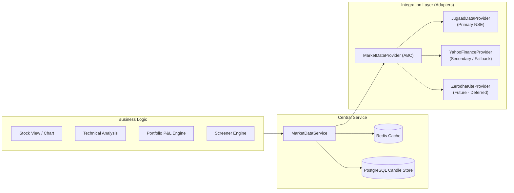
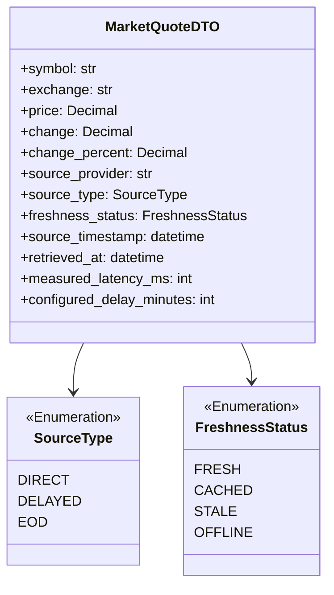

# Market Data Sources Architecture & Integration Guide

**Project:** Indian Stock Market Research & Intelligence Platform  
**Document Type:** Technical Integration Specification  
**Status:** Architecture Blueprint  
**Specification Reference:** `MASTER_SPECIFICATION_DJANGO.md` (Sections 6, 7 & 30)  
**Revision:** 2.1 (Final Architecture Refinements Applied)

---

## 1. Provider Overview & Strategic Role

The platform requires a **provider-agnostic market data pipeline**. Market data providers are treated as interchangeable external adapters implementing a uniform interface. Under no circumstances may application business logic import or query external providers directly.



### 1.1 Provider Responsibility Matrix

| Requirement | Primary Source | Secondary / Fallback Source | Deferred / Future Source |
|---|---|---|---|
| **NSE Historical Equities (EOD)** | **Jugaad-Data** | Yahoo Finance (`.NS`) | Zerodha Kite |
| **NSE Daily Bhavcopy** | **Jugaad-Data** | None (logged as missing) | Zerodha Kite |
| **Historical Indices (NIFTY, SENSEX)** | **Jugaad-Data** | Yahoo Finance (`^NSEI`, `^BSESN`) | Zerodha Kite |
| **Daily Stock Charts** | **Jugaad-Data** | Yahoo Finance | Zerodha Kite |
| **Indicative Quotes** | **Jugaad-Data** (Direct NSE Scrape) | Yahoo Finance (Delayed 15m) | Zerodha Kite |
| **Delivery Information** | **Jugaad-Data** (Bhavcopy reports) | None | Zerodha Kite |
| **Fundamental Data** | Manual Entry / Future API | Yahoo Finance (indicative ratios) | Screener.in / Trendlyne |
| **Broker Portfolio Sync** | Manual Entry (Initial) | None | **Zerodha Kite** (Phase 10) |

---

## 2. Two-Dimensional Market Data Status Model

Market data veracity is critical. Status is decoupled into two independent dimensions: **Source Type** (what tier of feed is supplying the price) and **Freshness Status** (the temporal validity of the local representation).



### 2.1 State Definitions

1. **Source Type (`source_type`):**
   - `DIRECT`: Direct exchange scrape during active market hours (09:15–15:30 IST) via Jugaad-Data.
   - `DELAYED`: Expressly delayed market data (e.g., Yahoo Finance 15-minute delay). Delay is explicitly recorded in `configured_delay_minutes=15`, not assumed.
   - `EOD`: Official end-of-day settlement bhavcopy published after market close.

2. **Freshness Status (`freshness_status`):**
   - `FRESH`: Quote retrieved directly from the external provider within the current cycle ($< 30\text{ seconds}$).
   - `CACHED`: Quote served from Redis within configured TTL ($30\text{s}$ for direct, $60\text{s}$ for delayed). **A cached quote is explicitly displayed as CACHED with its cache age and is never represented as live real-time.**
   - `STALE`: Cached or retrieved quote whose age exceeds allowable freshness during an active trading session ($> 5\text{ minutes}$ for direct; $> 20\text{ minutes}$ for delayed).
   - `OFFLINE`: Provider connection failed or timed out; displaying last persisted quote with explicit offline warning.

---

## 3. Initial Data Providers

### 3.1 Jugaad-Data (`jugaad-data`)
- **Repository:** [https://github.com/jugaad-py/jugaad-data](https://github.com/jugaad-py/jugaad-data)
- **Role:** Primary provider for Indian NSE equity and historical index data.
- **Capabilities:**
  - Historical equity stock candles (Open, High, Low, Close, Volume).
  - Historical index series (e.g., NIFTY 50, NIFTY BANK).
  - Daily NSE Bhavcopy ingestion (bulk EOD prices and delivery percentages).
- **Technical Considerations & Operational Rules:**
  1. *Scraping Mechanism:* Jugaad-Data communicates directly with public NSE web endpoints. It is **not** an official licensed broker feed.
  2. *Session & Headers:* The adapter maintains a persistent `requests.Session` to reuse cookies. It uses a **consistent, honest User-Agent** identifying the platform. User-Agent rotation to evade rate limits is prohibited.
  3. *Rate Limiting:* The adapter strictly enforces a minimum 1.5-second inter-request delay during bulk operations and pauses on HTTP 429/403 with exponential backoff.
  4. *Scheduled Execution:* Bulk bhavcopy downloads run strictly off-market hours (18:30 IST) on days confirmed as trading days by `ExchangeCalendar`.

### 3.2 Yahoo Finance (`yfinance`)
- **Documentation:** [https://ranaroussi.github.io/yfinance/](https://ranaroussi.github.io/yfinance/)
- **Role:** Secondary fallback provider for historical OHLCV and global market context.
- **Symbol Syntax:**
  - NSE Equities: `<SYMBOL>.NS` (e.g., `RELIANCE.NS`, `INFY.NS`, `TCS.NS`)
  - BSE Equities: `<SYMBOL>.BO` (e.g., `RELIANCE.BO`, `500325.BO`)
  - Indices: `^NSEI` (NIFTY 50), `^BSESN` (SENSEX), `^NSEBANK` (BANK NIFTY)
- **Technical Considerations & Operational Rules:**
  1. *Data Delay:* Quotes retrieved from Yahoo Finance are delayed by 15 minutes during trading sessions. They must be tagged `source_type=SourceType.DELAYED`, `configured_delay_minutes=15`.
  2. *Corporate Actions:* `yfinance` provides split-adjusted and unadjusted data. Unadjusted and adjusted close must be stored in separate database columns.
  3. *Fallback Usage:* If Jugaad-Data fails or experiences an outage for a given historical range, the system attempts Yahoo Finance fallback, recording a warning in `DataQualityIssue`.

---

## 4. Market Data Contract & Normalization

All external adapters transform incoming payloads into standardized, frozen Data Transfer Objects (DTOs).

### 4.1 Normalized Quote Schema (`MarketQuoteDTO`)
```python
from dataclasses import dataclass
from datetime import datetime
from decimal import Decimal
from typing import Optional
from enum import Enum

class SourceType(str, Enum):
    DIRECT = "DIRECT"
    DELAYED = "DELAYED"
    EOD = "EOD"

class FreshnessStatus(str, Enum):
    FRESH = "FRESH"
    CACHED = "CACHED"
    STALE = "STALE"
    OFFLINE = "OFFLINE"

@dataclass(frozen=True)
class MarketQuoteDTO:
    symbol: str
    exchange: str               # "NSE" or "BSE"
    price: Decimal              # Current traded price (LTP)
    change: Decimal             # Absolute change
    change_percent: Decimal     # Percentage change
    open: Decimal
    high: Decimal
    low: Decimal
    close: Decimal
    previous_close: Decimal
    volume: int
    source_provider: str        # "JUGAAD", "YAHOO", "ZERODHA"
    source_type: SourceType     # DIRECT, DELAYED, EOD
    freshness_status: FreshnessStatus  # FRESH, CACHED, STALE, OFFLINE
    source_timestamp: datetime  # Exact timestamp reported by provider (UTC)
    retrieved_at: datetime      # Timestamp recorded by our server (UTC)
    measured_latency_ms: Optional[int] # Latency of HTTP fetch in ms
    configured_delay_minutes: int      # 0 for Direct/EOD, 15 for Yahoo
```

### 4.2 Normalized Candle Schema (`HistoricalCandleDTO`)
```python
from dataclasses import dataclass
from datetime import datetime
from decimal import Decimal
from typing import Optional

@dataclass(frozen=True)
class HistoricalCandleDTO:
    timestamp: datetime         # UTC Candle boundary
    interval: str               # "1d", "1h", "15m", "5m"
    open: Decimal
    high: Decimal
    low: Decimal
    close: Decimal
    volume: int
    adjusted_close: Optional[Decimal]
    source_provider: str
```

---

## 5. Data Validation & Quality Hygiene Rules

Before persisting any quote or candle into PostgreSQL, the `MarketDataService` passes the DTO through the validation pipeline:

1. **OHLC Boundary Checks:**
   $$\text{Low} \le \text{Open} \le \text{High}$$
   $$\text{Low} \le \text{Close} \le \text{High}$$
   If violated, the candle is rejected and flagged as `INVALID_OHLC_RELATION`.
2. **Non-Negative Volume:**
   $$\text{Volume} \ge 0$$
3. **Price Reasonableness:**
   $$\text{Price} > 0$$
   Values equal to zero or negative are discarded.
4. **Exchange Calendar Validation:**
   Candle timestamps must fall on active trading days (excluding weekends and NSE scheduled holidays).
5. **No Price Averaging:**
   If Jugaad and Yahoo report conflicting closing prices for the same trading session:
   - Do **NOT** calculate an average.
   - Retain the configured primary provider's value (Jugaad).
   - Log an entry in `DataQualityIssue` noting the delta, measured latency, and timestamps.

---

## 6. Provider Health Monitoring & Circuit Breakers

The system monitors provider health via `integrations.market_data.health.ProviderHealthMonitor`:

- **Health Checks:** Periodic Celery task checks provider connectivity by querying a stable reference instrument (e.g. `RELIANCE`).
- **Circuit Breaker:** If a provider yields 3 consecutive connection timeouts or 429/403 responses, it is automatically marked `STATUS_DEGRADED` for 15 minutes, routing requests immediately to the fallback provider.
- **Admin Dashboard:** The `settings_app:data_sources` view surfaces live status badges, last success timestamp, latency in milliseconds, and current error logs.

---

## 7. User Interface Freshness Indicators

The persistent header and individual stock detail views must prominently communicate market data provenance:

- 🟢 **Live Direct (NSE)**: Data retrieved within the last 30 seconds during market hours.
- 🔵 **Cached Direct (30s ago)**: Redis cache hit within allowable TTL.
- 🟡 **Delayed (Yahoo Finance 15m)**: Indicates fallback data feed.
- ⚪ **EOD Settled**: Official end-of-day bhavcopy settlement.
- 🔴 **Offline / Stale**: Provider unavailable or cache expired; showing last persisted value with timestamp.
