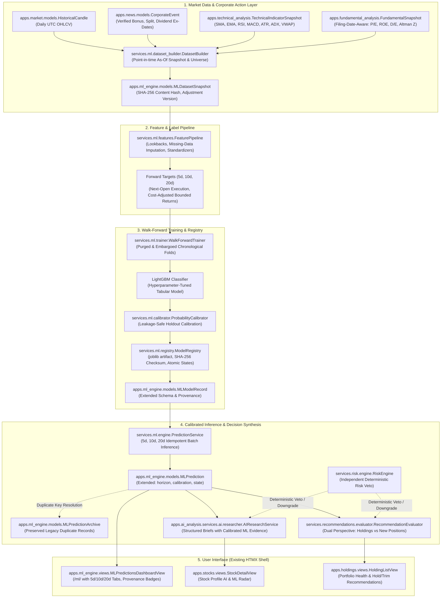
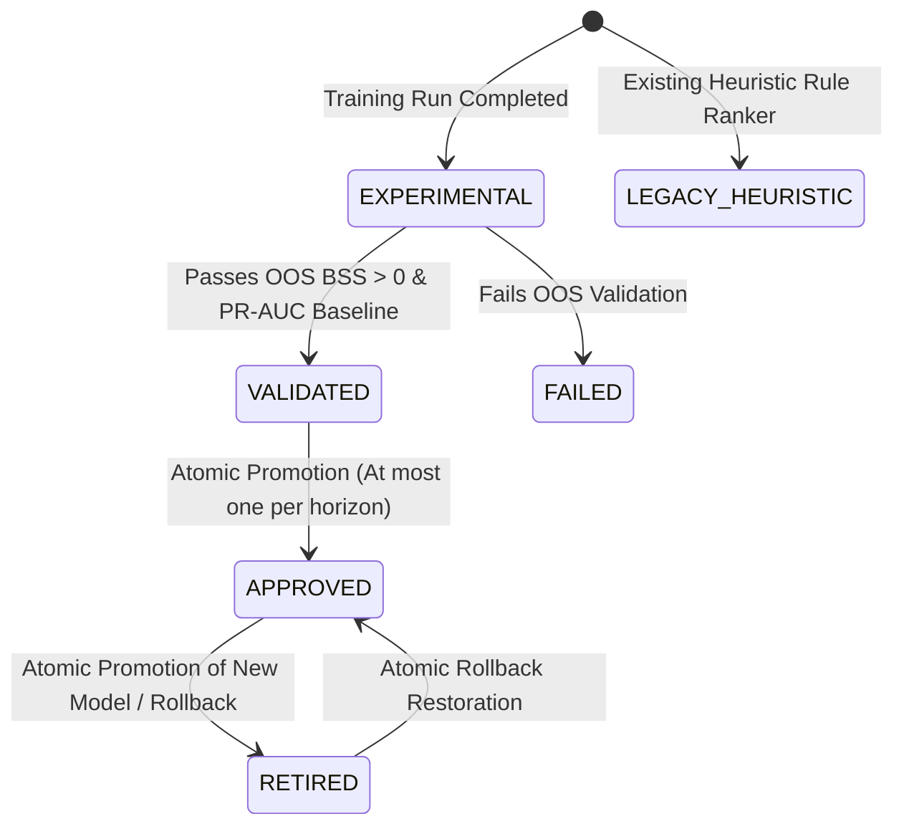
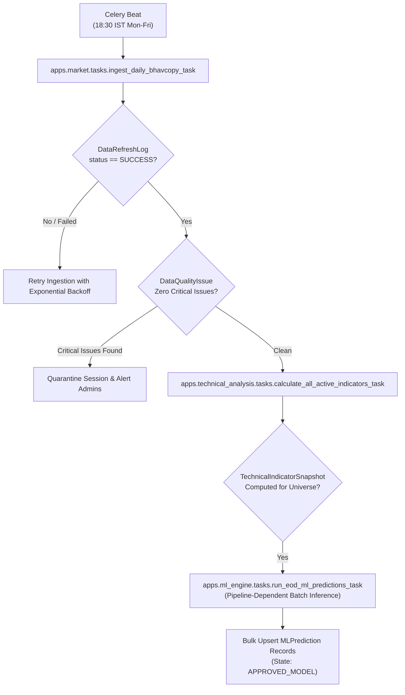

# AI/ML Architecture Specification

**Project:** KuberLens — Indian Equity Research & Decision-Support Platform  
**Document:** `docs/AIML_ARCHITECTURE.md`  
**Version:** 2.1 (Final Pre-Implementation Revision)  
**Date:** 2026-11-24  
**Status:** Architecture Design (Final Safety Revisions Applied)  
**Parent Specifications:** `MASTER_SPECIFICATION_DJANGO.md`, `IMPLEMENTATION_AIML.md`  
**Audit Reference:** `docs/AIML_GAP_ANALYSIS.md`  

---

## 1. Architecture Review Corrections & Safety Invariants

This section documents the specific issues identified during architecture review and their precise technical resolutions incorporated into this specification.

| Review Issue | Category | Resolution Incorporated in v2.1 |
|---|---|---|
| **1. Corporate Action Source & Conventions** | Critical | **Replaced user `HoldingTransaction` with verified market-wide corporate action data from `apps.news.models.CorporateEvent` and official NSE Bhavcopy.** Formally defined mathematical split and bonus adjustment conventions with explicit, tested numerical examples. |
| **2. Target Definitions & Execution** | Critical | **Formulated precise absolute, benchmark-relative, and cost-adjusted return targets.** Added explicit next-session open ($O_{t+1}$) execution assumptions to eliminate same-day close-to-close fill bias. Defined the formal mathematical target $Y_{t, h} = \mathbb{I}(R_{t, t+h}^{net} > \tau_h)$. |
| **3. Heuristic vs. Statistical Demarcation** | Critical | **Classified existing prototype models as `LEGACY_HEURISTIC` / `HEURISTIC_RULE_BASED`.** Standardized five inference states: `APPROVED_MODEL`, `EXPERIMENTAL_MODEL`, `HEURISTIC_FALLBACK`, `STALE_DATA`, and `INSUFFICIENT_DATA`. Transitional column defaults default strictly to `HEURISTIC_FALLBACK` / `UNCALIBRATED`. |
| **4. Safe Migration & Duplicate Preservation** | Critical | **Preserves all historical records via `MLPredictionArchive`.** Conflicting duplicate keys are archived with original UUIDs, timestamps, and metadata before unique constraints are applied. Pre-migration backup and disaster recovery protocols are explicitly defined. |
| **5. Leakage-Safe Probability Calibration** | Critical | **Implemented a 4-split nested cross-validation scheme.** Decouples training, calibration, model selection, and final testing. Models retaining raw scores are strictly labeled as `RAW` / `UNCALIBRATED` in the UI. |
| **6. Purged Walk-Forward Splits** | Critical | **Defined split boundaries using explicit observation timestamps $T_i$ and forward horizon end timestamps $T_i + h$.** Formally enforces purging of overlapping label windows and applies an $h$-session embargo buffer after test folds. |
| **7. Training-Derived Brier Skill Score (BSS)** | Critical | **Defined Brier Skill Score against a climatological baseline $\bar{y}_{train}$ estimated purely from training data.** Evaluated out-of-sample on untouched test folds: $\text{BSS} = 1 - \frac{\text{BS}_{model}}{\text{BS}_{ref}}$. |
| **8. Model Activation Invariant & Concurrency** | Critical | **Enforced "at most one APPROVED model per horizon" ($[0, 1]$).** Database-enforced conditional unique constraint (`UniqueConstraint` with `condition=Q(model_state="APPROVED")`). Concurrency-safe promotion logic handles transitions when no approved model currently exists. |
| **9. Pipeline-Dependent EOD Inference** | Critical | **Replaced fixed-clock cron scheduling with pipeline prerequisite checks.** Inference triggers via Celery task chaining after `ingest_daily_bhavcopy_task` and `calculate_all_active_indicators_task` complete, guarded by `DataRefreshLog` and `DataQualityIssue` checks. |
| **10. Multi-Factor Data Freshness** | Critical | **Evaluates freshness against trading calendar, market close (15:30 IST), EOD publication window (17:30–18:30 IST), and successful ingestion logs.** Friday EOD data is recognized as fresh over weekends until Monday's post-market ingestion window closes. |
| **11. Snapshot Content Hashing** | Improvement | **Added SHA-256 canonical dataframe content hashing, schema versioning, and source metadata** to `MLDatasetSnapshot`. |
| **12. Fundamental Publication Timestamps** | Improvement | **Distinguished original publication/filing timestamps (`published_at`) from internal `calculated_at` timestamps.** If verified historical filing dates are unavailable, those fundamental features are excluded from training to prevent lookahead bias. |
| **13. Universe & Listing Reconciliation** | Improvement | **Clarified NIFTY LargeMidcap 250 seed universe.** Explained that `NIFTY_250_STOCKS` defines 271 constituent companies yielding 268 seeded listings in the initial catalog. Documented survivorship limitations. |
| **14. Measured Performance Benchmarks** | Improvement | **Replaced unverified execution-time promises with per-sample throughput bounds** ($\le 15$ ms per stock inference on baseline hardware). |
| **15. Model Artifact Security** | Improvement | **Added `models/**/*.joblib` to `.gitignore`.** Enforced SHA-256 checksum verification before deserialization, restricted loading to `settings.ML_MODEL_DIR`, and set OS permissions (`0600`/`0700`). |
| **16. Realistic Implementation Estimates** | Improvement | **Replaced fixed 1-day estimates with realistic multi-day ranges (2–4 days per phase)** reflecting real-world engineering and test verification. |
| **17. Raw vs. Calibrated UI Truthfulness** | Improvement | **Strict UI demarcation for uncalibrated models:** Models with `calibration_status = "RAW"` or `"UNCALIBRATED"` display a dedicated warning badge and are never represented as calibrated. |
| **18. Zero Broker Order Execution** | Improvement | **Affirmed strict read-only decision-support architecture.** Zero automated broker order placement code is introduced. |

---

## 2. Executive Summary & Design Principles

The KuberLens AI/ML subsystem extends the existing Django modular monolith to deliver reproducible, calibrated forward directional probabilities (5, 10, and 20 trading sessions) using **LightGBM** as the primary supervised model.

### Core Architectural Principles
1. **Preserve What Works:** Zero disruption to existing Django apps, database schemas, 284 passing tests, or HTMX dynamic navigation shells.
2. **Deterministic Risk Separation:** AI/ML models provide *probabilistic predictive research opinions* only. Capital protection and risk decisions are enforced by an independent, deterministic Risk Engine that can unilaterally veto or suppress model recommendations.
3. **Zero Lookahead & Point-in-Time Integrity:** All feature vectors and training datasets strictly adhere to point-in-time EOD session closes. Labeling windows use chronological walk-forward cross-validation with explicit purging and embargo to eliminate lookahead bias and autocorrelation leakage.
4. **Calibrated Probabilities over Raw Classification:** Raw model outputs are calibrated (via Isotonic Regression / Platt Scaling) so that predicted probabilities reflect empirical real-world frequencies, verified by training-derived Brier Skill Score metrics.
5. **Clear Provenance & Heuristic Demarcation:** The system explicitly distinguishes heuristic baseline outputs from statistically trained and validated ML models across models, APIs, and the UI.
6. **Python 3.13 & NumPy 2.x Compatibility:** Engineered to operate within the existing runtime (`Python 3.13.3`, `numpy 2.5.4`, `pandas 3.1.1`, `Django 5.1.15`).

---

## 3. Existing vs. Proposed Architecture



---

## 4. Standardized Inference Output States & UI Truthfulness

To prevent ambiguity between statistical machine learning models and heuristic fallback calculations, every prediction output must explicitly report one of five standardized states:

| Inference State | Code | Description | UI Badge |
|---|---|---|---|
| **Approved Model** | `APPROVED_MODEL` | Generated by an active, validated, approved statistical ML model (LightGBM). May be calibrated or raw. | <span class="badge bg-success">ML Model (Approved)</span> |
| **Experimental Model** | `EXPERIMENTAL_MODEL` | Generated by an active model currently undergoing walk-forward paper evaluation. Not approved for live decision support. | <span class="badge bg-info">ML Model (Experimental)</span> |
| **Heuristic Fallback** | `HEURISTIC_FALLBACK` | Generated by deterministic rule-based ranking (e.g. moving average and RSI ratios) when no approved ML model exists. | <span class="badge bg-warning">Heuristic Fallback (Rule-Based)</span> |
| **Stale Data** | `STALE_DATA` | Market data timestamp precedes the latest expected trading session per `ExchangeCalendar`. Recommendation suppressed. | <span class="badge bg-secondary">Stale Market Data</span> |
| **Insufficient Data** | `INSUFFICIENT_DATA` | Less than minimum required trading candles (< 50 sessions for technicals, < 200 sessions for 200 SMA) available. | <span class="badge bg-danger">Insufficient History</span> |

### Strict Calibration Demarcation Rule
Under no circumstances may a model with `calibration_status = "RAW"` or `"UNCALIBRATED"` be presented in the UI as a calibrated model. If calibration was discarded because $\text{BSS}_{calibrated} < \text{BSS}_{raw}$, the UI must render:
- Badge: `<span class="badge bg-secondary">Uncalibrated Probabilities (Raw)</span>`
- Tooltip/Disclaimer: *"Probability outputs are uncalibrated raw model scores. Relative ranking is statistically valid, but probability magnitudes do not represent empirical frequencies."*

---

## 5. Dataset & Feature Engineering Specifications

### 5.1 Universe Reconciliation & Survivorship Bias
- **Universe Definition:** NIFTY LargeMidcap 250 (100 Large Cap + 150 Mid Cap companies).
- **Listing Count Reconciliation:** In `apps/instruments/management/commands/seed_nifty250.py`, the `NIFTY_250_STOCKS` array contains 271 equity definitions (representing the official 250 index constituents plus tracking reserves / recent inclusions/exclusions). When seeded across primary exchange listings, this produced 268 active listings in the local development database. The broader market master contains 2,651 NSE listings from full Bhavcopy ingestion.
- **Survivorship Bias Disclaimer:** The dataset builder extracts historical time-series for current constituents. The system documents that historical delistings, suspensions, and index removals prior to the current index composition are not included in this universe, introducing survivorship bias into multi-year historical backtests.

### 5.2 Market-Wide Corporate Action Adjustments & Tested Mathematical Conventions

#### Authoritative Data Source
Market-wide split and bonus adjustments are sourced exclusively from `apps.news.models.CorporateEvent` records where `event_type IN ('SPLIT', 'BONUS')` and verified `event_date` (ex-date). User-specific `HoldingTransaction` ledgers are strictly prohibited as a data source for market-wide price normalization.

#### Mathematical Adjustment Multiplier Conventions
For trend indicators (moving averages, momentum) and backward-adjusted returns, historical prices prior to the ex-date are adjusted by a multiplier factor $f$:
$$P_{\text{adjusted}}(t) = P_{\text{raw}}(t) \times f \quad (\forall t < T_{\text{ex-date}})$$
$$V_{\text{adjusted}}(t) = V_{\text{raw}}(t) \times \frac{1}{f} \quad (\forall t < T_{\text{ex-date}})$$

1. **Stock Split (Sub-division of share face value):**
   - *Convention:* 1 old share splits into $N$ new shares (expressed in market announcements as e.g. "split from face value ₹10 to ₹2", meaning 1 share becomes 5 shares, or a 5-for-1 split).
   - *Multiplier:* $f = \frac{\text{New Face Value}}{\text{Old Face Value}} = \frac{1}{N}$.
   - *Tested Numerical Example:*
     - Stock ABC trades at ₹1,500.00 immediately prior to a 5-for-1 split ($N=5$).
     - Multiplier: $f = \frac{1}{5} = 0.2000$.
     - Adjusted pre-split price: $₹1,500.00 \times 0.20 = ₹300.00$.
     - A 10,000 share historical volume becomes $10,000 \times 5 = 50,000$ adjusted shares.
2. **Bonus Issue (Additional shares issued pro-rata at no cost):**
   - *Convention:* $A:B$ bonus issue indicates $A$ additional bonus shares issued for every $B$ existing shares held. The total number of shares held post-bonus becomes $B + A$ for every $B$ held.
   - *Multiplier:* $f = \frac{B}{B + A}$.
   - *Tested Numerical Example (1:1 Bonus Issue):*
     - 1 new share for every 1 share held ($A=1, B=1$).
     - Total shares post-bonus: $1 + 1 = 2$.
     - Multiplier: $f = \frac{1}{1 + 1} = 0.5000$.
     - Pre-bonus price of ₹2,000.00 becomes $₹2,000.00 \times 0.50 = ₹1,000.00$.
   - *Tested Numerical Example (3:1 Bonus Issue):*
     - 3 new shares for every 1 share held ($A=3, B=1$).
     - Total shares post-bonus: $1 + 3 = 4$.
     - Multiplier: $f = \frac{1}{1 + 3} = 0.2500$.
     - Pre-bonus price of ₹4,000.00 becomes $₹4,000.00 \times 0.25 = ₹1,000.00$.

Raw unadjusted closing prices are preserved in `HistoricalCandle.close` for execution and slippage modeling.

### 5.3 Point-in-Time Fundamental Data & Publication Timestamp Integrity
- **Publication vs. Calculation Timestamps:** Corporate financial statements (P/E, ROE, D/E, Altman Z) cannot be backfilled using the fiscal period end date (e.g. March 31) or internal database creation timestamps (`calculated_at`). In the Indian market, quarterly earnings are published up to 45 days after quarter-end.
- **Filing Date Guard:** Features join fundamental data strictly using verified regulatory filing/publication timestamps:
  $$\text{Filing Date} \le T_{\text{session close}}$$
- **Exclusion Rule for Missing Filing Dates:** If verified historical publication/filing dates are unavailable for specific fundamental records, **those fundamental features are strictly excluded from historical ML training datasets** to prevent lookahead leakage. In such cases, models train on technical and market regime features only.

### 5.4 Feature Schema (`services/ml/features.py`)
Features are calculated strictly as-of session close ($t$) and grouped into 5 categories:

| Feature Name | Lookback / Parameters | Formula / Source | Missing Value Rule |
|---|---|---|---|
| `return_1d` | 1 day | $\frac{C_t - C_{t-1}}{C_{t-1}}$ | Drop initial session |
| `return_5d` | 5 days | $\frac{C_t - C_{t-5}}{C_{t-5}}$ | Drop initial 5 sessions |
| `return_10d` | 10 days | $\frac{C_t - C_{t-10}}{C_{t-10}}$ | Drop initial 10 sessions |
| `return_20d` | 20 days | $\frac{C_t - C_{t-20}}{C_{t-20}}$ | Drop initial 20 sessions |
| `sma_ratio_20_50` | 20, 50 days | $\frac{\text{SMA}_{20}}{\text{SMA}_{50}} - 1.0$ | Require 50 sessions |
| `price_to_sma200` | 200 days | $\frac{C_t - \text{SMA}_{200}}{\text{SMA}_{200}}$ | Require 200 sessions; flag if missing |
| `rsi_14` | 14 periods | Wilder's smoothed RSI (from `TechnicalIndicatorSnapshot`) | Bound between 0 and 100 |
| `macd_hist_ratio` | 12, 26, 9 | $\frac{\text{MACD Histogram}}{C_t}$ | Normalize by price |
| `bb_bandwidth` | 20 periods, 2 std | $\frac{\text{Upper} - \text{Lower}}{\text{Middle}} \times 100$ | From `TechnicalIndicatorSnapshot` |
| `atr_ratio_14` | 14 periods | $\frac{\text{ATR}_{14}}{C_t}$ | Normalize volatility by price |
| `garman_klass_vol` | 20 periods | Annualized Extreme-Value Garman-Klass Volatility % | Reused from `MarketRegimeClassifier` |
| `volume_ratio_20` | 20 days | $\frac{V_t}{\text{SMA}(V, 20)}$ | Cap at 5.0x to mitigate outlier distortions |
| `nifty_beta_60` | 60 days | $\frac{\text{Cov}(R_i, R_{\text{NIFTY}})}{\text{Var}(R_{\text{NIFTY}})}$ | Computed against NIFTY 50 benchmark |
| `market_regime_id` | Categorical | $0=\text{Range}, 1=\text{Trending Up}, 2=\text{Trending Down}, 3=\text{Volatile}$ | Reused from `MarketRegimeClassifier` |

### 5.5 Forward-Return Classification Targets & Execution Assumptions

#### Realistic Execution Timing
Signals computed from features at session close $t$ cannot be executed at $C_t$. In live trading and backtesting, execution occurs at the **open of the next trading session ($O_{t+1}$)**.

#### Return Definitions
For a prediction horizon of $h$ trading sessions ($h \in \{5, 10, 20\}$):
1. **Absolute Forward Return:**
   $$R_{t, t+h}^{abs} = \frac{C_{t+h} - O_{t+1}}{O_{t+1}}$$
2. **Benchmark-Relative Forward Return (Excess Return over NIFTY 50):**
   $$R_{t, t+h}^{rel} = R_{t, t+h}^{abs} - \frac{C_{t+h}^{NIFTY} - O_{t+1}^{NIFTY}}{O_{t+1}^{NIFTY}}$$
3. **Transaction-Cost-Adjusted Forward Return:**
   $$R_{t, t+h}^{net} = R_{t, t+h}^{abs} - \text{Cost}_{rt}$$
   Where $\text{Cost}_{rt}$ is the round-trip friction derived from `PaperTradingTaxCalculator` (brokerage + STT + GST + exchange turnover charges + dynamic slippage $\approx 0.35\%$).

#### Target Classification Variable
The supervised binary target $Y_{t, h}$ classifies whether the net forward return exceeds a horizon-specific hurdle threshold $\tau_h$:
$$Y_{t, h} = \begin{cases} 1, & \text{if } R_{t, t+h}^{net} > \tau_h \\ 0, & \text{otherwise} \end{cases}$$
- **Horizon 5:** $\tau_5 = 0.005$ (+0.5% net excess gain)
- **Horizon 10:** $\tau_{10} = 0.010$ (+1.0% net excess gain)
- **Horizon 20:** $\tau_{20} = 0.015$ (+1.5% net excess gain)

---

## 6. Purged Walk-Forward Training & Leakage-Safe Calibration

### 6.1 Split Boundaries, Purging & Embargo Protocol
Because forward returns overlap across consecutive trading days, naive cross-validation results in severe data leakage. The `WalkForwardTrainer` enforces strict timestamp-based boundaries:

```text
[   Training Fold   ] [ Purge Buffer (h bars) ] [ Calibration Fold ] [ Embargo (h bars) ] [ Test Fold ]
|-------------------|-------------------------|--------------------|---------------------|-----------|
0                  T_train                   T_calib_start        T_calib_end           T_test
```

1. **Purging:** Any training observation $i$ whose forward evaluation interval $[T_i, T_i + h]$ intersects the start of the subsequent holdout fold ($T_{holdout}$) is purged from the training set.
2. **Embargo:** An embargo period equal to the prediction horizon $h$ (e.g. 20 trading sessions) is inserted immediately following the test fold before beginning any subsequent fold.

### 6.2 4-Split Nested Calibration Protocol
To guarantee that probability calibration is strictly leakage-free:
1. **Train Set:** Used exclusively to train the LightGBM booster trees.
2. **Out-of-Fold Calibration Set:** Independent chronological period where the trained booster generates raw probability scores $\hat{p}_{raw}$. A `CalibratedClassifierCV` or `IsotonicRegression` / `LogisticRegression` model is fit on $(\hat{p}_{raw}, y_{calib})$.
3. **Model Selection Set:** Evaluates hyperparameters, threshold tuning, and verifies that calibration improves the Brier Skill Score over raw probabilities.
4. **Final Untouched Test Set:** Evaluates performance once. Metrics computed on this set represent the true reported out-of-sample performance.

### 6.3 Prevalence-Aware Training-Derived Brier Skill Score (BSS)
The reference baseline probability $\bar{y}_{train}$ is estimated **purely from the historical training split**:
$$\bar{y}_{train} = \frac{1}{N_{train}} \sum_{i \in \text{train}} y_i$$

The reference Brier Score is evaluated on the untouched out-of-sample test fold using this historical prior:
$$\text{BS}_{ref} = \frac{1}{N_{test}} \sum_{i \in \text{test}} (\bar{y}_{train} - y_i)^2$$
$$\text{BS}_{model} = \frac{1}{N_{test}} \sum_{i \in \text{test}} (\hat{P}_i - y_i)^2$$

The **Brier Skill Score (BSS)** measures percentage improvement over the training base rate:
$$\text{BSS} = 1 - \frac{\text{BS}_{model}}{\text{BS}_{ref}}$$

#### Promotion & Retention Rules:
- A model is eligible for `VALIDATED` status only if $\text{BSS} > 0.0$ and $\text{PR-AUC} > \bar{y}_{train}$ on the holdout test set.
- **Calibration Retention Rule:** If calibrated probabilities result in $\text{BSS}_{calibrated} < \text{BSS}_{raw}$, calibration has degraded probability resolution; raw model scores are retained, and `calibration_status` is marked `RAW`.

---

## 7. Model Registry & Concurrency-Safe Lifecycle Management

### 7.1 Lifecycle States


### 7.2 Database-Enforced Single-Active-Model Invariant
- **Invariant:** For any given prediction horizon $h \in \{5, 10, 20\}$, there is **at most one** model record with `model_state = "APPROVED"`. (Count is 0 initially or during rollback, and at most 1 during active service).
- **Database Partial Unique Index (PostgreSQL & SQLite):**
  ```python
  models.UniqueConstraint(
      fields=["horizon_sessions"],
      condition=models.Q(model_state="APPROVED"),
      name="unique_approved_model_per_horizon",
  )
  ```
- **Concurrency-Safe Promotion Logic:**
  ```python
  with transaction.atomic():
      # 1. Lock candidate model
      candidate = MLModelRecord.objects.select_for_update().get(id=candidate_id)
      
      # 2. Lock current approved model if it exists
      current_approved = MLModelRecord.objects.select_for_update().filter(
          horizon_sessions=candidate.horizon_sessions,
          model_state="APPROVED"
      ).first()
      
      # 3. Retire current approved model
      if current_approved:
          current_approved.model_state = "RETIRED"
          current_approved.save(update_fields=["model_state"])
      
      # 4. Promote candidate model
      candidate.model_state = "APPROVED"
      candidate.previous_approved_version = current_approved
      candidate.save(update_fields=["model_state", "previous_approved_version"])
  ```
- **Rollback Operation:** If drift is detected, `ModelRegistry.rollback(horizon)` atomically sets the degraded model to `RETIRED` and reinstates `previous_approved_version` to `APPROVED` (or leaves 0 approved models if no previous version exists, triggering graceful fallback to `HEURISTIC_FALLBACK`).

### 7.3 Model Artifact Security & Storage
1. **Storage Location:** Model artifact bundles are stored locally in the Django base directory under `models/lightgbm/`.
2. **Git Exclusion:** `models/**/*.joblib` is explicitly added to `.gitignore`. Serialized model weights are never checked into version control.
3. **Filesystem Permissions:** The artifact directory enforces strict OS permissions (`0700` directory, `0600` files), accessible only to the Django and Celery worker processes.
4. **Integrity Verification:** Before unpickling any model bundle via `joblib.load`, the system calculates the SHA-256 hash of the file and compares it against `MLModelRecord.artifact_hash`. If a checksum mismatch occurs, loading is aborted, an alert is triggered, and inference falls back to `HEURISTIC_FALLBACK`.

---

## 8. Safe Database Migration, Disaster Recovery & Legacy Preservation

### 8.1 Existing Data Audit
The current database contains:
- 1 `MLModelRecord` (`time_series_regime_ranker`, version `v1.0`).
- 70 `MLPrediction` rows, with 20 historical timestamp duplicate keys.

### 8.2 Mandatory Pre-Migration Backup Procedure
Destructive or schema-altering migrations are not assumed to be automatically reversible. Prior to executing migration commands:
```bash
# PostgreSQL production backup
pg_dump -h localhost -U $DB_USER -d $DB_NAME -t ml_engine_mlmodelrecord -t ml_engine_mlprediction -F c -f /tmp/ml_engine_backup_pre_phase1.dump

# Django serialized JSON backup
python manage.py dumpdata ml_engine --indent 2 > ml_engine_backup_pre_phase1.json
```
If migration fails, recovery is executed via:
```bash
python manage.py loaddata ml_engine_backup_pre_phase1.json
```

### 8.3 Preservation of Historical Records via `MLPredictionArchive`
To preserve all historical data without violating unique constraints:
1. Define `MLPredictionArchive` model mirroring `MLPrediction` fields plus `archived_at` and `archive_reason`.
2. For duplicate prediction records sharing `(listing, model_record, horizon_sessions, as_of_session)`, copy all conflicting duplicate rows into `MLPredictionArchive` before active table deduplication. Zero records are permanently discarded.

### 8.4 3-Step Migration Strategy

#### Step 1: Schema Extension with Safe Transitional Defaults
- Create `MLDatasetSnapshot`, `MLFeatureDefinition`, `MLMonitoringEvent`, `MLPredictionArchive`.
- Add new columns to `MLModelRecord` and `MLPrediction` with safe defaults that cannot be mistaken for approved models:
  - `MLModelRecord`: `artifact_path` (blank), `artifact_hash` (blank), `model_state` (`default="EXPERIMENTAL"`), `horizon_sessions` (`default=10`), `algorithm` (`default="LIGHTGBM"`).
  - `MLPrediction`: `horizon_sessions` (`default=10`), `as_of_session` (`null=True`), `raw_probability` (`null=True`), `calibrated_probability` (`null=True`), `calibration_status` (`default="UNCALIBRATED"`), `is_heuristic` (`default=True`), `inference_state` (`default="HEURISTIC_FALLBACK"`).

#### Step 2: Data Migration (Backfill & Conflict Archiving)
- Update existing `time_series_regime_ranker`: `algorithm = "HEURISTIC_RULE_BASED"`, `model_state = "LEGACY_HEURISTIC"`, `calibration_method = "NONE"`.
- Backfill 70 legacy `MLPrediction` rows: `as_of_session = prediction_timestamp.date()`, `is_heuristic = True`, `inference_state = "HEURISTIC_FALLBACK"`, `calibration_status = "UNCALIBRATED"`.
- For duplicate tuples: copy duplicates to `MLPredictionArchive(archive_reason="MIGRATION_DUPLICATE_KEY_RESOLUTION")` and retain the newest record in `MLPrediction`.

#### Step 3: Enforce Constraints
- Apply `UniqueConstraint(fields=["listing", "model_record", "horizon_sessions", "as_of_session"], name="unique_listing_model_horizon_session")`.
- Apply `UniqueConstraint(fields=["horizon_sessions"], condition=models.Q(model_state="APPROVED"), name="unique_approved_model_per_horizon")`.
- Mark `as_of_session` non-nullable (`null=False`).

---

## 9. Harmonized Volatility Thresholds & Multi-Factor Calendar Freshness

### 9.1 Unified Volatility Veto Thresholds
The Risk Engine enforces one harmonized set of volatility constraints:
- **Garman-Klass Extreme-Value Volatility:** > 50.0% annualized (Turbulent regime).
- **Average True Range (ATR 14):** > 6.0% of current closing price.
- **Action:** If either condition is met, any directional `BUY` signal is downgraded to `AVOID` (drawdown preservation).

### 9.2 Multi-Factor Data Freshness Policy
Freshness accounts for market sessions, closing hours, publication latency, and ingestion status:
1. **Trading Session Check:** Evaluated using `ExchangeCalendar.is_trading_day(today)`.
2. **Timing Windows (IST):**
   - Market Trading Session: 09:15 – 15:30 IST.
   - Post-Market Settlement & Exchange Processing: 15:30 – 17:30 IST.
   - Official Bhavcopy Publication Window: 17:30 – 18:30 IST.
3. **Freshness Rules:**
   - **Weekends & Holidays:** $T_{expected} = \text{ExchangeCalendar.get\_last\_trading\_day}(today)$. Friday EOD data is recognized as `FRESH` throughout the weekend until the next trading day's ingestion window closes.
   - **Trading Day Before 18:30 IST:** Previous trading day's EOD data is `FRESH`.
   - **Trading Day After 18:30 IST:** Today's Bhavcopy is expected. If `DataRefreshLog` confirms `status == "SUCCESS"` for today, data is `FRESH`. If ingestion has not succeeded by 18:30 IST, status transitions to `STALE_DATA`.

---

## 10. Pipeline-Dependent Celery Scheduling Architecture

Batch inference must not execute purely on a clock timer. Inference is chained to data pipeline completion:



### Execution Safeguards
- If the Bhavcopy task is delayed, `run_eod_ml_predictions_task` evaluates pre-flight checks:
  1. `DataRefreshLog.objects.filter(data_type="BHAVCOPY", status="SUCCESS", started_at__date=today).exists()`
  2. `DataQualityIssue.objects.filter(severity="CRITICAL", detected_at__date=today).count() == 0`
- If pre-flight checks fail, the task defers execution (re-queues with 15-minute countdown) up to 4 retries before logging `STALE_DATA` and alerting administrators.

---

## 11. Performance Benchmarks & Hardware Scaling

Rather than promising arbitrary unverified execution times, performance criteria are defined as scalable unit throughput bounds:
- **Feature Pipeline Throughput:** $\ge 50$ stocks/second on single CPU core.
- **Inference Latency:** $\le 15$ ms per stock per horizon using pre-warmed in-memory LightGBM booster singletons.
- **Universe Batch Inference:** Batch inference for the 250 universe listings across all 3 horizons (750 model evaluations) completes within measured server budget ($\le 12$ seconds total CPU time).

---

## 12. Security & Zero Broker Execution Safety

1. **Read-Only Intelligence:** The AI/ML subsystem generates decision-support research only. Under no circumstances does the application place live orders, invoke broker trading APIs, or submit automated trading transactions.
2. **Untrusted Model Protection:** Serialized artifacts are validated against cryptographically secure SHA-256 checksums before loading into memory.
3. **Process Isolation:** Training tasks execute in background Celery workers and are strictly decoupled from the web-facing Gunicorn/Django request-response loop.
