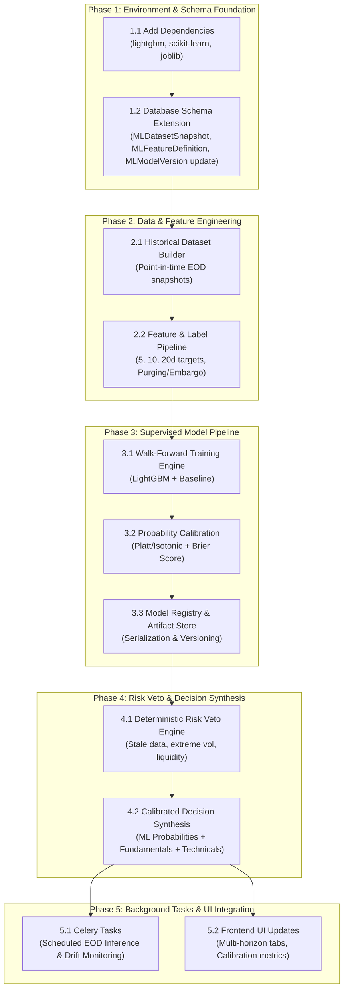

# AI/ML Gap Analysis & Repository Audit

**Project:** KuberLens — Indian Equity Research & Decision-Support Platform  
**Document:** `docs/AIML_GAP_ANALYSIS.md`  
**Date:** 2026-11-24  
**Audit Scope:** Comparison of `IMPLEMENTATION_AIML.md` and `MASTER_SPECIFICATION_DJANGO.md` against the existing Django codebase, database models, services, tasks, tests, and dependencies.  
**Baseline Verification:** 284 / 284 automated tests passing across 33 test suites (`pytest`).

---

## 1. Executive Summary

A comprehensive, non-destructive audit of the KuberLens codebase was conducted on 2026-11-24.

The existing application is a clean, production-hardened Django 5.1 modular monolith structured into 22 distinct domain apps. It contains rich market data ingestion pipelines (Jugaad-Data and Yahoo Finance), deterministic technical indicator calculations, 5-factor fundamental scoring, immutable transaction ledgers with FIFO lot accounting, swing trading setups, realistic paper trading with Indian statutory taxation, and rule-based heuristic AI/ML components.

However, the existing `ml_engine` and `ai_analysis` apps currently utilize **heuristic rule-based approximations** (e.g., hardcoded moving-average ratios and static JSON metrics) rather than a reproducible, statistical machine-learning pipeline with forward-horizon targets, walk-forward chronological validation, probability calibration, and serialized model artifacts as mandated by `IMPLEMENTATION_AIML.md`.

No application code, database migrations, or dependencies were altered during this audit.

---

## 2. Inventory of Existing Implementation & Reusable Assets

### 2.1 Django Applications & Core Architecture
The system consists of 22 active local apps registered in `config/settings/base.py`:
- `core`: Base `AuditedModel` (UUID primary key, created/updated timestamps), `HTMXResponseMixin`, Fernet encryption helpers (`encrypt_value`, `decrypt_value`), Indian currency formatting filters (`format_inr`), SVG trend tags.
- `accounts`: `CustomUser` (UUID, email-based auth), `UserPreference`, session management, profile controls.
- `dashboard`: Real-time index ribbons (NIFTY 50, SENSEX, NIFTY BANK), portfolio summary cards, market overview.
- `instruments`: Canonical `Instrument` (ISIN, legal name, sector, market cap) and `ExchangeListing` (exchange, symbol, series, trading status, lot size).
- `market`: `DataProvider`, `MarketQuote` (with 2D status: `source_type` and `freshness_status`), `HistoricalCandle` (UTC timestamped OHLCV), `DataRefreshLog`, `DataQualityIssue`, `DerivativeContract`.
- `stocks`: Stock profiles, company overview, instant HTMX search autocomplete, lightweight chart JSON endpoints.
- `technical_analysis`: `TechnicalIndicatorSnapshot` storing versioned calculations (`tech-v2.0.0`).
- `fundamental_analysis`: `FundamentalSnapshot` storing versioned financial ratios, Altman Z-Score, Piotroski F-Score, and 5-factor scores.
- `portfolio`: `Portfolio` container, cash balance, sector allocation, `InvestmentJournalEntry`.
- `holdings`: `HoldingTransaction` (immutable ledger supporting BUY, SELL, BONUS, SPLIT, DIVIDEND, REVERSAL), `Holding` (derived active positions), `LotAllocation` (closed lots audit trail).
- `screener`: Multi-factor screening engine evaluating pre-calculated snapshots with exportable CSVs and presets.
- `watchlists`: User watchlists, target price tracking, quick-add actions.
- `trading`: Swing trading setups (Pullback in Uptrend, Breakout with Volume, Oversold Bounce, Supertrend Trend-Following), `TradeJournal` with mandatory pre-trade checklists.
- `paper_trading`: Virtual brokerage accounts, CNC/MIS margin validation, simulated slippage (0.05% - 0.10%), statutory Indian charges (STT, GST, SEBI, Stamp Duty), AI Behavioral Trader Coach.
- `ipo`: Canonical 8-stage IPO lifecycle tracking, live subscription breakdown (QIB, NII, Retail), GMP tracker, allotment probability predictor.
- `ai_analysis`: Multi-perspective AI research briefs (`StockAIAnalysis`), REST-based `GeminiAIProvider` and zero-hallucination `StructuredRuleFallbackProvider`.
- `ml_engine`: Heuristic `MarketRegimeClassifier` (Garman-Klass volatility, Bollinger bandwidth), rule-based `StockMLRanker`, `MLModelRecord`, `MLPrediction`.
- `news`: Financial news feed, corporate actions calendar (Bonus, Split, Dividend).
- `alerts`: Price, RSI, and portfolio threshold alert triggers with cooldown deduplication.
- `backtesting`: Deterministic chronological strategy backtesting engine (zero lookahead), slippage and brokerage modeling, performance KPIs.
- `brokers`: Read-only Zerodha Kite Connect v3 client stub, Fernet-encrypted token vault, automated holdings synchronizer.
- `reports`: Institutional printable tear-sheets and CSV export center.
- `notifications`: In-app notification center and header unread badge counter.
- `settings_app`: Data provider health monitoring dashboard and latency tracker.

### 2.2 Historical Market Data Collection & Storage
- **Models (`apps/market/models.py`):**
  - `HistoricalCandle`: Stores `listing`, `timestamp` (UTC), `interval` (`1d`), `open`, `high`, `low`, `close`, `volume`, `adjusted_close`, `source_provider`, `retrieved_at`. Enforces `UniqueConstraint(fields=["listing", "interval", "timestamp"])`.
  - `MarketQuote`: Stores latest price, high, low, volume, `source_type` (`DIRECT`, `DELAYED`, `EOD`), `freshness_status` (`FRESH`, `CACHED`, `STALE`, `OFFLINE`), `measured_latency_ms`.
  - `DataQualityIssue`: Captures `INVALID_OHLC`, `NEGATIVE_VOLUME`, `PROVIDER_DISCREPANCY`, `GAP_DETECTED`.
- **Adapters (`integrations/market_data/`):**
  - `JugaadProvider`: Preferred adapter for NSE historical bhavcopy, equity history, and live quotes (`integrations/market_data/providers/jugaad/`).
  - `YahooProvider`: Secondary historical adapter for OHLCV fallback (`integrations/market_data/providers/yahoo/`).
  - `MarketDataNormalizer`: Enforces monotonic sanity checks (e.g. low <= open, close <= high) without synthesizing artificial prices.
- **Calendar (`services/calendar/exchange_calendar.py`):**
  - Authoritative Indian market calendar: detects trading days, weekends, NSE gazetted holidays, Muhurat trading sessions, and active trading hours (09:15 - 15:30 IST).

### 2.3 Technical Indicators & Feature Engineering
- **Engine (`services/indicators/calculator.py`):**
  - Vectorized calculation via pandas and numpy.
  - Trend: SMA (20, 50, 100, 200), EMA (9, 20, 50), MACD (12, 26, 9 line, signal, histogram), Supertrend (10, 3).
  - Momentum: Wilder's smoothed RSI 14, Stochastic RSI (K, D), ADX 14 with Directional Indicators (+DI, -DI), ROC 10.
  - Volatility: Bollinger Bands (20, 2) with Bandwidth %, Average True Range (ATR 14).
  - Volume / Structure: Volume SMA 20, Relative Volume ratio, VWAP, OBV, 20-period Support/Resistance Min/Max.
- **Storage (`apps/technical_analysis/models.py`):**
  - `TechnicalIndicatorSnapshot`: Stores derived values tagged with `calculation_version` (`tech-v2.0.0`) and compound unique constraint on `(listing, interval, timestamp, calculation_version)`.

### 2.4 Fundamental Analysis Capabilities
- **Engine (`services/fundamentals/analyzer.py`):**
  - Computes 5-factor scoring (Growth, Profitability, Solvency, Valuation, Ownership) scaled 0–100.
  - Valuation: P/E, P/B, P/S, EV/EBITDA, Dividend Yield, Dividend Rate (DPS), Sector-relative P/E benchmark.
  - Profitability: ROE, ROCE, Operating Margin, Net Profit Margin, EPS.
  - Solvency & Health: Debt-to-Equity, Current Ratio, Interest Coverage, Free Cash Flow, Altman Z-Score, Piotroski F-Score (0–9), DuPont analysis.
  - Shareholding: Promoter, FII, DII, Public holdings.
- **Storage (`apps/fundamental_analysis/models.py`):**
  - `FundamentalSnapshot`: Persists corporate financial snapshots tagged with `fund-v2.0.0`.

### 2.5 Portfolio, Holdings & Recommendation Capabilities
- **Ledger Engine (`services/portfolio/accounting.py`):**
  - Strictly immutable transaction accounting with FIFO lot allocation.
  - Buy transaction fee capitalization, sell fee deduction, corporate action split/bonus stock distribution, transaction reversals.
- **Recommendation Evaluator (`services/recommendations/evaluator.py`):**
  - Evaluates dual perspectives:
    - *Existing Holder*: Capital preservation, trimming gains (>30%), reducing concentration (>20%), exiting downtrends (>12% loss), anti-averaging down guard.
    - *New Buyer*: Entry zones, breakout invalidation, stop loss, risk-to-reward ratios.

### 2.6 Backtesting Engine
- **Engine (`services/backtesting/engine.py`):**
  - Deterministic chronological simulation loop without forward lookahead bias.
  - Evaluates stop-loss, profit targets, and signal exits (e.g. SMA crossover, RSI overbought, 20-day high breakout).
  - Models percentage slippage (default 0.05%) and flat brokerage (default 0.03%).
  - Computes performance KPIs: Total Return, CAGR, Max Drawdown, Win Rate, Profit Factor, Average Win/Loss, Equity Curve time-series.

### 2.7 Existing AI/ML Code
- **`apps/ai_analysis` & `services/ai/researcher.py`:**
  - Aggregates verified context: market quotes, technical snapshots, fundamental snapshots, active portfolio holdings.
  - Audits missing information explicitly (e.g. missing 200 SMA, missing D/E ratio, unverified promoter pledges).
  - Integrates Gemini API (`integrations/ai_providers/gemini.py`) with zero-hallucination fallback (`integrations/ai_providers/fallback.py`).
  - Persists structured research briefs in `StockAIAnalysis`.
- **`apps/ml_engine` & `services/ml/engine.py`:**
  - `MarketRegimeClassifier`: Computes Garman-Klass extreme-value volatility and Bollinger Bandwidth to classify regimes into `TRENDING_UP`, `TRENDING_DOWN`, `RANGE_BOUND`, `HIGH_VOLATILITY`.
  - `StockMLRanker`: Uses a heuristic scoring formula over SMA ratio, RSI, and volume ratio to produce `MLPrediction` records.
  - `MLModelRecord`: Stores metadata and static evaluation metrics (`accuracy`, `precision`, `recall`, `f1_score`).

### 2.8 Celery, Redis & Background Processing
- **Configuration (`config/celery.py`, `config/settings/base.py`):**
  - Celery 5.4.0 with Redis broker (`redis://`) and result backend.
  - Task autodiscovery enabled.
- **Active Tasks:**
  - `apps/market/tasks.py`: `ingest_daily_bhavcopy_task` (runs EOD after verifying `ExchangeCalendar.is_trading_day`), `monitor_provider_health_task` (5-minute provider latency and health check).
  - `apps/technical_analysis/tasks.py`: `calculate_technical_indicators_task` (recomputes indicator snapshots for a listing), `calculate_all_active_indicators_task` (daily batch recalculation).

### 2.9 Testing & Dependencies
- **Test Suite:** 284 automated tests passing in ~38 seconds using `pytest` + `pytest-django`.
- **Installed Packages (`requirements/base.txt`):**
  - `Django 5.1`, `pandas 2.2.0`, `numpy` (via pandas), `jugaad-data 0.26`, `yfinance 0.2.40`, `celery 5.4.0`, `redis 5.2.0`, `cryptography 43.0.1`, `djangorestframework 3.15.2`, `psycopg[binary] 3.2.3`.
- **Key Missing Packages for AI/ML:**
  - `lightgbm`, `scikit-learn`, `joblib` (or `cloudpickle`), `scipy`. Optional challengers: `xgboost`, `mlflow`, `torch` / `chronos-forecasting`.

---

## 3. Requirement-by-Requirement Gap Classification

Requirements are classified as:
- **`IMPLEMENTED`**: Fully built, active, and verified with test coverage.
- **`PARTIALLY IMPLEMENTED`**: Foundation, models, or heuristic logic exists, but requires expansion or formalization to meet AI/ML specifications.
- **`MISSING`**: Component or pipeline not currently implemented in the codebase.
- **`BLOCKED`**: Cannot be implemented until predecessor requirements are completed.

| ID | Requirement Category | Specification Reference | Status | Evidence in Codebase | Identified Gaps / Missing Capabilities |
|---|---|---|:---:|---|---|
| **REQ-01** | **Multi-Horizon Probabilities (5, 10, 20 sessions)** | `IMPLEMENTATION_AIML.md` §1.1, §7.2 | **MISSING** | `apps/ml_engine/models.py:MLPrediction`, `services/ml/engine.py:StockMLRanker` | Current `StockMLRanker` only outputs an ad-hoc 10-day heuristic score. Does not support 5-day or 20-day horizons. Does not produce calibrated probability distributions. |
| **REQ-02** | **Experimental Return / Price Forecasts** | `IMPLEMENTATION_AIML.md` §1.2, §10 | **MISSING** | `services/ml/engine.py` | No continuous return or price interval forecasting model exists. Amazon Chronos-2 or statistical ARIMA/GARCH forecasting adapters are not implemented. |
| **REQ-03** | **Ensemble Decision Synthesis** | `IMPLEMENTATION_AIML.md` §1.3, §11 | **PARTIALLY IMPLEMENTED** | `services/recommendations/evaluator.py`, `services/ai/researcher.py` | Heuristic synthesis of technical and fundamental signals exists in `RecommendationEvaluator`. However, it does not ingest calibrated ML forward probabilities, regime probabilities, or explicit confidence bounds. |
| **REQ-04** | **Explainable Assessments (`BUY`, `HOLD`, `SELL`, `AVOID`, `INSUFFICIENT_DATA`)** | `IMPLEMENTATION_AIML.md` §1.4, §11 | **PARTIALLY IMPLEMENTED** | `apps/ai_analysis/models.py:StockAIAnalysis`, `apps/ml_engine/models.py:MLPrediction` | Opinions exist in `ai_analysis` and `recommendations`, but ML feature attributions are raw static dictionary entries in `MLPrediction.feature_contributions` rather than formal TreeSHAP / model explanations. `INSUFFICIENT_DATA` state is not standard across ML outputs. |
| **REQ-05** | **Contextual Separation (Holdings vs Prospective vs Swing)** | `IMPLEMENTATION_AIML.md` §1.5, §11 | **IMPLEMENTED** | `services/recommendations/evaluator.py`, `services/ai/researcher.py:gather_structured_context`, `apps/trading/` | Distinct logic branches exist for existing holders (protect gains, trim, stop loss, anti-averaging down) vs prospective buyers (entry zones, R:R) vs swing traders (`SwingScanner`). |
| **REQ-06** | **Point-in-Time Backtesting with Realistic Indian Costs** | `IMPLEMENTATION_AIML.md` §1.6, §12 | **PARTIALLY IMPLEMENTED** | `services/backtesting/engine.py:BacktestEngine`, `services/paper_trading/tax_calculator.py` | `BacktestEngine` enforces zero lookahead and slippage, but only applies flat brokerage (0.03%). It does not evaluate ML models out-of-sample or incorporate the statutory Indian tax math (STT, GST, SEBI, Stamp Duty) present in `paper_trading`. |
| **REQ-07** | **Quality, Calibration, Drift & Operational Monitoring** | `IMPLEMENTATION_AIML.md` §1.7, §8, §13 | **MISSING** | `apps/market/models.py:DataQualityIssue` | `DataQualityIssue` records raw data flaws, but no ML monitoring exists for feature drift, concept drift, Brier calibration scores, prediction degradation, or model rollback triggers. |
| **REQ-08** | **First Supervised Model (LightGBM Tabular Baseline)** | `IMPLEMENTATION_AIML.md` §3, §8 | **MISSING** | `requirements/base.txt`, `services/ml/` | `lightgbm` is not installed. `StockMLRanker` relies on hardcoded if-else heuristics rather than a trained Gradient Boosted Decision Tree. |
| **REQ-09** | **Challenger Models (XGBoost, Random Forest)** | `IMPLEMENTATION_AIML.md` §3, §10 | **BLOCKED** | None | Blocked until the LightGBM baseline and training pipeline (REQ-08, REQ-13) are implemented and benchmarked. |
| **REQ-10** | **Time-Series Forecasting Adapter (Chronos-2)** | `IMPLEMENTATION_AIML.md` §3, §10 | **BLOCKED** | None | Blocked until baseline validation is complete and GPU/hardware/weight licensing constraints are evaluated. |
| **REQ-11** | **Historical Dataset Builder & Snapshots** | `IMPLEMENTATION_AIML.md` §6.3, §13 | **MISSING** | `apps/market/models.py:HistoricalCandle`, `apps/instruments/` | `HistoricalCandle` stores raw candles, but there is no `MLDatasetSnapshot` model to record versioned dataset time windows, universe hashes, and point-in-time point-of-truth snapshots. |
| **REQ-12** | **Point-in-Time Feature & Label Pipeline** | `IMPLEMENTATION_AIML.md` §7.1, §7.2 | **PARTIALLY IMPLEMENTED** | `services/indicators/calculator.py` | `TechnicalIndicatorCalculator` computes all required indicators (SMA, EMA, RSI, MACD, ATR, Bollinger, ADX, VWAP). However, an automated pipeline that aligns these features strictly as-of session close and constructs forward-horizon labels (5, 10, 20d) without leakage does not exist. |
| **REQ-13** | **Walk-Forward Chronological Training Pipeline** | `IMPLEMENTATION_AIML.md` §8 | **MISSING** | `services/ml/engine.py` | No train/validate/test walk-forward splitting engine with purging and embargo for overlapping label windows exists. |
| **REQ-14** | **Probability Calibration Engine** | `IMPLEMENTATION_AIML.md` §8, §9 | **MISSING** | `services/ml/engine.py` | Probabilities in `MLPrediction` are heuristic calculations without Platt scaling, isotonic regression, or Brier score verification. |
| **REQ-15** | **Model Registry & Versioned Artifact Store** | `IMPLEMENTATION_AIML.md` §9, §13 | **PARTIALLY IMPLEMENTED** | `apps/ml_engine/models.py:MLModelRecord` | `MLModelRecord` exists in the database, but lacks model artifact storage paths (URI), feature schema hashes, dataset version foreign keys, and model lifecycle states (`EXPERIMENTAL`, `VALIDATED`, `APPROVED`, `RETIRED`). |
| **REQ-16** | **Inference Contracts & Idempotency** | `IMPLEMENTATION_AIML.md` §9 | **PARTIALLY IMPLEMENTED** | `apps/ml_engine/models.py:MLPrediction` | `MLPrediction` stores predictions, but lacks horizon session columns (5, 10, 20), as-of session dates, calibration status, and unique constraints to prevent duplicate predictions for the same session and model version. |
| **REQ-17** | **Independent Deterministic Risk Veto Engine** | `IMPLEMENTATION_AIML.md` §11.1 | **PARTIALLY IMPLEMENTED** | `services/risk/calculator.py`, `services/recommendations/evaluator.py` | Risk calculations (1-2% risk-per-share, 20% concentration cap) exist, but there is no standalone `RiskEngine` that can deterministically veto or suppress ML predictions due to stale data, low liquidity, extreme volatility, or model degradation. |
| **REQ-18** | **AI/ML Celery Tasks & Scheduled Automation** | `IMPLEMENTATION_AIML.md` §15 | **MISSING** | `config/celery.py`, `apps/market/tasks.py` | Celery is fully configured, but no Celery tasks exist for dataset building, feature generation, scheduled batch inference, model performance evaluation, or drift detection. |
| **REQ-19** | **UI Horizon & Model Interpretability Integration** | `IMPLEMENTATION_AIML.md` §14 | **PARTIALLY IMPLEMENTED** | `apps/ml_engine/views.py`, `templates/ml_engine/dashboard.html` | `/ml/` dashboard displays regime cards and predictions, but lacks horizon tabs (5d / 10d / 20d), probability confidence breakdowns, top feature driving factors, and model status badges. |

---

## 4. Architectural Conflicts & Data Risks

### 4.1 Heuristic vs. Statistical Machine Learning Conflict
- **Current State:** `apps/ml_engine/services/ml/engine.py:StockMLRanker` claims in `MLModelRecord` to have `accuracy: 0.684` and `precision: 0.712`, but the actual code evaluates a hardcoded formula:
  ```python
  score = 0.50
  if sma_ratio > 1.02: score += 0.15
  if 50 <= rsi <= 65: score += 0.12
  ```
- **Risk:** This simulates an ML prediction using technical rules. Under `IMPLEMENTATION_AIML.md`, these scores must be replaced with empirically trained and calibrated models (LightGBM baseline) without disrupting existing views or UI templates.

### 4.2 Forward-Looking Data Leakage & Label Overlap
- **Current State:** Moving average and RSI indicators in `services/indicators/calculator.py` are computed sequentially, which is safe.
- **Risk:** In 10-day and 20-day forward return labeling, consecutive daily training observations share 9 and 19 days of overlapping returns. Without explicit **purging and embargo** during walk-forward splits, standard cross-validation will yield severe data leakage and artificially inflated performance metrics.

### 4.3 Corporate Actions & Adjusted Price Integrity
- **Current State:** `HistoricalCandle` records `close` and an optional `adjusted_close`. Bhavcopy imports populate raw EOD closing prices.
- **Risk:** Training ML models on unadjusted prices across stock splits or bonuses (e.g. 1:1 bonus halving price) creates false -50% return signals. The feature pipeline must enforce explicit split/bonus adjusted series for target calculations while preserving execution prices.

### 4.4 Missing Package Dependencies
- **Current State:** The virtual environment (`.venv`) contains Python 3.13 with pandas, numpy, and Django.
- **Missing Dependencies:**
  - `lightgbm`: Mandatory baseline tabular GBDT model.
  - `scikit-learn`: Required for preprocessing, walk-forward time-series splits, probability calibration (IsotonicRegression, CalibratedClassifierCV), and metrics (Brier score, PR-AUC).
  - `joblib`: Required for deterministic serialization and versioning of trained model artifacts.
  - `scipy`: Required for statistical distributions and Garman-Klass bounds.

---

## 5. Dependency Graph & Suggested Implementation Order

To implement the missing AI/ML subsystem smoothly without breaking existing functionality, the following phased dependency order is required:



### Detailed Implementation Phases:

#### **Phase 1: Dependencies & Persistence Models**
- **Dependencies:** None.
- **Action:**
  1. Add `lightgbm>=4.5.0`, `scikit-learn>=1.5.0`, `joblib>=1.4.0` to `requirements/base.txt`.
  2. Extend `apps/ml_engine/models.py` with:
     - `MLDatasetSnapshot`: Tracks date range, universe ISINs, snapshot hash, record count.
     - `MLFeatureDefinition`: Declares feature name, version, lookback window, formula type.
     - Update `MLModelRecord` to store artifact path (`artifact_uri`), `model_state` (`EXPERIMENTAL`, `VALIDATED`, `APPROVED`, `RETIRED`), `feature_schema_hash`.
     - Update `MLPrediction` to include `horizon_sessions` (5, 10, 20), `as_of_session`, `calibration_status`, `target_definition`, and enforce unique constraints on `(listing, model_record, horizon_sessions, as_of_session)`.
  3. Create and apply Django migrations safely.

#### **Phase 2: Historical Dataset Builder & Feature/Label Pipeline**
- **Dependencies:** Phase 1.
- **Action:**
  1. Build `services/ml/dataset_builder.py` to extract point-in-time, corporate-action-adjusted historical data snapshots for the NIFTY 250 universe.
  2. Build `services/ml/features.py` to compile feature vectors (SMAs, EMAs, RSI, MACD, ATR, Garman-Klass volatility, relative volume, NIFTY 50 benchmark beta) using existing `TechnicalIndicatorCalculator`.
  3. Define forward return labels at 5, 10, and 20 trading sessions.
  4. Write comprehensive tests ensuring zero future leakage and verifying purging/embargo boundaries.

#### **Phase 3: LightGBM Baseline Training & Probability Calibration**
- **Dependencies:** Phase 2.
- **Action:**
  1. Build `services/ml/trainer.py` to execute walk-forward cross-validation.
  2. Train simple benchmark models (constant prior and logistic momentum baseline).
  3. Train LightGBM classifier predicting direction over 5, 10, and 20 sessions.
  4. Implement probability calibration (`services/ml/calibrator.py`) using isotonic regression or Platt scaling on an out-of-fold calibration set.
  5. Save versioned model artifacts to a local artifact directory using `joblib`.

#### **Phase 4: Independent Risk Veto & Decision Synthesis**
- **Dependencies:** Phase 3.
- **Action:**
  1. Build `services/risk/engine.py` formalizing the deterministic Risk Veto:
     - Vetoes or downgrades recommendations when market data is stale, model calibration is degraded, volatility exceeds tolerance, or single-stock portfolio concentration exceeds 20%.
  2. Update `services/recommendations/evaluator.py` and `services/ai/researcher.py` to incorporate calibrated ML probabilities alongside technical trend signals and fundamental scores.
  3. Support contextual guidance: holding portfolio management vs new capital deployment vs short-term swing trading.

#### **Phase 5: Celery Automation & UI Dashboard Integration**
- **Dependencies:** Phase 4.
- **Action:**
  1. Add Celery tasks in `apps/ml_engine/tasks.py`:
     - `run_eod_predictions_task`: Runs daily batch inference across active universe stocks after Bhavcopy ingestion.
     - `monitor_model_drift_task`: Compares historical predictions against realized outcomes and tracks Brier scores and calibration drift.
  2. Update `/ml/` dashboard template and partials:
     - Support 5, 10, and 20-session horizon filters.
     - Display calibrated probability confidence bars, market regime context, and top driving feature attributions.
     - Add model provenance card showing active model version, training range, out-of-sample Brier score, and evaluation metrics.

---

## 6. Audit Conclusion & Next Steps

The KuberLens platform possesses a solid architectural foundation. All underlying market data, financial math, portfolio ledgers, and template components are robust and tested (284 passing tests).

The gap between the current state and `IMPLEMENTATION_AIML.md` is strictly contained within the mathematical and modeling layer: transitioning `ml_engine` from heuristic mock rules to a disciplined, calibrated LightGBM pipeline with point-in-time datasets and multi-horizon forward targets.

### Recommendation
Upon user approval of this gap analysis:
1. Proceed to **Step 2** of `IMPLEMENTATION_AIML.md` §17: Draft `docs/AIML_ARCHITECTURE.md` and `docs/AIML_ROADMAP.md` detailing the precise service contracts, model schemas, and migration strategy.
2. Maintain the freeze on application code until the architecture and roadmap documents are approved.
