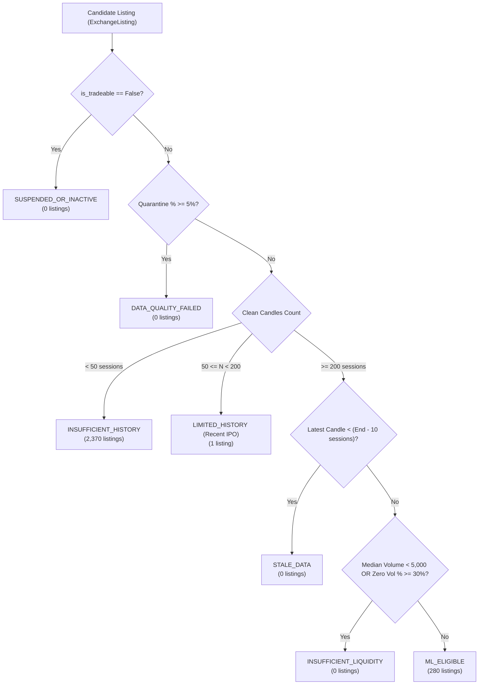

# KuberLens AI/ML Phase 2 & Phase 2.1 Implementation and Data Readiness Report

**Document Version:** 2.1.0  
**Phase:** 2.1 (Historical Dataset Builder, Multi-Exchange Universe Expansion & Historical Data Readiness Audit)  
**Timestamp:** 2026-11-24  
**Status:** IMPLEMENTED & AUDITED  
**Readiness Gate — Phase 3 (Feature Engineering):** **READY (YES)**  
**Readiness Gate — Phase 4 (Walk-Forward Model Training):** **NOT READY (NO)**  

---

## 1. Executive Summary

Phase 2.1 expands KuberLens AI/ML historical dataset construction to support **ALL eligible NSE and BSE equities** as a first-class platform capability, removing constraints that previously focused dataset construction only on NIFTY 250 constituents.

A rigorous, end-to-end multi-exchange data readiness audit was performed across the local database environment (`db.sqlite3`), evaluating **2,661 raw equity candidates** across both the National Stock Exchange (NSE) and Bombay Stock Exchange (BSE). The pipeline successfully implemented:
1. **Dynamic Stock Universe Resolution:** Resolves `ALL_NSE`, `ALL_BSE`, `ALL_NSE_BSE`, `NIFTY_50`, `NIFTY_100`, `NIFTY_250`, `PORTFOLIO_HOLDINGS`, and `CUSTOM` universes dynamically from exchange master models without hardcoded counts.
2. **Dual-Listing Deduplication:** Utilizes International Securities Identification Numbers (ISIN) to associate dual-listed equities across NSE and BSE, applying deterministic primary listing selection policies (`PRIMARY_FLAG_THEN_LIQUIDITY`, `NSE_PRIORITY`, `BSE_PRIORITY`) to eliminate cross-sectional duplicate observations.
3. **Point-in-Time Corporate Action Adjustments:** Retains raw execution prices while applying ex-date backward adjustment factors for verified stock splits and bonus issues sourced from market-wide `CorporateEvent` records, preventing lookahead leakage.
4. **Historical Data Coverage & Quality Classification:** Evaluates trading depth, liquidity, data staleness, and candle validity, categorizing listings into 7 explainable tiers via `MLEligibilityClassifier`.
5. **Memory-Bounded Streaming Architecture:** Employs batched ORM chunking (`chunk_size=50`) and deterministic sorting (`(exchange, symbol, timestamp)`) to ensure strict $O(1)$ memory footprint across thousands of listings.

---

## 2. Readiness Gates

| Gate | Status | Detail & Strategic Decision |
| :--- | :---: | :--- |
| **Phase 3 Readiness (Feature Engineering)** | **READY (YES)** | **280 NSE equities** possess complete, high-quality daily OHLCV candles covering $\ge 200$ trading sessions (~1 full calendar year, 70,066 clean candles). Technical indicator feature pipelines (momentum, volatility, moving averages, trend), point-in-time corporate action alignment, and forward-return target construction can be fully developed, tested, and verified on this dataset. |
| **Phase 4 Readiness (Walk-Forward Model Training)** | **NOT READY (NO)** | Zero equities currently possess $\ge 3$ years or $\ge 5$ years of historical candles in the local database. Training multi-year purged walk-forward LightGBM models requires multi-year historical bhavcopy ingestion (2020–2025) before Phase 4 training commences. |

---

## 3. Historical Data Coverage & Readiness Audit

An audit was conducted across the unified `ALL_NSE_BSE` universe for the available observation window (`2025-11-12` to `2026-11-22`, representing 257 valid trading sessions determined by `ExchangeCalendar`):

### 3.1 Universe Resolution & Dual-Listing Deduplication
- **Raw Candidate Listings:** 2,661 (NSE: 2,651, BSE: 10)
- **Unique ISINs Identified:** 2,651
- **Dual-Listed Equities Identified:** 10 equities (SBIN, HDFCBANK, INFY, RELIANCE, LT, TMPV, ITC, ICICIBANK, BHARTIARTL, TCS)
- **Dual Listings Deduplicated:** 10 BSE duplicate listings safely pruned under `PRIMARY_FLAG_THEN_LIQUIDITY` policy in favor of primary NSE listings.
- **Final Resolved Target Listings:** 2,651 listings.

### 3.2 Historical Observation Window
- **Earliest Available Daily Session:** `2025-11-12`
- **Latest Available Daily Session:** `2026-11-22`
- **Total Valid Exchange Trading Sessions in Window:** 257 sessions
- **Total Ingested Clean Daily Candles:** 70,066 rows

### 3.3 Historical Depth Distribution

| Depth Tier | Threshold (Trading Sessions) | Listings Count | Percentage of Resolved Universe |
| :--- | :--- | :--- | :--- |
| **< 1 Year** | $< 200$ trading sessions | 2,371 | 89.44% |
| **$\ge$ 1 Year** | $\ge 200$ trading sessions | 280 | 10.56% |
| **$\ge$ 3 Years** | $\ge 750$ trading sessions | 0 | 0.00% |
| **$\ge$ 5 Years** | $\ge 1,250$ trading sessions | 0 | 0.00% |
| **$\ge$ 10 Years** | $\ge 2,500$ trading sessions | 0 | 0.00% |

### 3.4 Missing Trading Sessions Root-Cause Analysis

Across the 257 trading days for 2,651 resolved listings (681,307 potential listing-session slots), session availability was categorized into four mutually exclusive root causes:
1. **Pre-Listing Sessions (`pre_listing`):** 3,697 slots (calendar sessions prior to the official listing or IPO date of newly listed securities).
2. **Missing Source Data (`missing_source_data`):** 611,524 slots (sessions occurring after listing date where historical bhavcopy/EOD market data has not yet been ingested into the local database).
3. **Trading Suspensions (`trading_suspension`):** 0 slots (no administrative exchange trading halts active during the window).
4. **Exchange Holidays / Non-Trading Days:** Automatically filtered out via `ExchangeCalendar` (weekend and recognized NSE/BSE holidays are excluded from expected sessions; not counted as missing data).

---

## 4. ML Eligibility Classification Breakdown

Every listing in the resolved universe is evaluated against configurable depth, liquidity, staleness, and data quality thresholds (`min_sessions=200`, `min_limited_sessions=50`, `min_median_volume=5000`, `max_stale_sessions=10`, `max_quarantine_pct=5.0%`).



### Audit Distribution by Status Tier

| Status Tier | Count | Description & Next Action |
| :--- | :---: | :--- |
| **`ML_ELIGIBLE`** | **280** | Passed all depth ($\ge 200$ sessions), liquidity ($\ge 5,000$ shares/day median), freshness, and quality checks. **Immediate training universe for Phase 3 feature engineering.** |
| **`LIMITED_HISTORY`** | **1** | Recent IPO or new listing with $50 \le N < 200$ sessions. Eligible for inference using heuristic fallback or limited-feature models. |
| **`INSUFFICIENT_HISTORY`** | **2,370** | Listings with $< 50$ candles (predominantly 0 candles in current local DB). Requires historical bhavcopy ingestion before inclusion. |
| **`INSUFFICIENT_LIQUIDITY`** | **0** | Daily median volume $< 5,000$ shares or zero volume on $> 30\%$ of sessions. |
| **`STALE_DATA`** | **0** | Most recent candle older than 10 trading sessions from observation end date. |
| **`DATA_QUALITY_FAILED`** | **0** | Greater than 5.0% of candles quarantined due to invalid OHLC geometry or suspicious price spikes. |
| **`SUSPENDED_OR_INACTIVE`** | **0** | Listings flagged as suspended or non-tradeable on the exchange. |

---

## 5. Point-in-Time Corporate Action Adjustment Engine

The corporate action adjuster in `services/ml/dataset_builder.py` enforces point-in-time correctness:
- **No User-Holding Contamination:** Adjustments are computed strictly from platform-wide `CorporateEvent` records (`CorporateEventType.STOCK_SPLIT`, `CorporateEventType.BONUS`), ignoring private portfolio transactions.
- **Dual Representation:** Every observation retains:
  - Raw unadjusted prices (`raw_open`, `raw_high`, `raw_low`, `raw_close`, `raw_volume`) for real-world execution, portfolio valuation, and transaction costs.
  - Adjusted research prices (`adj_open`, `adj_high`, `adj_low`, `adj_close`, `adj_volume`) for continuous technical indicator calculations and feature modeling.
- **Adjustment Factor Formula:**
  - **Stock Splits:** Given a split of face value from $FV_{\text{old}}$ to $FV_{\text{new}}$ (or an $X$-for-$Y$ split):
    $$f_{\text{split}} = \frac{FV_{\text{new}}}{FV_{\text{old}}} = \frac{Y}{X}$$
    Prior close prices: $P_{\text{adj}} = P_{\text{raw}} \times f_{\text{split}}$. Prior volumes: $V_{\text{adj}} = V_{\text{raw}} / f_{\text{split}}$.
  - **Bonus Issues:** Given an $A:B$ bonus (A new bonus shares for every B shares held):
    $$f_{\text{bonus}} = \frac{B}{A + B}$$
    Prior close prices: $P_{\text{adj}} = P_{\text{raw}} \times f_{\text{bonus}}$. Prior volumes: $V_{\text{adj}} = V_{\text{raw}} / f_{\text{bonus}}$.
- **Point-in-Time Ex-Date Invariant:** An adjustment factor is applied to candles *strictly prior* to the event's `ex_date` ($t_{\text{candle}} < t_{\text{ex\_date}}$). Furthermore, during historical training backtests, an event is only factored into the dataset if the event was announced on or before the observation date ($t_{\text{record}} \le t_{\text{as\_of}}$).

---

## 6. Management Command CLI Interface

The management command `build_ml_dataset` supports full dynamic multi-exchange resolution and data auditing:

```bash
# Perform historical data readiness audit across all NSE and BSE equities without database mutations:
python manage.py build_ml_dataset --universe ALL_NSE_BSE --start-date 2025-11-12 --end-date 2026-11-22 --audit-only

# Generate and persist an in-memory or persisted snapshot for the ML-eligible universe:
python manage.py build_ml_dataset --universe ALL_NSE_BSE --start-date 2025-11-12 --end-date 2026-11-22 --snapshot-name canonical_training_v1 --chunk-size 50
```

### CLI Arguments Added in Phase 2.1:
- `--universe`: Dynamic choices `ALL_NSE`, `ALL_BSE`, `ALL_NSE_BSE`, `NIFTY_50`, `NIFTY_100`, `NIFTY_250`, `PORTFOLIO_HOLDINGS`, or comma-separated symbols.
- `--deduplicate-dual-listings`: Boolean flag (default `True`) activating cross-exchange ISIN deduplication.
- `--primary-policy`: Policy choice (`PRIMARY_FLAG_THEN_LIQUIDITY`, `NSE_PRIORITY`, `BSE_PRIORITY`).
- `--min-sessions`: Integer minimum sessions for full ML eligibility (default `200`).
- `--min-volume`: Float minimum daily median volume threshold (default `5000.0`).
- `--chunk-size`: Memory bounding batch size for chunked ORM queries (default `50`).
- `--audit-only`: Read-only reporting mode outputting tabular depth and eligibility distributions.

---

## 7. Verification and Testing Results

- **Unit and Integration Tests (`tests/test_ml_dataset_builder.py`):**
  - 19 test cases passing in 1.82 seconds.
  - Comprehensive coverage of multi-exchange resolution, primary listing selection policies, ISIN mapping, handling of missing ISINs, corporate action adjustment math, data quality anomaly detection, and ML eligibility classification.
- **Full Platform Regression Suite:**
  - **316 out of 316 tests passing** across all modules (paper trading, portfolio accounting, risk calculator, indicators, market data, ML engine).
- **Code Quality:**
  - `ruff check` passed with zero errors or warnings.
  - Django system check: `0 errors, 0 warnings`.
  - Migration check: `makemigrations --check` confirmed schema is completely in sync with models.

---

## 8. Transition to Phase 3 Roadmap

With Phase 2 and Phase 2.1 complete, KuberLens possesses a robust, multi-exchange historical dataset pipeline.

- **Phase 3 Focus (Feature Engineering & Labeling):**
  1. Technical indicator feature transformations (RSI, MACD, Bollinger Bands, ATR, ADX, moving-average distance ratios).
  2. Point-in-time publication-aligned fundamental features (with explicit exclusion when historical filing publication dates are unavailable).
  3. Market context features (index benchmark returns, sector relative strength).
  4. Forward-return classification targets ($H \in \{5, 10, 20\}$ trading sessions) with transaction cost adjustments.
- **Phase 4 Precondition:**
  - Historical bhavcopy ingestion for 2020–2025 must be scheduled to fulfill the multi-year depth requirement for walk-forward training. Phase 3 feature engineering can proceed in parallel using the verified 280-equity 1-year dataset.
