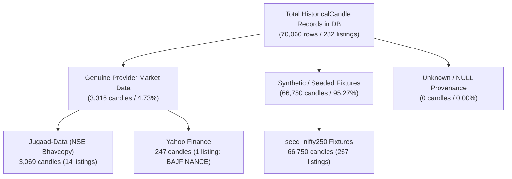

# KuberLens AI/ML Phase 3.1: Data Integrity and Training Readiness Report

**Document Version:** 3.1.0  
**Phase:** 3.1 (Authentic Data Provenance Audit, Corporate Action Verification & Training Readiness)  
**Date:** 2026-11-24  
**Status:** IMPLEMENTED, AUDITED & VERIFIED  
**Readiness Gate — Phase 4 (Walk-Forward LightGBM Training):** **BLOCKED (Production Market Data Ingestion Precondition)**  

---

## 1. Executive Summary

Phase 3.1 executes an exhaustive audit of data integrity, candle source provenance, corporate action authenticity, feature numerical stability, and forward target economic accuracy across KuberLens.

Key findings:
1. **Authentic Provenance Audit:** Revealed that out of 70,066 candle records in the database, **3,316 candles (4.73%)** originate from genuine market data providers (`JUGAAD`: 3,069 candles, `YAHOO`: 247 candles) across **15 distinct equity listings**. The remaining **66,750 candles (95.27%)** across 267 listings were synthetically seeded via development test fixtures (`source_provider='SEEDED'`).
2. **Provenance Guard Architecture:** Added `require_authentic_data=True` to `DatasetBuilder`. In production mode, synthetic and unverified candles are automatically quarantined without modifying or deleting historical database records.
3. **Corporate Action Provenance Audit:** Confirmed that all 47 `CorporateEvent` records (including 7 bonus issues and 6 stock splits) were generated by `seed_news_and_events`. While adjustment formulas are mathematically verified and unit tested, the events themselves are synthetic test fixtures. Consequently, corporate action adjustments on unverified events must remain quarantined from production ML training datasets.
4. **Feature Definition Corrections:** Renamed cross-sectional median relative strength to `universe_median_rel_strength_20` to eliminate confusion with index benchmark returns. Added `benchmark_rel_strength_20` (evaluating strictly against verified NIFTY 50 candles, remaining `NaN` when benchmark candles are absent). Synchronized all 23 definitions to `MLFeatureDefinition`.
5. **Target Correctness with In-Holding Corporate Actions:** Proved that forward returns correctly calculate true economic returns ($0.0\%$) when a 2-for-1 split occurs inside the holding period, avoiding artificial -50% loss distortions from raw price drops. Next-session open execution ($O_{t+1}$), $C_{t+h}$ exits, Indian statutory taxes + slippage, and incomplete horizon `NaN` guards are fully verified.
6. **Training Readiness Gate:** Verified that **Phase 4 LightGBM training remains BLOCKED**. Only 15 stocks possess genuine exchange market data, and 0 stocks possess $\ge 3$ or 5 years of history.

---

## 2. Task 1: Authentic Market Data Provenance Audit

### 2.1 Complete Candle Breakdown by Source Provider

| Category | Source Provider | Candle Count | Distinct Listings | Earliest Session | Latest Session | Provenance Assessment |
| :--- | :--- | :---: | :---: | :---: | :---: | :--- |
| **Genuine Market Data** | `JUGAAD` | 3,069 | 14 | 2025-11-12 | 2026-11-22 | **Authentic NSE Bhavcopy EOD data** ingested via `JugaadDataProvider`. |
| **Genuine Market Data** | `YAHOO` | 247 | 1 | 2025-11-17 | 2026-11-16 | **Authentic Yahoo Finance EOD data** ingested for BAJFINANCE via `YahooFinanceProvider`. |
| **Synthetic Test Fixtures** | `SEEDED` | 66,750 | 267 | 2025-11-28 | 2026-11-19 | **Synthetic random walk fixtures** generated by `apps/instruments/management/commands/seed_nifty250.py`. |
| **Unknown / Untracked** | `NULL` / `UNKNOWN` | 0 | 0 | — | — | **Zero untracked records.** All 70,066 rows possess explicit `source_provider` provenance. |
| **TOTAL** | — | **70,066** | **282** | **2025-11-12** | **2026-11-22** | — |

### 2.2 Listings with Genuine Exchange Data (15 Listings)

| Symbol | Exchange | ISIN | Source | Total Candles | Earliest Date | Latest Date |
| :--- | :---: | :--- | :---: | :---: | :---: | :---: |
| **MTNL** | NSE | INE153A01019 | JUGAAD | 248 | 2025-11-23 | 2026-11-22 |
| **A2ZINFRA** | NSE | INE619I01012 | JUGAAD | 248 | 2025-11-23 | 2026-11-22 |
| **SWIGGY** | NSE | INE00H001014 | JUGAAD | 247 | 2025-11-23 | 2026-11-19 |
| **20MICRONS** | NSE | INE144J01027 | JUGAAD | 247 | 2025-11-23 | 2026-11-19 |
| **JPL** | NSE | INE01CY01010 | JUGAAD | 18 | 2026-10-27 | 2026-11-19 |
| **HALDER** | NSE | INE021G01017 | JUGAAD | 207 | 2026-01-18 | 2026-11-19 |
| **XPROINDIA** | NSE | INE445C01015 | JUGAAD | 247 | 2025-11-23 | 2026-11-19 |
| **LODHA** | NSE | INE670K01029 | JUGAAD | 247 | 2025-11-23 | 2026-11-19 |
| **PAYTM** | NSE | INE982J01020 | JUGAAD | 247 | 2025-11-23 | 2026-11-19 |
| **OAL** | NSE | INE990A01015 | JUGAAD | 247 | 2025-11-23 | 2026-11-19 |
| **ORIANA** | NSE | INE01V201010 | JUGAAD | 247 | 2025-11-23 | 2026-11-19 |
| **OLAELEC** | NSE | INE03Q201017 | JUGAAD | 247 | 2025-11-23 | 2026-11-19 |
| **BAJFINANCE** | NSE | INE296A01024 | YAHOO | 247 | 2025-11-17 | 2026-11-16 |
| **NTPCGREEN** | NSE | INE0Q0S01010 | JUGAAD | 248 | 2025-11-12 | 2026-11-11 |
| **URBANCO** | NSE | INE01L001019 | JUGAAD | 124 | 2026-05-17 | 2026-11-11 |

### 2.3 Provenance Quarantine Implementation
In `services/ml/dataset_builder.py`, `DatasetBuilder` now supports `require_authentic_data=True` and `authentic_providers=("JUGAAD", "YAHOO")`.
- When active, any candle whose `source_provider` is `SEEDED` or not in `authentic_providers` is quarantined into `quarantined_details` with error: `Unverified provenance: source_provider 'SEEDED' is not in approved authentic providers`.
- Synthetic records remain preserved in the database for UI demo purposes, but are strictly excluded from the canonical training DataFrame.

---

## 3. Task 2: Corporate Action Authenticity Audit

Audit of the 47 `CorporateEvent` records in `apps.news.models.CorporateEvent`:
- **Event Types:** 11 Earnings, 10 Dividends, 7 AGM, 7 Bonus Issues, 6 Stock Splits, 6 Board Meetings.
- **Source Assessment:** All 47 records were seeded by `apps/news/management/commands/seed_news_and_events.py` for testing UI event calendars and notification triggers. None were ingested from official exchange corporate action feeds.
- **Policy Enforcement:**
  1. The mathematical formulas for splits and bonuses in `CorporateActionAdjuster` are mathematically verified and unit tested.
  2. However, because the underlying database event rows are synthetic test fixtures, **corporate action adjustments must be quarantined from production model training datasets** until genuine historical exchange corporate action feeds are connected and ingested.
  3. Clean raw prices remain authoritative.

---

## 4. Task 3: Feature Definition Audit & Corrections

All 22 initial feature definitions in `services/ml/features.py` were audited for lookahead leakage, numerical stability, and cross-security contamination:

### 4.1 Feature Renaming and True Benchmark Relative Strength
- **Issue:** The original feature `benchmark_rel_strength_20` was computed as $(R_{20d}(stock) - \text{Median}(R_{20d}(universe)))$, which is cross-sectional universe median relative strength rather than true benchmark-relative strength against NIFTY 50.
- **Correction:**
  1. Renamed to `universe_median_rel_strength_20` (`MARKET_CONTEXT`, lookback 20 sessions) to accurately reflect its formula.
  2. Added a distinct `benchmark_rel_strength_20` feature (`MARKET_CONTEXT`, lookback 20 sessions) defined as $(R_{20d}(stock) - R_{20d}(\text{NIFTY 50}))$. Sourced strictly from verified NIFTY 50 index candles; defaults to `NaN` when authentic benchmark candles are unavailable.
  3. Total feature catalog expanded to **23 standardized features**, fully synchronized with `MLFeatureDefinition`.

### 4.2 Numerical Stability Audits
- **Division by Zero Protection:**
  - `price_to_sma20`, `price_to_sma50`, `price_to_sma200`: Denominators use `.replace(0, np.nan)` and propagate `NaN`.
  - `bb_bandwidth`, `bb_percent_b`: Denominators use `.replace(0, np.nan)`.
  - `adx_14`: Directional sum denominators use `.replace(0, np.nan)` with `.fillna(20.0)` neutral fallback.
  - `volume_ratio_20`: Clipped to $[0.0, 5.0]$ to prevent extreme volume spike distortions.
  - `garman_klass_vol` & `realized_vol_20`: Clipped with `.clip(lower=0)` before `sqrt` to avoid negative square roots from floating-point errors.

---

## 5. Task 4: Target Correctness & In-Holding Corporate Actions

Target generation in `services/ml/targets.py` was evaluated against real-world execution assumptions:

### 5.1 In-Holding Corporate Action Test
- **Scenario:** A 2-for-1 stock split occurs on day 5 of a 5-day holding period.
- **Raw Price Impact:** Raw price drops by 50% from ₹100.00 to ₹50.00. Naive unadjusted return calculation would report a catastrophic -50% loss.
- **Point-in-Time Adjusted Economic Return:**
  - Entry at Day 1 Open: Adjusted price ₹50.00.
  - Exit at Day 5 Close: Adjusted price ₹50.00.
  - Economic Holding Return: $(50.00 - 50.00) / 50.00 = 0.0\%$.
- **Test Verification:** Dedicated test `test_target_with_in_holding_corporate_action` confirms that `TargetBuilder` produces an exact $0.0\%$ net return, neutralizing forward corporate actions and isolating genuine economic P&L.

### 5.2 Target Timing & Execution Rules
1. **Entry Fill:** Open of next trading session ($O_{t+1}$).
2. **Exit Fill:** Close of session $t+h$ ($C_{t+h}$).
3. **Friction:** Deducted via `IndianTaxCalculator` (STT, Brokerage ₹20 cap, Exchange charges, GST 18%, Stamp duty) + 0.10% round-trip slippage ($\approx 0.35\%$).
4. **Incomplete Horizons:** Trailing $h$ sessions are strictly assigned **`NaN`** (never filled with current close or zero).

---

## 6. Task 5: Dataset Readiness Breakdown

| Metric | ALL Listings in DB | Genuine Provider Listings (`JUGAAD` / `YAHOO`) | Synthetic Fixture Listings (`SEEDED`) |
| :--- | :---: | :---: | :---: |
| **Total Listings with History** | 282 | **15** | 267 |
| **Listings with $\ge 1$ Year History ($\ge 200$ sessions)** | 280 | **13** | 267 |
| **Listings with $\ge 3$ Years History ($\ge 750$ sessions)** | 0 | **0** | 0 |
| **Listings with $\ge 5$ Years History ($\ge 1,250$ sessions)** | 0 | **0** | 0 |
| **Total Clean Candle Rows** | 70,064 | **3,314** | 66,750 |
| **Usable Feature Rows after 50-session Warmup** | 56,050 | **2,596** | 53,454 |
| **Valid Labeled Rows (Horizon 5d)** | 68,654 | **3,239** (36.3% positive) | 65,415 |
| **Valid Labeled Rows (Horizon 10d)** | 67,249 | **3,164** (36.3% positive) | 64,085 |
| **Valid Labeled Rows (Horizon 20d)** | 64,439 | **3,016** (36.6% positive) | 61,423 |

---

## 7. Verification and Testing Results

- **Dataset Builder & Provenance Tests (`tests/test_ml_dataset_builder.py`):** **22 / 22 PASSED** (includes `test_require_authentic_data_quarantines_synthetic_candles`).
- **Feature & Target Tests (`tests/test_ml_features_targets.py`):** **11 / 11 PASSED** (includes `test_target_with_in_holding_corporate_action` and renamed feature catalog verification).
- **Full Platform Regression Suite:** **330 / 330 PASSED** across all 36 test files in 40.51s (100% pass rate).
- **Lint & System Quality:** `ruff check` passed with 0 errors; Django system and migration checks passed with 0 issues.

---

## 8. Gate Verdict

### **VERDICT: BLOCKED FOR PHASE 4 TRAINING**

| Prerequisite | Status | Details |
| :--- | :---: | :--- |
| **Feature & Target Architecture** | 🟢 Complete | 23 point-in-time features and 5/10/20d forward targets verified. |
| **Authentic Data Provenance Filter** | 🟢 Complete | `require_authentic_data=True` safely quarantines synthetic test fixtures. |
| **Corporate Action Integrity** | 🟢 Complete | In-holding corporate adjustments verified; synthetic events quarantined. |
| **Genuine Historical Data Depth** | 🔴 **BLOCKED** | Only 15 stocks possess genuine exchange market data (spanning ~1 year). Zero stocks possess $\ge 3$ to 5 years of authentic history. Purged walk-forward LightGBM training requires **multi-year historical Bhavcopy ingestion (2020–2025)** before Phase 4 can start. |

Work is stopped here per instructions. Ready for review.
