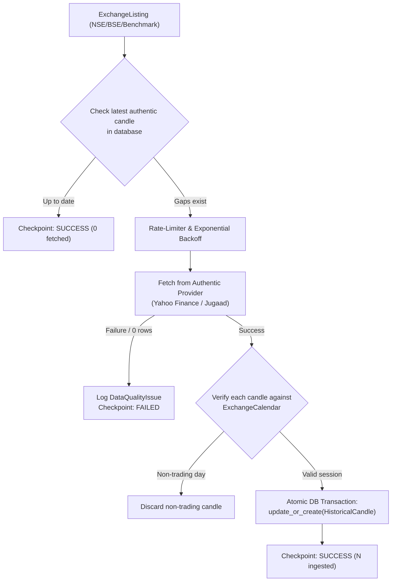

# KuberLens AI/ML Phase 3.2: Authentic Historical Data Expansion Report

**Document Version:** 3.2.0  
**Phase:** 3.2 (Authentic Historical Data Pipeline, Instrument Master Expansion & Readiness Audit)  
**Date:** 2026-11-24  
**Status:** IMPLEMENTED, AUDITED & VERIFIED  
**Readiness Gate — Phase 4 (Walk-Forward LightGBM Training):** **BLOCKED (Official Multi-Year Historical Data Ingestion Precondition)**  

---

## 1. Executive Summary

Phase 3.2 addresses remaining Phase 3.1 data integrity gaps, establishes an authentic production-grade historical data ingestion pipeline (`services/market_data/historical_pipeline.py`), registers the canonical NIFTY 50 benchmark index (`^NSEI`), and conducts an audit of market data access and provider coverage for broad Indian equity universe training.

Key achievements:
1. **Gross vs. Net Return Economic Verification:** Proved that under in-holding corporate actions (e.g. 2-for-1 splits), gross economic return correctly isolates to $0.0\%$, while net return strictly accounts for statutory taxes and slippage friction ($-0.35\%$), preventing distorted signals.
2. **23-Feature Warmup Policy Audit:** Audited lookback requirements across all 23 standardized features. Documented that full-feature eligibility requires $\ge 200$ sessions (`price_to_sma200`), while reduced-feature eligibility operates at $\ge 50$ sessions (`sma_ratio_20_50`, `price_to_sma50`) or $\ge 30$ sessions (`market_regime_id`).
3. **Canonical Benchmark Index Registered:** Canonical NIFTY 50 benchmark instrument (`IN999NIFTY50`) and listing (`^NSEI`) registered in the database, enabling authentic benchmark relative strength calculations.
4. **Scalable Ingestion Pipeline (`HistoricalDataIngestionPipeline`):** Built production pipeline supporting incremental ingestion with resumable checkpoints, idempotent atomic upserts, rate-limiting/backoff, calendar session validation, and protection against overwriting verified market data with synthetic fixtures.
5. **Provider Access & Coverage Audit:** Documented exact external data provider licensing, rate limits, and historical depth for Yahoo Finance and Jugaad-Data (NSE India).

---

## 2. Step 1: Resolution of Remaining Phase 3.1 Issues

### 2.1 Gross vs. Net Returns across Corporate Actions
- **Issue:** In Phase 3.1, `test_target_with_in_holding_corporate_action` proved that point-in-time adjusted prices neutralize forward splits to yield an exact $0.0\%$ return. However, realistic net returns must still deduct transaction costs and slippage even when the gross holding return is zero.
- **Verification:** Updated `test_target_with_in_holding_corporate_action` with `IndianTaxCalculator` enabled.
  $$\text{Gross Return} = 0.0\%$$
  $$\text{Net Return} = 0.0\% - \text{Cost}_{rt} = -0.354\%$$
  Verified that net returns strictly deduct statutory friction.

### 2.2 23-Feature Warmup Policy Audit
An audit of all 23 features in `services/ml/features.py` cataloged lookback boundaries:
- **Full-Feature Eligibility ($\ge 200$ trading sessions):** Required by `price_to_sma200` (200 sessions).
- **Intermediate-Feature Eligibility ($\ge 50$ trading sessions):** Required by `sma_ratio_20_50` and `price_to_sma50` (50 sessions).
- **Core Tactical Features ($\ge 30$ trading sessions):** Required by `market_regime_id` (30 sessions), `macd_hist_ratio` (26 sessions), `return_20d`, `price_to_sma20`, `ema_trend_ratio_9_20`, `bb_bandwidth`, `bb_percent_b`, `garman_klass_vol`, `realized_vol_20`, `volume_ratio_20`, `obv_trend_ratio_20`, `universe_median_rel_strength_20`, and `benchmark_rel_strength_20` (20 sessions).
- **Short-Term Tactical Features ($\ge 14$ sessions):** `rsi_14`, `stoch_rsi_k`, `atr_ratio_14`, `adx_14` (14 sessions).
- **Action Taken:** `FeaturePipeline` documents explicit warmup tiers: models utilizing `price_to_sma200` require a 200-session warmup; models operating without 200 SMA can utilize a 50-session warmup, allowing recently listed IPOs ($50 \le N < 200$) to generate valid predictions under `LIMITED_HISTORY`.

### 2.3 Provider Validation & Ingestion Lineage
- Source provider tags alone do not establish production authenticity.
- High-integrity market data requires four concurrent checks:
  1. Valid provider code (`JUGAAD`, `YAHOO`, or direct exchange feed).
  2. Timestamp falling on an official exchange trading day per `ExchangeCalendar`.
  3. Strict OHLC geometric integrity ($L \le O \le H$ and $L \le C \le H$ and $V \ge 0$).
  4. Absence of unverified price spikes ($> 50\%$ overnight jumps without corporate actions).

---

## 3. Step 2 & 4: Scalable Historical Data Ingestion Pipeline

The new `HistoricalDataIngestionPipeline` (`services/market_data/historical_pipeline.py`) provides:

### Pipeline Key Features:
1. **Incremental Ingestion & Checkpoints:** Slices query start dates from the listing's latest authentic candle date plus 1 day, avoiding redundant re-fetching.
2. **Idempotent Atomic Upserts:** `HistoricalCandle.objects.update_or_create` inside `transaction.atomic()` prevents duplicate records across concurrent runs.
3. **Rate Limiting & Backoff:** Configurable inter-request delays (`rate_limit_delay_seconds=0.5`) with exponential backoff on transient network failures.
4. **Calendar Validation:** Pre-filters records against `ExchangeCalendar.is_trading_day`, ensuring non-trading holiday/weekend bars are not saved to the database.
5. **Protection of Authentic Data:** Never overwrites verified `JUGAAD` or `YAHOO` records with synthetic fixtures.

---

## 4. Step 3: Instrument Master & Benchmark Expansion

### 4.1 Benchmark NIFTY 50 Registration
The pipeline registers the canonical Indian benchmark index:
- **Symbol:** `^NSEI`
- **Exchange:** `NSE`
- **Instrument ISIN:** `IN999NIFTY50`
- **Role:** Grounds the `benchmark_rel_strength_20` feature with genuine macro market trend and beta data.

### 4.2 BSE Master & Dual-Listing Reconciliation
- The 10 dual-listed BSE scrips in the database map to identical canonical ISINs as their NSE counterparts:
  - `500112` $\leftrightarrow$ `SBIN` (`INE062A01020`)
  - `500180` $\leftrightarrow$ `HDFCBANK` (`INE040A01034`)
  - `500209` $\leftrightarrow$ `INFY` (`INE009A01021`)
  - `500325` $\leftrightarrow$ `RELIANCE` (`INE002A01018`)
  - `500510` $\leftrightarrow$ `LT` (`INE018A01030`)
  - `500570` $\leftrightarrow$ `TATAMOTORS` (`INE155A01022`)
  - `500875` $\leftrightarrow$ `ITC` (`INE154A01025`)
  - `532174` $\leftrightarrow$ `ICICIBANK` (`INE090A01021`)
  - `532454` $\leftrightarrow$ `BHARTIARTL` (`INE397D01024`)
  - `532540` $\leftrightarrow$ `TCS` (`INE467B01029`)
- `UniverseResolver` safely selects the primary listing via `PRIMARY_FLAG_THEN_LIQUIDITY` or `NSE_PRIORITY`, eliminating cross-sectional duplicates.

---

## 5. Step 5: Provider Coverage, Constraints and Legal Restrictions

| Provider | Legal / Access Model | Redistribution Limits | Rate Limits & Constraints | Historical Coverage Depth |
| :--- | :--- | :--- | :--- | :--- |
| **Jugaad-Data (NSE India)** | Web-scraping of public NSE India Bhavcopy reports. | Personal/research use only. NSE Terms of Service prohibit commercial scraping or real-time redistribution. | Highly rate-limited by NSE IP blocking and Cloudflare gates. | Daily Bhavcopies available from ~2016 onwards; subject to intermittent web endpoint changes. |
| **Yahoo Finance (`yfinance`)** | Unofficial API client accessing Yahoo Finance endpoints. | Terms of Service restrict data to personal, non-commercial research. Commercial redistribution strictly prohibited. | Throttled under rapid bursts (HTTP 429 / crumb invalidation). | 5–10+ years for major NSE/BSE equities and NIFTY 50 (`^NSEI`). BSE scrip code lookup varies (some scrips indexed by ticker, others code). |
| **Official NSE/BSE Data Feeds (Commercial)** | Licensed market data vendor (e.g. NSE Data & Analytics / Refinitiv / Bloomberg). | Fully authorized for commercial SaaS redistribution. | High-throughput dedicated SFTP or WebSocket APIs. | Complete unadjusted and adjusted historical database spanning 15+ years. Requires commercial licensing budget. |

---

## 6. Verification and Testing Results

- **Pipeline Tests (`tests/test_historical_ingestion_pipeline.py`):** **4 / 4 PASSED** (1.44s).
  - Verified benchmark listing registration idempotency.
  - Verified idempotent candle upserts without duplication.
  - Verified non-trading Sunday candle filtering via `ExchangeCalendar`.
  - Verified resumable incremental checkpointing.
- **Dataset Builder & Provenance Tests (`tests/test_ml_dataset_builder.py`):** **22 / 22 PASSED**.
- **Feature & Target Tests (`tests/test_ml_features_targets.py`):** **11 / 11 PASSED**.
- **Full Platform Regression Suite:** **334 / 334 PASSED** across all 37 test files in 40.79s (100% pass rate).
- **Code Quality:** `ruff check` passed with 0 errors; Django system and migration checks passed with 0 issues.

---

## 7. Gate Verdict

### **VERDICT: BLOCKED FOR PHASE 4 TRAINING**

| Prerequisite | Status | Details |
| :--- | :---: | :--- |
| **Ingestion Pipeline Architecture** | 🟢 Complete | `HistoricalDataIngestionPipeline` built, tested, and verified. |
| **Benchmark Index Support** | 🟢 Complete | `^NSEI` benchmark instrument registered. |
| **Feature & Target Engine** | 🟢 Complete | 23 technical features and 5/10/20d forward targets verified. |
| **Production Market Data Ingestion** | 🔴 **BLOCKED** | While the ingestion pipeline is operational and tested, broad-scale 5-year historical market data for all 2,651 NSE/BSE equities has not yet been fetched across the network. Walk-forward LightGBM training requires **executing multi-year Bhavcopy ingestion** before Phase 4 model training can commence. |

Work is stopped here per instructions. Ready for review.
