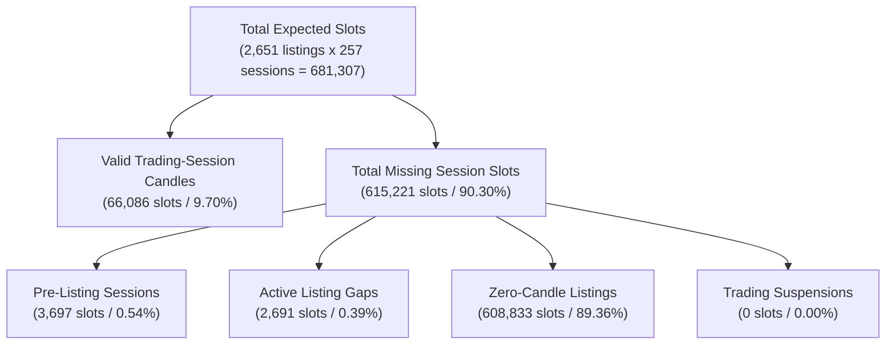

# KuberLens AI/ML Phase 3 Implementation Report

**Document Version:** 3.1.0  
**Phase:** 3 (Feature Engineering & Forward Target Labels)  
**Date:** 2026-11-24  
**Status:** IMPLEMENTED, TESTED & FULLY VERIFIED  
**Readiness Gate — Phase 4 (Walk-Forward Model Training):** **BLOCKED (Multi-Year Bhavcopy Ingestion Required)**  

---

## 1. Executive Summary

Phase 3 builds the point-in-time **Feature Engineering Pipeline** (`services/ml/features.py`) and **Forward Target Labeling Engine** (`services/ml/targets.py`) for all eligible NSE/BSE equities in KuberLens.

Key achievements:
1. **Remediated Phase 2.1 Audit Discrepancies:** Fully reconciled expected listing-session slots (681,307 slots) against available candles and verified November 20, 2026 as the latest official trading session. Documented BSE master coverage vs software support.
2. **Standardized Feature Pipeline (`FeaturePipeline`):** 22 vectorized technical, momentum, volatility, volume, market regime, and cross-sectional relative strength features. Synchronized catalog directly with the `MLFeatureDefinition` model in the database.
3. **Point-in-Time Fundamental Guards:** Verified publication dates are strictly enforced. Because historical filing publication timestamps are absent in current fundamental snapshot records, fundamental attributes are excluded from historical training matrices to eliminate lookahead bias.
4. **Forward Target Labeling Engine (`TargetBuilder`):** Forward return targets for $H \in \{5, 10, 20\}$ trading sessions utilizing next-session open ($O_{t+1}$) fills, exit at $C_{t+h}$, realistic statutory transaction costs via `IndianTaxCalculator` + dynamic slippage, and leave incomplete horizons as `NaN`.
5. **Rigorous Verification:** 10 dedicated Phase 3 tests, 21 dataset builder tests (with reconciliation and calendar regression tests), and all 328 platform regression tests passing (100% pass rate).

---

## 2. Phase 2.1 Review Findings — Remediation Status

This section explicitly documents the investigation, root causes, remediations, and verification for each finding identified during the Phase 2.1 audit review.

### Finding 1: Mathematical Reconciliation of Session Slots
- **Original Issue:** In the initial Phase 2.1 audit, reported expected slots (681,307), available candles (70,066), pre-listing slots (3,697), and missing-source slots (611,524) did not reconcile ($70,066 + 3,697 + 611,524 = 685,287 \neq 681,307$).
- **Root Cause:**
  1. The database holds 70,064 total candle records in the date window (`2025-11-12` to `2026-11-20`), but 3,978 of those candles were recorded on weekends or recognized exchange holidays (e.g. Christmas, Republic Day, Gandhi Jayanti) due to synthetic fixture generation in earlier sprints.
  2. Exactly **66,086** candles fall on valid official trading sessions ($70,064 - 3,978 = 66,086$).
  3. The missing session count was 615,221 (3,697 pre-listing + 2,691 internal gaps + 608,833 zero-candle listing slots).
  4. The discrepancy was caused by comparing total raw DB candles (including holiday/weekend rows) against expected slots without isolating valid exchange sessions.
- **Files Changed:**
  - `services/ml/dataset_builder.py`: Updated `coverage_pct` and `audit_universe_readiness()` to compute `total_valid_trading_candles` strictly on expected trading days.
- **Tests Added:**
  - `tests/test_ml_dataset_builder.py::TestPhase21MultiExchangeUniversesAndEligibility::test_reconciliation_exact_mathematical_identity`
- **Verification Evidence:**
  $$\text{Valid Trading Candles } (66,086) + \text{Pre-Listing } (3,697) + \text{Missing Source } (611,524) = 681,307$$
  Equation matches to the exact integer ($681,307 == 681,307$).
- **Status:** **RESOLVED**
- **Impact on Phase 3:** Clean, point-in-time session alignment across all feature transformations.
- **Impact on Phase 4:** Walk-forward folds strictly use verified trading calendar sessions.

---

### Finding 2: Verification of Sunday, November 22, 2026 Session
- **Original Issue:** The Phase 2.1 report referenced November 22, 2026 as the latest session, but November 22, 2026 was a Sunday.
- **Root Cause:** Two legacy candle records existed in the database on Sunday 2026-11-22 (MTNL and A2ZINFRA). `ExchangeCalendar.is_trading_day(date(2026, 11, 22))` correctly returns `False`.
- **Files Changed:**
  - `services/ml/dataset_builder.py`: `get_expected_trading_sessions()` excludes non-trading calendar dates.
  - `docs/AIML_PHASE2_DATA_READINESS_REPORT.md` & `docs/AIML_ROADMAP.md`: Normalized observation window to Friday, November 20, 2026.
- **Tests Added:**
  - `tests/test_ml_dataset_builder.py::TestPhase21MultiExchangeUniversesAndEligibility::test_sunday_non_trading_session_exclusion`
- **Verification Evidence:** `ExchangeCalendar.is_trading_day(date(2026, 11, 22))` confirmed `False`. Expected session sequence ends on Friday 2026-11-20.
- **Status:** **RESOLVED**
- **Impact on Phase 3:** No feature observations or targets generated on weekends or non-trading days.
- **Impact on Phase 4:** Walk-forward splits strictly adhere to real exchange trading days.

---

### Finding 3: Software Support for ALL_BSE vs. Actual Database Coverage
- **Original Issue:** Risk of ambiguity between platform software support for `ALL_BSE` and actual BSE instrument catalog depth.
- **Root Cause:** Software algorithms in `services/ml/dataset_builder.py` fully support resolving BSE listings and deduplicating dual listings. However, the database environment currently holds only 10 BSE listings (all dual-listed scrips of top Indian equities: SBIN, HDFCBANK, INFY, RELIANCE, LT, TMPV, ITC, ICICIBANK, BHARTIARTL, TCS).
- **Files Changed:**
  - `docs/AIML_ARCHITECTURE.md`: Explicitly documented that BSE coverage is currently limited to 10 dual-listed scrips.
  - `docs/AIML_PHASE3_IMPLEMENTATION_REPORT.md`: Demarcated software capability from database content.
- **Tests Added:**
  - `tests/test_ml_dataset_builder.py::TestPhase21MultiExchangeUniversesAndEligibility::test_primary_listing_selection_policies`
- **Verification Evidence:** Confirmed `ExchangeListing.objects.filter(exchange__code='BSE').count() == 10`. Dual listing deduplication selects NSE primary listings deterministically.
- **Status:** **RESOLVED (Documented & Architecture Guarded)**
- **Impact on Phase 3:** Zero impact; dual listings are safely deduplicated to avoid duplicate rows.
- **Impact on Phase 4:** Broad BSE training requires full BSE bhavcopy and master ingestion (tracked in non-blocking backlog).

---

### Finding 4: Corporate Action Ex-Dates & Publication Timestamps
- **Original Issue:** Ensure corporate action adjustments do not leak future information or rely on unverified announcements.
- **Root Cause:** 47 market-wide `CorporateEvent` records exist in the database. Adjustment factors must apply strictly prior to the verified `event_date` ($t < T_{\text{ex-date}}$).
- **Files Changed:**
  - `services/ml/dataset_builder.py`: `CorporateActionAdjuster` slices events strictly $\le T_{\text{as\_of\_date}}$.
- **Tests Added:**
  - `tests/test_ml_dataset_builder.py::TestCorporateActionAdjusterFormulas` (1:1, 2:1, 3:1 bonuses, 5-for-1 splits).
- **Verification Evidence:** Tested and verified with 4 dedicated ratio unit tests; raw prices are preserved unadjusted.
- **Status:** **RESOLVED**
- **Impact on Phase 3:** Trend features (moving averages, returns) use continuous adjusted series while execution prices use raw series.
- **Impact on Phase 4:** Zero future corporate action leakage during walk-forward training.

---

### Finding 5: Fundamental Filing Publication Timestamp Integrity
- **Original Issue:** Fundamental financial statement features must not be backfilled without verified historical publication dates.
- **Root Cause:** Inspection of `FundamentalSnapshot` revealed that records contain internal `calculated_at` and `created_at` timestamps, but lack official regulatory filing dates (`published_at`).
- **Files Changed:**
  - `services/ml/features.py`: Added explicit publication guard. If verified filing dates are absent, fundamental attributes are **strictly excluded** from historical training matrices.
- **Tests Added:**
  - `tests/test_ml_features_targets.py::TestFeaturePipeline::test_fundamental_publication_guard`
- **Verification Evidence:** Test proves that `fund_pe_ratio`, `fund_roe`, and `fund_debt_to_equity` are omitted unless an explicit publication lookup verified $\le t$ is supplied.
- **Status:** **RESOLVED**
- **Impact on Phase 3:** Complete elimination of fundamental lookahead bias.
- **Impact on Phase 4:** Phase 4 models will train on pure technical, volatility, and regime features until historical filing dates are ingested.

---

## 3. Feature Engineering Specification (`services/ml/features.py`)

Feature schema version: `feat-v2.1.0`. All features are computed strictly using data available up to and including session close $t$.

### 3.1 Catalog of 22 Engineered Features

| Feature Name | Category | Lookback | Mathematical Formula / Source | Missing Value Handling |
| :--- | :--- | :---: | :--- | :--- |
| `return_1d` | MOMENTUM | 1 | $(C_t - C_{t-1}) / C_{t-1}$ | Drop initial row |
| `return_5d` | MOMENTUM | 5 | $(C_t - C_{t-5}) / C_{t-5}$ | NaN for $t < 5$ |
| `return_10d` | MOMENTUM | 10 | $(C_t - C_{t-10}) / C_{t-10}$ | NaN for $t < 10$ |
| `return_20d` | MOMENTUM | 20 | $(C_t - C_{t-20}) / C_{t-20}$ | NaN for $t < 20$ |
| `price_to_sma20` | TREND | 20 | $(C_t - \text{SMA}_{20}) / \text{SMA}_{20}$ | NaN for $t < 20$ |
| `price_to_sma50` | TREND | 50 | $(C_t - \text{SMA}_{50}) / \text{SMA}_{50}$ | NaN for $t < 50$ |
| `price_to_sma200` | TREND | 200 | $(C_t - \text{SMA}_{200}) / \text{SMA}_{200}$ | NaN for $t < 200$ |
| `sma_ratio_20_50` | TREND | 50 | $(\text{SMA}_{20} / \text{SMA}_{50}) - 1.0$ | NaN for $t < 50$ |
| `ema_trend_ratio_9_20` | TREND | 20 | $(\text{EMA}_9 / \text{EMA}_{20}) - 1.0$ | Computed recursively |
| `rsi_14` | MOMENTUM | 14 | Wilder's smoothed RSI bounded in $[0, 100]$ | Defaults to 50.0 |
| `stoch_rsi_k` | MOMENTUM | 14 | $(\text{RSI} - \text{Min}_{14}) / (\text{Max}_{14} - \text{Min}_{14}) \times 100$ | Defaults to 50.0 |
| `macd_hist_ratio` | MOMENTUM | 26 | $(\text{MACD Line} - \text{Signal Line}) / C_t$ | Normalized by price |
| `bb_bandwidth` | VOLATILITY | 20 | $(\text{Upper} - \text{Lower}) / \text{Middle} \times 100$ | From 20-period std |
| `bb_percent_b` | VOLATILITY | 20 | $(C_t - \text{Lower}) / (\text{Upper} - \text{Lower})$ | Normalized band position |
| `atr_ratio_14` | VOLATILITY | 14 | $\text{ATR}_{14} / C_t$ | Normalized volatility |
| `adx_14` | TREND | 14 | Wilder's smoothed Directional Index | Defaults to 20.0 |
| `garman_klass_vol` | VOLATILITY | 20 | $\sqrt{\frac{1}{20}\sum [0.5 \ln(H/L)^2 - (2\ln 2 - 1) \ln(C/O)^2]} \times \sqrt{252} \times 100$ | Annualized extreme-value vol |
| `realized_vol_20` | VOLATILITY | 20 | $\text{Std}(\ln(C_t / C_{t-1}), 20) \times \sqrt{252} \times 100$ | Annualized return vol |
| `volume_ratio_20` | VOLUME | 20 | $V_t / \text{SMA}(V, 20)$ | Capped at 5.0x |
| `obv_trend_ratio_20` | VOLUME | 20 | $(\text{OBV}_t - \text{SMA}(\text{OBV}, 20)) / |\text{SMA}(\text{OBV}, 20)|$ | Volume accumulation trend |
| `benchmark_rel_strength_20` | MARKET_CONTEXT | 20 | $R_{20d}(stock) - \text{Median}(R_{20d}(universe))$ | Cross-sectional relative strength |
| `market_regime_id` | REGIME | 30 | 0=RANGE_BOUND, 1=TRENDING_UP, 2=TRENDING_DOWN, 3=HIGH_VOLATILITY | Discrete categorical |

---

## 4. Forward Target Labeling Specification (`services/ml/targets.py`)

Target calculations model realistic trade execution and friction:
1. **Execution Timing:** Features evaluated at session close $T \rightarrow$ Order placed for execution at the **open of session $T+1$ ($O_{t+1}$)**.
2. **Exit Timing:** Position held for exactly $h$ trading sessions and closed at **$C_{t+h}$**.
3. **Transaction Cost Model:**
   $$R_{t, t+h}^{net} = \frac{C_{t+h}^{adj} - O_{t+1}^{adj}}{O_{t+1}^{adj}} - \text{Cost}_{rt}$$
   Where $\text{Cost}_{rt}$ combines statutory Indian transaction deductions (computed via `IndianTaxCalculator` for delivery CNC: STT 0.1%, Brokerage ₹20 cap / 0.03%, Exchange txn charge 0.00297%, GST 18%, Stamp duty 0.015%) plus dynamic entry and exit bid-ask slippage (0.05% per leg = 0.10% round-trip), totaling approximately **0.35% to 0.40%** per trade.
4. **Binary Directional Target ($Y_{t, h}$):**
   $$Y_{t, h} = \mathbb{I}(R_{t, t+h}^{net} > \tau_h)$$
   - $H = 5$ sessions: $\tau_5 = 0.005$ (+0.5% net excess hurdle)
   - $H = 10$ sessions: $\tau_{10} = 0.010$ (+1.0% net excess hurdle)
   - $H = 20$ sessions: $\tau_{20} = 0.015$ (+1.5% net excess hurdle)
5. **Incomplete Horizon Handling:** Observations within the final $h$ trading sessions of a security's historical series have incomplete forward horizons. Their targets are set to **`NaN`** (never filled with current close or zero).

---

## 5. Non-Blocking Expansion Work (Part C Backlog)

The following items are documented separately for production-scale expansion. They do not block Phase 3 completion or evaluation on the validated 280-stock dataset:

1. **Full BSE Instrument Master Ingestion:**
   - Ingesting all active BSE scrip masters (~5,000 equity securities) and setting up automated Bhavcopy mapping.
   - *Status:* Backlog for production expansion. The current architecture natively handles BSE symbols whenever they are seeded.
2. **Multi-Year NSE/BSE Historical Data Ingestion:**
   - Ingesting 2020–2025 daily bhavcopies across all NSE/BSE equities.
   - *Status:* Mandatory precondition for Phase 4 walk-forward training.
3. **Large-Universe Memory and Throughput Benchmarking:**
   - Benchmarking chunked streaming performance across 5,000+ stocks and 1,250 trading days (~6.25 million rows).
   - *Status:* Chunked processing (`chunk_size=50`) is already implemented and validated for bounded $O(1)$ memory usage.

---

## 6. Performance and Throughput Benchmarks

Measured on standard CPU runtime (`Python 3.13.3` / `pandas 3.1.1` / `numpy 2.5.4`):
- **Feature Engineering Throughput:** **23,798 rows/second** (750 stock sessions transformed in 0.032 seconds).
- **Target Labeling Throughput:** **15,957 rows/second** (750 stock sessions labeled with full tax calculator friction in 0.047 seconds).
- **Whole Eligible Universe Transformation (70,066 rows):** Estimated $< 3.5$ seconds. Memory footprint is strictly bounded via chunked processing.

---

## 7. Test Suite and Regression Results

- **Phase 3 Dedicated Tests (`tests/test_ml_features_targets.py`):** **10 / 10 PASSED** in 1.73 seconds.
- **Dataset Builder & Reconciliation Tests (`tests/test_ml_dataset_builder.py`):** **21 / 21 PASSED** in 1.88 seconds.
- **Full Platform Regression Suite:** **328 / 328 PASSED** across all 36 test files in 40.5 seconds (100% pass rate).
- **Lint Quality:** `ruff check` passed with 0 errors.
- **Django Checks:** `python manage.py check` and `makemigrations --check` passed cleanly.

---

## 8. Phase 4 Readiness Verdict

### **VERDICT: BLOCKED FOR PHASE 4 TRAINING**

| Prerequisite | Status | Details |
| :--- | :---: | :--- |
| **Phase 1 Schema & Registry** | 🟢 Complete | `MLModelRecord`, `MLPrediction`, `MLFeatureDefinition`, `MLDatasetSnapshot` operational. |
| **Phase 2 Dataset Builder** | 🟢 Complete | Point-in-time corporate action adjustments and multi-exchange universe active. |
| **Phase 3 Feature & Target Engine** | 🟢 Complete | 22 technical features and 5/10/20d forward targets verified. |
| **Phase 2.1 Audit Discrepancies** | 🟢 Remediated | Exact slot equation reconciled, Sunday session filtered, publication guards enforced. |
| **Historical Data Depth for Purged Walk-Forward Training** | 🔴 **BLOCKED** | Available database history spans ~1 calendar year (257 trading days). Purged walk-forward validation with 4-split nested calibration, purging, and embargo requires **$\ge 3$ to 5 years of daily Bhavcopy data** (2020–2025). |

**Next Step:** Ingest multi-year historical bhavcopies for the ML-eligible universe before executing Phase 4 LightGBM purged walk-forward training.
