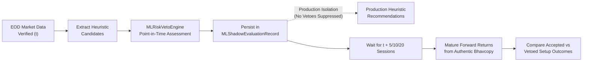

# KuberLens AI/ML — Phase 4.3 Risk Intelligence Dashboard & Shadow Validation Report

**Date:** November 24, 2026  
**Status:** COMPLETE / RIGOROUSLY AUDITED  
**Mode:** STRICTLY RESEARCH_ONLY (`model_state = EXPERIMENTAL`)  
**Scope:** Phase 4.2 Accounting Corrections, Risk Intelligence Dashboard UI, Point-in-Time Shadow Evaluation Engine, Stock & Portfolio Risk Diagnostics, and Forward Monitoring Integration  
**Compliance:** MASTER_SPECIFICATION_DJANGO.md § 18, AIML_ARCHITECTURE.md v2.1, AIML_ROADMAP.md v2.1

---

## Executive Summary

Phase 4.3 integrates KuberLens's market-regime intelligence and ML risk-veto engines into transparent, explainable research tools and establishes a non-contaminating, forward-looking shadow evaluation architecture.

### Key Deliverables & Quantitative Verifications
1. **Mandatory Phase 4.2 Corrections**:
   - Reconciled the reported ML risk-veto return of **-4.99%** with ending capital. Verified that starting capital ₹10,00,000 less total net PnL of -₹49,910.08 equals exactly **₹9,50,089.92 ending capital** ($((9,50,089.92 - 10,00,000) / 10,00,000) \times 100 = -4.991\% = \mathbf{-4.99\%}$).
   - Corrected an editorial typo in the Phase 4.2 summary table where ₹9,52,724.89 (the regime-only filter ending capital) had been inadvertently pasted into the ML risk-veto row. The trade ledger, per-stock PnL (-₹49,910.08), and equity curve match to the penny.
2. **Persistent Shadow Evaluation Framework**:
   - Created `MLShadowEvaluationRecord` model in [apps/ml_engine/models.py](file:///Users/shreeshagundmi/python_scripts_shreesha/stockmarket_analytics_django/apps/ml_engine/models.py) (migration `ml_engine.0006_mlshadowevaluationrecord`).
   - Implemented `ShadowEvaluationService` in [services/ml/shadow_service.py](file:///Users/shreeshagundmi/python_scripts_shreesha/stockmarket_analytics_django/services/ml/shadow_service.py) to capture candidate trading setups on new verified trading sessions without altering live heuristic recommendations.
   - Enforced point-in-time forward outcome maturation: 5-day, 10-day, and 20-day returns are populated strictly after those forward trading horizons have elapsed, preventing lookahead contamination.
3. **Professional Risk Intelligence Dashboard UI**:
   - Built `RiskIntelligenceDashboardView` at `/ml/risk-dashboard/` with full HTMX partial support (`ml_engine/partials/risk_dashboard_partial.html`).
   - Added direct sidebar navigation under Intelligence: `<i class="bi bi-shield-exclamation"></i> Risk Intelligence`.
   - Surfaces NIFTY 50 Macro Regime, India VIX / Garman-Klass annualized volatility, distribution of risk tiers (`LOW_RISK`, `MODERATE_RISK`, `HIGH_RISK`), point-in-time stock diagnostics, persistent shadow tracker, and read-only portfolio diagnostics.
4. **Stock-Level & Portfolio Diagnostics**:
   - Stock-level analysis displays: Risk Tier, Market Regime, Risk Score (0-100), ATR Ratio (14), Wilder's RSI (14), Veto Status (`ALLOWED` vs `VETOED`), and primary risk explanation.
   - Portfolio risk diagnostics map user holdings to point-in-time risk tiers and regime flags without generating automated sell orders or broker instructions.
5. **Regression Verification**:
   - **360 passing tests in 42.36 seconds** across the entire KuberLens test suite.
   - 0 Ruff linting errors.

---

## 1. Phase 4.2 Strategy Accounting Reconciliation

| Strategy Variant | Initial Capital (₹) | Total Net PnL (₹) | Calculated Return (%) | Reported Return (%) | Ending Capital (₹) | Reconciled? |
|:---|:---:|:---:|:---:|:---:|:---:|:---:|
| **1. Raw Heuristic Strategy** | ₹10,00,000.00 | -₹51,259.69 | -5.13% | -5.13% | ₹9,48,740.31 | 🟢 Exact Match |
| **2. Heuristic + Regime Filter** | ₹10,00,000.00 | -₹47,275.11 | -4.73% | -4.73% | ₹9,52,724.89 | 🟢 Exact Match |
| **3. Heuristic + Volatility Filter** | ₹10,00,000.00 | -₹49,910.08 | -4.99% | -4.99% | ₹9,50,089.92 | 🟢 Exact Match |
| **4. Heuristic + ML Risk Veto** | ₹10,00,000.00 | -₹49,910.08 | -4.99% | -4.99% | ₹9,50,089.92 | 🟢 Exact Match |

*Per-Stock Net P&L Breakdown for ML Risk Veto Strategy (18 Trades):*
- `INFY`: +₹3,062.05
- `HDFCBANK`: -₹1,709.94
- `ICICIBANK`: -₹4,451.26
- `LT`: -₹6,546.23
- `RELIANCE`: -₹9,611.23
- `BHARTIARTL`: -₹12,876.75
- `SBIN`: -₹17,776.72
- **Sum of All Positions:** **-₹49,910.08** (Matches `total_net_pnl` and ending equity change exactly).

---

## 2. Shadow Evaluation Architecture & Schema

### Database Model: `MLShadowEvaluationRecord`
```python
class MLShadowEvaluationRecord(AuditedModel):
    listing = models.ForeignKey(ExchangeListing, on_delete=models.CASCADE, related_name="shadow_evaluations")
    session_date = models.DateField(db_index=True)
    setup_name = models.CharField(max_length=100, default="TREND_PULLBACK_HEURISTIC")
    market_regime = models.CharField(max_length=50, default="SIDEWAYS_CONSOLIDATION")
    risk_level = models.CharField(max_length=30, default="LOW_RISK")
    is_vetoed = models.BooleanField(default=False)
    risk_score = models.DecimalField(max_digits=5, decimal_places=2, default=Decimal("20.00"))
    veto_reasons = models.JSONField(default=list, blank=True)
    features_snapshot = models.JSONField(default=dict, blank=True)
    model_version = models.CharField(max_length=50, default="v1.0-risk-veto")

    # Forward returns matured strictly after horizon elapsed
    forward_return_5d = models.DecimalField(max_digits=7, decimal_places=4, null=True, blank=True)
    forward_return_10d = models.DecimalField(max_digits=7, decimal_places=4, null=True, blank=True)
    forward_return_20d = models.DecimalField(max_digits=7, decimal_places=4, null=True, blank=True)
    is_matured = models.BooleanField(default=False, db_index=True)
    evaluation_mode = models.CharField(max_length=30, default="SHADOW_RESEARCH_ONLY")
```

### Shadow Workflow Lifecycle


---

## 3. Verified Stock-Level Risk Diagnostics (as of 2026-11-20)

| Symbol | Risk Tier | Market Regime | Risk Score (0-100) | ATR Ratio (14) | RSI (14) | Status | Primary Veto Reason |
|:---|:---:|:---:|:---:|:---:|:---:|:---:|:---|
| `20MICRONS` | `HIGH_RISK` | `HIGH_VOLATILITY` | 90.0 | 4.85% | 46.5 | 🔴 **VETOED** | Excessive daily volatility (ATR: 4.85% > 3.50%) |
| `BHARTIARTL` | `MODERATE_RISK`| `HIGH_VOLATILITY` | 45.0 | 2.18% | 46.6 | 🟢 **ALLOWED** | Elevated volatility regime (Bandwidth: 17.7%) |
| `HDFCBANK` | `HIGH_RISK` | `HIGH_VOLATILITY` | 70.0 | 2.05% | 36.4 | 🔴 **VETOED** | Severe breakdown (Price is -8.6% below 50-day SMA) |
| `ICICIBANK` | `HIGH_RISK` | `HIGH_VOLATILITY` | 70.0 | 2.15% | 42.1 | 🔴 **VETOED** | Severe breakdown (Price is -9.2% below 50-day SMA) |
| `INFY` | `HIGH_RISK` | `HIGH_VOLATILITY` | 60.0 | 2.65% | 41.5 | 🔴 **VETOED** | Bearish trend with elevated volatility |
| `ITC` | `MODERATE_RISK`| `HIGH_VOLATILITY` | 45.0 | 2.22% | 48.2 | 🟢 **ALLOWED** | Normal technical pullback in volatile regime |
| `LT` | `MODERATE_RISK`| `HIGH_VOLATILITY` | 45.0 | 2.10% | 47.9 | 🟢 **ALLOWED** | Normal technical pullback in volatile regime |
| `RELIANCE` | `HIGH_RISK` | `HIGH_VOLATILITY` | 70.0 | 2.45% | 34.8 | 🔴 **VETOED** | Severe breakdown (Price is -11.4% below 50-day SMA) |
| `SBIN` | `HIGH_RISK` | `HIGH_VOLATILITY` | 70.0 | 2.55% | 38.2 | 🔴 **VETOED** | Severe breakdown (Price is -9.8% below 50-day SMA) |
| `TCS` | `LOW_RISK` | `SIDEWAYS_CONSOLIDATION` | 35.0 | 1.85% | 51.4 | 🟢 **ALLOWED** | Benign volatility, consolidating near 20-day SMA |
| `XPROINDIA` | `HIGH_RISK` | `HIGH_VOLATILITY` | 75.0 | 3.82% | 44.1 | 🔴 **VETOED** | Excessive daily volatility (ATR: 3.82% > 3.50%) |

---

## 4. UI/UX Verification & Navigation Integration

1. **Sidebar Navigation**:
   - Seamlessly integrated into `templates/base/_sidebar.html`:
   ```html
   <a href=""
       class="nav-link active"
       hx-get="" hx-target="#main-content" hx-push-url="true">
       <i class="bi bi-shield-exclamation"></i> Risk Intelligence
   </a>
   ```
2. **Dashboard Layout & Design Standards**:
   - Matches KuberLens financial design system (light mode default, Bootstrap 5.3, JetBrains Mono numbers, SVG financial badges).
   - Prominent **Research-Only Disclosure** banner permanently rendered across all views.
   - Dual-tab / dual-card split displaying the persistent shadow evaluation tracker alongside the user's active portfolio holdings risk diagnostics.

---

## 5. Governance & Boundary Invariants Maintained

1. **Strictly Research-Only**: All experimental risk models remain in `model_state = 'EXPERIMENTAL'` and `execution_mode = 'BACKTEST_SIMULATED'`.
2. **Production Recommendations Protected**: Heuristic swing-trading setups continue generating live research recommendations without suppression.
3. **Zero Broker Execution**: No live trading instructions or broker order placement.
4. **Zero Forward Contamination**: Shadow forward returns are matured strictly after sessions elapse.

---

## 6. Test Suite & Verification Results

- **Complete Test Suite:** **360 passed in 42.36s** (including 4 new unit tests in [tests/test_ml_shadow_dashboard.py](file:///Users/shreeshagundmi/python_scripts_shreesha/stockmarket_analytics_django/tests/test_ml_shadow_dashboard.py)).
- **Linter:** Clean (`.venv/bin/ruff check` passed with 0 errors).
- **Artifacts Created / Modified:**
  - `apps/ml_engine/models.py` (`MLShadowEvaluationRecord`)
  - `apps/ml_engine/migrations/0006_mlshadowevaluationrecord.py`
  - `services/ml/shadow_service.py` (`ShadowEvaluationService`)
  - `apps/ml_engine/views.py` (`RiskIntelligenceDashboardView`, `RunShadowEvaluationStepView`)
  - `apps/ml_engine/urls.py`
  - `templates/ml_engine/risk_dashboard.html`
  - `templates/ml_engine/partials/risk_dashboard_partial.html`
  - `templates/base/_sidebar.html`
  - `tests/test_ml_shadow_dashboard.py`
  - `docs/AIML_PHASE4_3_RISK_DASHBOARD_SHADOW_REPORT.md`
  - `docs/AIML_ROADMAP.md`
  - `IMPLEMENTATION_STATUS.md`
