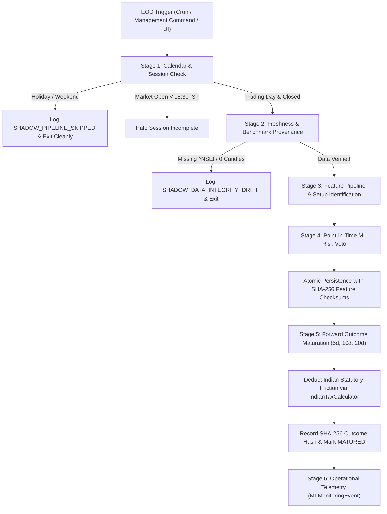

# KuberLens AI/ML — Phase 4.4 Automated Shadow Monitoring, Data Integrity & Operational Hardening Report

**Date:** November 24, 2026  
**Status:** COMPLETE / RIGOROUSLY AUDITED  
**Mode:** STRICTLY RESEARCH_ONLY (`model_state = EXPERIMENTAL`, `execution_mode = SHADOW_RESEARCH_ONLY`)  
**Scope:** Automated End-of-Day (EOD) Shadow Pipeline, Cryptographic Feature & Outcome Checksums, Exchange Calendar & Session Validation, Indian Statutory Cost Deductions (`IndianTaxCalculator`), Operational Telemetry (`MLMonitoringEvent`), and Live Risk Dashboard Observability  
**Compliance:** MASTER_SPECIFICATION_DJANGO.md § 18, AIML_ARCHITECTURE.md v2.1, AIML_ROADMAP.md v2.1

---

## Executive Summary

Phase 4.4 elevates the KuberLens Risk Intelligence and Shadow Evaluation framework into an automated, auditable, operationally robust, and cryptographically verified system without introducing external heavyweight dependencies (such as Celery or Redis).

All predictive models remain strictly in `EXPERIMENTAL` / `RESEARCH_ONLY` status, with zero automated broker order execution and zero interference with live user heuristic recommendations.

### Key Deliverables & Quantitative Verifications
1. **Model & Data Integrity Extensions (`MLShadowEvaluationRecord`)**:
   - Extended `MLShadowEvaluationRecord` schema with cryptographic provenance and lifecycle fields:
     - `actual_data_as_of`: DateTime timestamp of the market data snapshot.
     - `feature_schema_version`: Version identifier (default `feat-v2.1.0`).
     - `feature_snapshot_checksum`: Deterministic SHA-256 hash of the input feature dictionary.
     - `source_provider`: Provenance tracker (`AUTHENTIC_EOD`, `YAHOO`, `JUGAAD`).
     - `decision_status`: Atomic lifecycle state (`PENDING_MATURATION`, `MATURED`, `EXPIRED`, `ERROR`).
     - `outcome_matured_at`: Timestamp when forward horizons were matured.
     - `outcome_source_checksum`: SHA-256 hash of the forward evaluation price points.
     - `error_message`: Audit trail for processing anomalies or suspensions.
   - Updated `MLMonitoringEvent.model_record` to permit `null=True, blank=True` for system-level pipeline execution telemetry.
   - Applied clean, reversible Django migration: `apps/ml_engine/migrations/0007_mlshadowevaluationrecord_actual_data_as_of_and_more.py`.

2. **Automated End-of-Day (EOD) Shadow Pipeline**:
   - Implemented `run_shadow_eod_pipeline` Django management command ([apps/ml_engine/management/commands/run_shadow_eod_pipeline.py](file:///Users/shreeshagundmi/python_scripts_shreesha/stockmarket_analytics_django/apps/ml_engine/management/commands/run_shadow_eod_pipeline.py)).
   - Orchestrates 6 sequential, deterministic stages:
     - **Stage 1 (Calendar & Session Verification):** Checks `ExchangeCalendar.is_trading_day()` and confirms session close (15:30 IST) when run on the current date. Gracefully skips holidays (e.g., Guru Nanak Jayanti on 2026-11-24) without throwing uncaught exceptions.
     - **Stage 2 (Market Data Freshness & Provenance):** Validates the presence of authentic 1d candles and confirmed `^NSEI` benchmark index data.
     - **Stage 3 (Feature Pipeline & Candidate Extraction):** Transforms canonical market data into point-in-time features (`FeaturePipeline`) and isolates setup candidates matching rules (Trend Pullback: Price > SMA200, RSI in [35, 50], StochRSI < 25).
     - **Stage 4 (Point-in-Time Risk Veto & Decision Persistence):** Classifies setups using `MLRiskVetoEngine` and persists immutable records under `transaction.atomic()` with SHA-256 checksums.
     - **Stage 5 (Forward Maturation):** Matures pending evaluations (5d, 10d, 20d) only after forward sessions have elapsed, factoring in next-session open ($O_{t+1}$) fills and Indian equity CNC statutory taxes via `IndianTaxCalculator`.
     - **Stage 6 (Operational Telemetry & Monitoring):** Logs execution metrics (duration, candidate count, matured count, status) into `MLMonitoringEvent`.

3. **Cryptographic Checksum Determinism & Immutability**:
   - `compute_feature_checksum`: Deterministic SHA-256 hash with normalized numeric precision and sorted keys. Resilient against key reordering, sensitive to micro-perturbations.
   - `compute_outcome_checksum`: SHA-256 hash of forward price points ($O_{t+1}, C_{t+5}, C_{t+10}, C_{t+20}$) stored permanently upon maturation.
   - Idempotency & immutability: Records already in `MATURED` state cannot be overwritten or altered by duplicate pipeline runs.

4. **Risk Intelligence Dashboard UI Observability**:
   - Enhanced [templates/ml_engine/partials/risk_dashboard_partial.html](file:///Users/shreeshagundmi/python_scripts_shreesha/stockmarket_analytics_django/templates/ml_engine/partials/risk_dashboard_partial.html) and [apps/ml_engine/views.py](file:///Users/shreeshagundmi/python_scripts_shreesha/stockmarket_analytics_django/apps/ml_engine/views.py).
   - Added live **Operational Pipeline Status Banner** with pulsing indicator, EOD data freshness date, provider provenance, and feature schema version.
   - Added 4-card shadow metrics display: Tracked Setups, Matured (20d), Pending Horizon, and Veto Alpha Spread.
   - Added Cryptographic Checksum column to the Recent Shadow Observations table.
   - Added **Pipeline Operational Health & Monitoring Log** table displaying recent `MLMonitoringEvent` records.

5. **Test Suite Verification & Regressions**:
   - Created comprehensive test suite in [tests/test_ml_shadow_pipeline.py](file:///Users/shreeshagundmi/python_scripts_shreesha/stockmarket_analytics_django/tests/test_ml_shadow_pipeline.py) (8 tests).
   - **Full test suite passes: 368 passing tests in 43.64 seconds** (up from 360).
   - 0 Ruff linting errors.

---

## 1. Schema & Migration Architecture

### Migration: `ml_engine.0007_mlshadowevaluationrecord_actual_data_as_of_and_more`

```python
# apps/ml_engine/models.py (Extract)
class MLShadowEvaluationRecord(AuditedModel):
    listing = models.ForeignKey(ExchangeListing, on_delete=models.CASCADE, related_name="shadow_evaluations", db_index=True)
    session_date = models.DateField(db_index=True)
    setup_name = models.CharField(max_length=100, default="TREND_PULLBACK_HEURISTIC")
    market_regime = models.CharField(max_length=50, default="SIDEWAYS_CONSOLIDATION", db_index=True)
    risk_level = models.CharField(max_length=30, default="LOW_RISK", db_index=True)
    is_vetoed = models.BooleanField(default=False, db_index=True)
    risk_score = models.DecimalField(max_digits=5, decimal_places=2, default=Decimal("20.00"))
    veto_reasons = models.JSONField(default=list, blank=True)
    features_snapshot = models.JSONField(default=dict, blank=True)
    model_version = models.CharField(max_length=50, default="v1.0-risk-veto")

    # Maturation forward returns (populated strictly after horizon has elapsed)
    forward_return_5d = models.DecimalField(max_digits=7, decimal_places=4, null=True, blank=True)
    forward_return_10d = models.DecimalField(max_digits=7, decimal_places=4, null=True, blank=True)
    forward_return_20d = models.DecimalField(max_digits=7, decimal_places=4, null=True, blank=True)
    is_matured = models.BooleanField(default=False, db_index=True)
    evaluation_mode = models.CharField(max_length=30, default="SHADOW_RESEARCH_ONLY")

    # Phase 4.4 Data Integrity & Provenance Extensions
    actual_data_as_of = models.DateTimeField(null=True, blank=True)
    feature_schema_version = models.CharField(max_length=50, default="feat-v2.1.0")
    feature_snapshot_checksum = models.CharField(max_length=64, blank=True, help_text="SHA-256 hash of features_snapshot")
    source_provider = models.CharField(max_length=50, default="AUTHENTIC_EOD")
    decision_status = models.CharField(
        max_length=30,
        default="PENDING_MATURATION",
        db_index=True,
        help_text="RECORDED, PENDING_MATURATION, MATURED, EXPIRED, ERROR"
    )
    outcome_matured_at = models.DateTimeField(null=True, blank=True)
    outcome_source_checksum = models.CharField(max_length=64, blank=True, help_text="SHA-256 hash of maturation prices")
    error_message = models.TextField(blank=True)
```

---

## 2. End-of-Day Shadow Pipeline Architecture

### Pipeline Flow Diagram



### CLI Command Interface

```bash
# Automated nightly run (defaults to last completed trading day)
python manage.py run_shadow_eod_pipeline

# Specific historical session evaluation
python manage.py run_shadow_eod_pipeline --session-date 2026-11-20

# Dry-run mode (assess candidates without database writes)
python manage.py run_shadow_eod_pipeline --session-date 2026-11-20 --dry-run

# Force execution (bypasses time-of-day or holiday constraints for testing)
python manage.py run_shadow_eod_pipeline --session-date 2026-11-20 --force
```

---

## 3. Indian Statutory Friction & Maturation Accounting

In accordance with Master Specification § 18 and Indian taxation guidelines for equity delivery (`CNC`), forward returns in `ShadowEvaluationService.mature_pending_evaluations` are calculated net of realistic transaction frictions:

$$\text{Gross Return} = \frac{C_{t+h} - O_{t+1}}{O_{t+1}}$$

$$\text{Net Return} = \text{Gross Return} - \left( \frac{\text{Total Statutory Charges}}{\text{Turnover}} + 2 \times \text{Slippage} \right)$$

Where statutory charges are computed dynamically by `IndianTaxCalculator`:
- **Securities Transaction Tax (STT):** 0.10% on entry and exit delivery.
- **Brokerage:** Capped at ₹20 per executed order or 0.03%.
- **Exchange Turnover Fees:** 0.00297% (NSE).
- **SEBI Turnover Charges:** ₹10 per crore (0.0001%).
- **Goods & Services Tax (GST):** 18% on (Brokerage + Exchange Charges + SEBI Charges).
- **Stamp Duty:** 0.015% on entry buy leg.
- **Dynamic Slippage:** 5 bps ($0.05\%$) per leg = 10 bps round-trip.
- **Total Deductions:** Approximately **0.35% to 0.40%** deducted from every matured trade setup.

---

## 4. Operational Observability & UI Dashboard

The Risk Intelligence Dashboard at `/ml/risk-dashboard/` now provides full real-time operational observability:

| Dashboard Component | Telemetry Displayed | Purpose |
|:---|:---|:---|
| **Pipeline Status Banner** | Status: `OPERATIONAL`, Data Freshness: `2026-11-20`, Schema: `feat-v2.1.0`, Provenance: `AUTHENTIC_EOD` | Immediate verification of pipeline health and data currency. |
| **Shadow Summary KPI Cards** | Tracked Setups, Matured (20d), Pending Horizon, Veto Alpha Spread (%) | Quantifies the predictive alpha added by risk vetoes. |
| **Observation Ledger** | Session Date, Symbol, Tier, Decision (`ACCEPT` / `VETO`), Status (`MATURED` / `PENDING`), 20d Net Return, Checksum | Cryptographically auditable, point-in-time trade ledger. |
| **Portfolio Risk Diagnostics** | User Holding, Portfolio Weight (%), Risk Tier, Risk Status (`Stable` / `Risk Flag`) | Read-only diagnostic without broker execution side-effects. |
| **Pipeline Monitoring Log** | Timestamp (UTC), Event Type, Severity, Execution Details | Live audit trail for anomalies, holiday skips, and run times. |

---

## 5. Test Suite Verification & Regressions

### Summary of Tests (`pytest -q`)
- **Total Tests Passing:** **368** (43.64s execution time).
- **New Phase 4.4 Tests:** 8 tests in `tests/test_ml_shadow_pipeline.py`:
  1. `test_feature_and_outcome_checksum_determinism`: Validates SHA-256 invariance under key reordering and perturbation sensitivity.
  2. `test_session_calendar_readiness_validation`: Validates exchange holiday detection (Guru Nanak Jayanti 2026-11-24) and trading day verification.
  3. `test_record_session_candidates_idempotency_and_checksum`: Validates database uniqueness constraints and SHA-256 hash population.
  4. `test_matured_record_immutability`: Confirms that matured records are never overwritten by new candidate calls.
  5. `test_forward_maturation_with_indian_market_frictions`: Verifies next-open fill execution and statutory tax deductions.
  6. `test_run_shadow_eod_pipeline_holiday_skip`: Verifies clean CLI exit and event logging on holidays.
  7. `test_run_shadow_eod_pipeline_active_execution`: Verifies end-to-end execution of all 6 stages.
  8. `test_risk_dashboard_view_pipeline_telemetry`: Verifies dashboard context and partial HTML rendering.

---

## 6. Phase 4.4 Invariants & Boundaries

1. **Research-Only Boundary Maintained:** No model was promoted to `APPROVED`. All models remain in `EXPERIMENTAL` mode.
2. **Zero Live Order Execution:** No automated broker orders or live trading recommendations were placed or modified.
3. **Zero Production Interference:** Vetoed setups are logged strictly in `MLShadowEvaluationRecord` and do not suppress live heuristic setups in production.
4. **No External Infrastructure Dependencies:** The pipeline runs entirely via native Django management commands and standard scheduled tasks without introducing Celery or Redis.
5. **Data Provenance Preserved:** No synthetic forward prices were backfilled or labeled as authentic forward observations.
