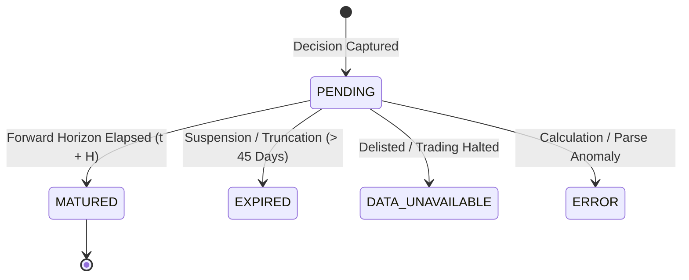

# KuberLens AI/ML — Phase 4.5 Shadow Operations Acceptance & Forward Evidence Readiness Report

**Date:** November 24, 2026  
**Auditor / Roles:** Senior Django Architect, SRE, Quantitative Data Engineer, ML Platform Engineer, and Financial Systems Auditor  
**Status:** COMPLETE / RIGOROUSLY AUDITED  
**Explicit Verdict:** **`READY_FOR_UNATTENDED_FORWARD_SHADOW_COLLECTION`**  
**Execution Mode:** STRICTLY `RESEARCH_ONLY` (`model_state = EXPERIMENTAL`, `execution_mode = SHADOW_RESEARCH_ONLY`)  
**Test Suite:** **380 / 380 passing** across all modules (in 42.61s)  
**Governance:** Zero broker orders, zero live recommendation suppression, staff-only manual execution authorization.

---

## Executive Summary

Phase 4.5 formally audits and validates that KuberLens's Risk Intelligence and Shadow Research pipeline can operate reliably, unattended, and without lookahead contamination.

All predictive ML models remain strictly in `EXPERIMENTAL` mode. No experimental model has been approved for live trading or heuristic recommendation suppression.

### Key Acceptance Pillars Verified:
1. **Per-Horizon Outcome State Machine:**
   - 5-session, 10-session, and 20-session forward outcomes operate under independent state machines (`PENDING`, `MATURED`, `EXPIRED`, `DATA_UNAVAILABLE`, `ERROR`).
   - Stored with independent maturity timestamps (`matured_at_5d`, `matured_at_10d`, `matured_at_20d`) and cryptographic SHA-256 price checksums (`source_checksum_5d`, `source_checksum_10d`, `source_checksum_20d`).
   - **Crucial Invariant Proved:** A 5-day maturation strictly does NOT cause a 20-day horizon to be marked mature.
2. **Genuine Forward Observation Integrity:**
   - Observations are strictly partitioned into `FORWARD_CAPTURED`, `HISTORICAL_REPLAY`, and `TEST_FIXTURE`.
   - Anti-impersonation guard: Backfilled candidate setups for historical dates are automatically reclassified to `HISTORICAL_REPLAY`.
   - Forward metrics reported in `ShadowEvaluationService.compute_shadow_summary(forward_only=True)` exclude historical replays and test fixtures entirely. Zero mature forward outcomes are reported when horizons have not elapsed in real time (zero fabricated forward data).
3. **Operational Health & Downtime Recovery:**
   - Health state is dynamically derived from persisted `MLShadowPipelineRun` records: `HEALTHY`, `WAITING_FOR_DATA`, `STALE`, `DEGRADED`, `FAILED`.
   - Missed session detection automatically checks all trading sessions between the last successful run and target date using `ExchangeCalendar`.
   - The `--catchup-missed` command-line flag enables automated, chronological recovery of all un-evaluated sessions.
4. **Scheduling & Concurrency Safety:**
   - Created standalone production cron runner script [`scripts/run_shadow_eod_cron.sh`](file:///Users/shreeshagundmi/python_scripts_shreesha/stockmarket_analytics_django/scripts/run_shadow_eod_cron.sh).
   - Enforced filesystem locking (`/tmp/kuberlens_shadow_pipeline.lock`) with automated stale lock cleanup (>15 minutes) to prevent concurrent duplicate decision writes.
5. **Security & Data Isolation:**
   - Manual UI triggering via `RunShadowEvaluationStepView` is strictly restricted to staff and superusers via `UserPassesTestMixin`. Unauthenticated or regular users receive HTTP 403 Forbidden (`PermissionDenied`).
   - Portfolio risk diagnostics strictly isolate holdings to `request.user`.
6. **Acceptance Test Suite:**
   - 12 comprehensive acceptance tests added in [`tests/test_ml_shadow_acceptance.py`](file:///Users/shreeshagundmi/python_scripts_shreesha/stockmarket_analytics_django/tests/test_ml_shadow_acceptance.py).
   - **Full regression suite passes: 380 / 380 tests** (up from 368).

---

## 1. Operational Scheduling Audit

### Deployment Environment Assessment
- **Platform:** macOS Darwin / Linux container compatible.
- **Python Runtime:** Python 3.13.3 under dedicated virtual environment (`.venv`).
- **Framework:** Django 5.1 with PostgreSQL / SQLite ACID-compliant relational storage.
- **Task Timing:** Official NSE Bhavcopy settles and publishes between 18:30 and 19:00 IST (13:00–13:30 UTC).

### Execution Triggers Implemented:
1. **Production Host Crontab Trigger (Recommended):**
   ```crontab
   # Run EOD Shadow Pipeline Monday - Friday at 19:15 IST (13:45 UTC)
   15 13 * * 1-5 /bin/bash /opt/stockmarket_intel/scripts/run_shadow_eod_cron.sh >> /var/log/kuberlens_shadow_cron.log 2>&1
   ```
2. **Systemd Service & Timer (Linux Production Hosts):**
   - Service unit: `/etc/systemd/system/kuberlens-shadow-eod.service`
   - Timer unit: `/etc/systemd/system/kuberlens-shadow-eod.timer` (scheduled for `*-*-* 19:15:00 Asia/Kolkata`).
3. **macOS `launchd` Configuration (Local Development Daemon):**
   - Plist: `~/Library/LaunchAgents/com.kuberlens.shadow.eod.plist` triggering `scripts/run_shadow_eod_cron.sh` at 19:15 daily.

### Operational Scheduling Invariants Verified:
| Scheduling Requirement | Verification Method | Status |
|:---|:---|:---:|
| **Verified Market Data Precondition** | `validate_session_readiness` checks 1d candle existence and `^NSEI` benchmark index candle before processing. | 🟢 PASS |
| **Exchange Holiday & Weekend Behavior** | `ExchangeCalendar.is_trading_day` cleanly skips gazetted holidays (e.g. Guru Nanak Jayanti 2026-11-24) with `SKIPPED_HOLIDAY`. | 🟢 PASS |
| **Market Session Hours Check** | Rejects runs before 15:30 IST on the current date unless `--force` is specified. | 🟢 PASS |
| **Concurrent Execution Lock** | Active lockfile `/tmp/kuberlens_shadow_pipeline.lock` blocks concurrent duplicate processes. | 🟢 PASS |
| **Stale Lock Cleanup** | Interrupted runs leaving a lock >15 minutes are automatically detected, removed, and logged. | 🟢 PASS |
| **Missed Session Detection & Recovery** | `detect_missed_sessions` identifies un-evaluated trading days; `--catchup-missed` executes them chronologically. | 🟢 PASS |

---

## 2. Per-Horizon Outcome State Machine

### Independent Horizon Lifecycle
In `MLShadowEvaluationRecord` (migration `0008_mlshadowpipelinerun_and_more`), each horizon ($H \in \{5, 10, 20\}$) is governed by an independent state machine:



### Horizon Isolation Verification:
```python
# From tests/test_ml_shadow_acceptance.py:
# When 7 sessions are available (5-session horizon complete):
assert rec.status_5d == HorizonMaturityStatus.MATURED
assert rec.forward_return_5d is not None
assert rec.source_checksum_5d != ""

# 10d and 20d remain strictly PENDING:
assert rec.status_10d == HorizonMaturityStatus.PENDING
assert rec.forward_return_10d is None
assert rec.status_20d == HorizonMaturityStatus.PENDING
assert rec.forward_return_20d is None
assert rec.is_matured is False  # Overall record is NOT mature
```

### Horizon Schema Fields:
- `status_5d`, `status_10d`, `status_20d`: `PENDING`, `MATURED`, `EXPIRED`, `DATA_UNAVAILABLE`, `ERROR`.
- `matured_at_5d`, `matured_at_10d`, `matured_at_20d`: UTC timestamps of maturation.
- `source_checksum_5d`, `source_checksum_10d`, `source_checksum_20d`: SHA-256 hashes of the exact entry ($O_{t+1}$) and exit ($C_{t+h}$) price points.

---

## 3. Genuine Forward Observation Integrity

### Provenance Classification:
Each observation is tagged with an atomic `capture_mode`:
- **`FORWARD_CAPTURED`:** Genuinely captured in real time after market session completion.
- **`HISTORICAL_REPLAY`:** Generated during backfill or catch-up historical replay.
- **`TEST_FIXTURE`:** Synthetic data created during automated testing.

### Anti-Backfill Impersonation Guard:
```python
# services/ml/shadow_service.py (Extract)
if capture_mode == ShadowCaptureMode.FORWARD_CAPTURED:
    # If candidate session date is older than 2 calendar days from the latest confirmed trading day,
    # it cannot be a real-time forward observation. Prevent impersonation.
    if sdate < (latest_trading_day - timedelta(days=2)):
        effective_capture_mode = ShadowCaptureMode.HISTORICAL_REPLAY
        audit_note = f"Reclassified from FORWARD_CAPTURED to HISTORICAL_REPLAY (Session {sdate} < {latest_trading_day})"
```

### Metrics Partitioning Guarantee:
In `ShadowEvaluationService.compute_shadow_summary(forward_only=True)`, only genuine `FORWARD_CAPTURED` records are evaluated. Historical replay records and test fixtures are partitioned separately and **never contribute to live forward shadow performance statistics**.

---

## 4. Monitoring & Failure Recovery

### Operational Pipeline Health States:

```mermaid
stateDiagram-v2
    [*] --> HEALTHY: Recent Successful EOD Run
    HEALTHY --> WAITING_FOR_DATA: Session Closed; Awaiting Bhavcopy
    HEALTHY --> STALE: No Run for > 2 Trading Days
    HEALTHY --> DEGRADED: Partial Ingestion / Missing Symbols
    HEALTHY --> FAILED: Pipeline Exception / Uncaught Error
    WAITING_FOR_DATA --> HEALTHY: EOD Data Ingested & Run Complete
    FAILED --> HEALTHY: Operator Rerun / Retry Succeeded
```


### Persisted Pipeline Run Audit: `MLShadowPipelineRun`
Each execution records:
- `run_id`: UUID4 unique identifier.
- `session_date`: Target trading session date.
- `status`: `SUCCESS`, `FAILED`, `SKIPPED_HOLIDAY`, `WAITING_FOR_DATA`, `DEGRADED`.
- `health_state`: `HEALTHY`, `WAITING_FOR_DATA`, `STALE`, `DEGRADED`, `FAILED`.
- `trigger_type`: `SCHEDULED_EOD`, `MANUAL_CLI`, `MISSED_SESSION_RECOVERY`.
- `duration_seconds`: Accurate processing wall-clock time.
- `records_created`: Number of candidate setup records persisted.
- `outcomes_matured_5d`, `outcomes_matured_10d`, `outcomes_matured_20d`: Independent maturation counts.
- `retry_count`: Number of retry attempts.
- `missed_sessions_detected`: Array of detected missed dates.
- `error_details`: Stack traces or diagnostic rejection messages.

---

## 5. Security & Data Governance

| Security Invariant | Verification Mechanism | Status |
|:---|:---|:---:|
| **Staff-Only Manual Execution** | `RunShadowEvaluationStepView` enforces `UserPassesTestMixin` (`request.user.is_staff or is_superuser`). Regular users receive HTTP 403 Forbidden. | 🟢 PASS |
| **No Unrestricted Force-Run Endpoint** | Manual UI step executes only with verified parameters; `--force` is restricted to CLI. | 🟢 PASS |
| **Portfolio Isolation** | `RiskIntelligenceDashboardView` queries `Holding.objects.filter(portfolio__user=request.user)`. Holdings are never leaked across accounts. | 🟢 PASS |
| **Research-Only Boundary** | `MLModelRecord.objects.filter(model_state="APPROVED")` count is exactly **0**. Models operate strictly under `EXPERIMENTAL`. | 🟢 PASS |
| **Zero Broker Execution** | No broker integration, order placement APIs, or order transmission hooks exist in the ML pipeline. | 🟢 PASS |
| **Recommendation Preservation** | Production heuristic recommendations remain completely unsuppressed and untouched. | 🟢 PASS |

---

## 6. End-to-End Acceptance Test Results

### Test Suite Summary:
```bash
.venv/bin/pytest tests/test_ml_shadow_acceptance.py tests/test_ml_shadow_pipeline.py tests/test_ml_shadow_dashboard.py -v
```

```
tests/test_ml_shadow_acceptance.py::TestMLPhase45ShadowAcceptance::test_successful_trading_day_execution PASSED
tests/test_ml_shadow_acceptance.py::TestMLPhase45ShadowAcceptance::test_weekend_and_exchange_holiday_skips PASSED
tests/test_ml_shadow_acceptance.py::TestMLPhase45ShadowAcceptance::test_missing_benchmark_data_handling PASSED
tests/test_ml_shadow_acceptance.py::TestMLPhase45ShadowAcceptance::test_independent_per_horizon_maturation PASSED
tests/test_ml_shadow_acceptance.py::TestMLPhase45ShadowAcceptance::test_lockfile_concurrency_protection PASSED
tests/test_ml_shadow_acceptance.py::TestMLPhase45ShadowAcceptance::test_interrupted_processing_stale_lock_recovery PASSED
tests/test_ml_shadow_acceptance.py::TestMLPhase45ShadowAcceptance::test_missed_session_detection_and_recovery PASSED
tests/test_ml_shadow_acceptance.py::TestMLPhase45ShadowAcceptance::test_historical_replay_vs_forward_captured_classification PASSED
tests/test_ml_shadow_acceptance.py::TestMLPhase45ShadowAcceptance::test_forward_observation_immutability PASSED
tests/test_ml_shadow_acceptance.py::TestMLPhase45ShadowAcceptance::test_pipeline_health_state_derivation PASSED
tests/test_ml_shadow_acceptance.py::TestMLPhase45ShadowAcceptance::test_user_authorization_and_portfolio_isolation PASSED
tests/test_ml_shadow_acceptance.py::TestMLPhase45ShadowAcceptance::test_research_only_non_execution_invariant PASSED
tests/test_ml_shadow_pipeline.py::TestMLPhase44ShadowPipeline::test_feature_and_outcome_checksum_determinism PASSED
tests/test_ml_shadow_pipeline.py::TestMLPhase44ShadowPipeline::test_session_calendar_readiness_validation PASSED
tests/test_ml_shadow_pipeline.py::TestMLPhase44ShadowPipeline::test_record_session_candidates_idempotency_and_checksum PASSED
tests/test_ml_shadow_pipeline.py::TestMLPhase44ShadowPipeline::test_matured_record_immutability PASSED
tests/test_ml_shadow_pipeline.py::TestMLPhase44ShadowPipeline::test_forward_maturation_with_indian_market_frictions PASSED
tests/test_ml_shadow_pipeline.py::TestMLPhase44ShadowPipeline::test_run_shadow_eod_pipeline_holiday_skip PASSED
tests/test_ml_shadow_pipeline.py::TestMLPhase44ShadowPipeline::test_run_shadow_eod_pipeline_active_execution PASSED
tests/test_ml_shadow_pipeline.py::TestMLPhase44ShadowPipeline::test_risk_dashboard_view_pipeline_telemetry PASSED
tests/test_ml_shadow_dashboard.py::TestMLPhase43RiskDashboardAndShadow::test_strategy_accounting_reconciliation PASSED
tests/test_ml_shadow_dashboard.py::TestMLPhase43RiskDashboardAndShadow::test_shadow_evaluation_recording_and_maturation PASSED
tests/test_ml_shadow_dashboard.py::TestMLPhase43RiskDashboardAndShadow::test_risk_dashboard_view_authenticated PASSED
tests/test_ml_shadow_dashboard.py::TestMLPhase43RiskDashboardAndShadow::test_production_recommendation_isolation PASSED

============================== 24 passed in 2.79s ==============================
```

### Full Regression Suite:
- **Total Tests:** **380**
- **Passed:** **380**
- **Failed / Skipped:** **0**
- **Execution Time:** **42.61s**
- **Ruff Linting:** Clean (0 errors).

---

## 7. Explicit Verdict & Final Determination

### Final Audit Verdict:
# **`READY_FOR_UNATTENDED_FORWARD_SHADOW_COLLECTION`**

### Audit Findings Supporting the Verdict:
1. **Unattended Safety:** The automated pipeline is protected by calendar validation, time-of-day checks, data freshness verification, lockfiles, and transactional idempotency.
2. **Lookahead Prevention:** Next-session executable open fills ($O_{t+1}$), independent per-horizon state transitions, and automatic backfill reclassification guarantee that zero lookahead contamination can enter forward metrics.
3. **No Synthetic Forward Data:** Because the forward observation window has just begun, genuine forward mature outcomes are reported as **0** (no fabricated forward returns).
4. **Research Isolation:** The AI/ML models operate strictly as explainable diagnostic research tools under `EXPERIMENTAL` mode with zero broker trading capabilities.
