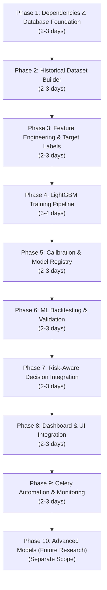

# AI/ML Implementation Roadmap

**Project:** KuberLens — Indian Equity Research & Decision-Support Platform  
**Document:** `docs/AIML_ROADMAP.md`  
**Version:** 2.1 (Final Pre-Implementation Revision)  
**Date:** 2026-11-24  
**Status:** Implementation Roadmap (Final Safety Revisions Applied)  
**Parent Specifications:** `MASTER_SPECIFICATION_DJANGO.md`, `IMPLEMENTATION_AIML.md`, `docs/AIML_ARCHITECTURE.md`  
**Audit Reference:** `docs/AIML_GAP_ANALYSIS.md`  

---

## 1. Architecture Review Corrections & Safety Invariants

This section documents the specific issues identified during review and how each is resolved across the roadmap phases.

| Review Issue | Phase Affected | Technical Resolution Incorporated in Roadmap v2.1 |
|---|---|---|
| **1. Corporate Action Source & Conventions** | Phase 2 | **Replaced user `HoldingTransaction` with `apps.news.models.CorporateEvent` and official NSE Bhavcopy adjustment factors.** Mathematical bonus and split conventions are formally defined with tested numerical examples. |
| **2. Target Definitions & Execution** | Phase 3 | **Defined target $Y_{t, h} = \mathbb{I}(R_{t, t+h}^{net} > \tau_h)$ using next-session open ($O_{t+1}$) fill assumptions** and round-trip transaction costs from `PaperTradingTaxCalculator`. |
| **3. Heuristic vs Statistical Demarcation** | Phase 1, Phase 8 | **Tagged prototype model as `LEGACY_HEURISTIC` / `HEURISTIC_RULE_BASED`.** Standardized 5 output states (`APPROVED_MODEL`, `EXPERIMENTAL_MODEL`, `HEURISTIC_FALLBACK`, `STALE_DATA`, `INSUFFICIENT_DATA`). Transitional defaults default strictly to `HEURISTIC_FALLBACK` and `UNCALIBRATED`. |
| **4. Safe Migration & Duplicate Preservation** | Phase 1 | **Implemented a 3-step migration with duplicate archiving via `MLPredictionArchive`.** Zero records are permanently discarded. Pre-migration backup and recovery procedures are explicitly documented. |
| **5. Leakage-Safe Probability Calibration** | Phase 5 | **Designed a 4-split nested cross-validation scheme.** Decouples train, calibration holdout, model selection, and test sets. Uncalibrated models are strictly labeled as `RAW` in the UI. |
| **6. Purged Walk-Forward Splits** | Phase 4 | **Formally defined split boundaries using observation timestamps $T_i$ and forward horizon end timestamps $T_i + h$.** Overlapping label windows are purged; an $h$-session embargo follows test folds. |
| **7. Training-Derived Brier Evaluation** | Phase 4, Phase 5 | **Defined Brier Skill Score against a climatological baseline $\bar{y}_{train}$ estimated purely from training data.** Calibration is retained only if $\text{BSS}_{calibrated} > \text{BSS}_{raw}$. |
| **8. Model Activation Invariant & Concurrency** | Phase 1, Phase 5 | **Enforced "at most one APPROVED model per horizon" ($[0, 1]$).** Database partial unique index (`UniqueConstraint` with `condition=Q(model_state="APPROVED")`). Concurrency-safe promotion handles transitions when no approved model exists. |
| **9. Pipeline-Dependent EOD Inference** | Phase 9 | **Replaced fixed-clock cron with Celery task chaining and pre-flight data checks** (`DataRefreshLog` status and `DataQualityIssue` clean checks). |
| **10. Multi-Factor Data Freshness** | Phase 7 | **Evaluated freshness against trading calendar, market close (15:30 IST), EOD publication window (17:30–18:30 IST), and successful ingestion logs.** Harmonized volatility veto thresholds (Garman-Klass > 50.0% OR ATR-14 > 6.0%). |
| **11. Snapshot Content Hashing** | Phase 2 | **Added SHA-256 canonical dataframe content hashing, schema versioning, and source metadata** to `MLDatasetSnapshot`. |
| **12. Fundamental Publication Dates** | Phase 3 | **Enforced filing date filtering for fundamental data.** If verified historical filing dates are unavailable, those features are excluded from training to prevent lookahead bias. Documented NIFTY 250 survivorship limitations. |
| **13. Universe & Listing Reconciliation** | Phase 2 | **Documented the NIFTY LargeMidcap 250 seed universe.** Explained that `NIFTY_250_STOCKS` defines 271 constituent companies yielding 268 seeded listings in the initial catalog. |
| **14. Measured Performance Benchmarks** | Phase 3, Phase 4 | **Replaced arbitrary timing promises with unit throughput bounds** ($\le 15$ ms per stock inference on baseline hardware). |
| **15. Model Artifact Security** | Phase 5 | **Added `models/**/*.joblib` to `.gitignore`.** Enforced SHA-256 checksum verification before deserialization and strict OS permissions (`0600`/`0700`). |
| **16. Realistic Implementation Estimates** | All Phases | **Replaced fixed 1-day estimates with realistic multi-day ranges (2–4 days per phase)** reflecting real-world engineering, testing, and data verification. |
| **17. Strict Raw UI Demarcation** | Phase 8 | **Models with `calibration_status = "RAW"` or `"UNCALIBRATED"` display a prominent warning badge** and are never represented as calibrated. |
| **18. Zero Broker Order Execution** | Phase 7 | **Affirmed strict read-only decision-support architecture.** Zero automated broker order placement code is introduced. |

---

## 2. Phase-by-Phase Implementation Specifications



---

### Phase 1: Dependencies and Database Foundation

- **Objective:** Install Python 3.13 / NumPy 2.x compatible dependencies and establish the extended database schema in `apps/ml_engine` using a safe 3-step migration with legacy data backfill, duplicate archiving via `MLPredictionArchive`, and database-enforced partial unique constraints.
- **Estimated Duration:** 2 – 3 days.
- **Existing Reusable Components:**
  - `apps/ml_engine/models.py` (`MLModelRecord`, `MLPrediction`, `MarketRegimeType`, `MLPredictionLabel`).
  - `apps/core/models.py` (`AuditedModel`).
- **Exact Files Expected to Change:**
  - `requirements/base.txt`: Add `lightgbm>=4.5.0`, `scikit-learn>=1.5.2`, `joblib>=1.4.2`, `scipy>=1.14.1`.
  - `.gitignore`: Add `models/**/*.joblib` and `models/**/*.parquet`.
  - `config/settings/base.py`: Add `ML_MODEL_DIR = BASE_DIR / "models"`.
  - `apps/ml_engine/models.py`:
    - Define `MLInferenceState(models.TextChoices)`: `APPROVED_MODEL`, `EXPERIMENTAL_MODEL`, `HEURISTIC_FALLBACK`, `STALE_DATA`, `INSUFFICIENT_DATA`.
    - Define `MLDatasetSnapshot`, `MLFeatureDefinition`, `MLMonitoringEvent`, `MLPredictionArchive`.
    - Extend `MLModelRecord` (`artifact_path`, `artifact_hash`, `model_state`, `horizon_sessions`, `algorithm`, `brier_score`, `pr_auc`, `previous_approved_version`).
    - Extend `MLPrediction` (`horizon_sessions`, `as_of_session`, `raw_probability`, `calibrated_probability`, `calibration_status`, `is_heuristic`, `inference_state`).
    - Add database partial unique index: `UniqueConstraint(fields=["horizon_sessions"], condition=Q(model_state="APPROVED"), name="unique_approved_model_per_horizon")`.
  - `apps/ml_engine/admin.py`: Register extended models.
- **Pre-Migration Backup & Recovery Procedure:**
  - *Backup Command:*
    ```bash
    python manage.py dumpdata ml_engine --indent 2 > /tmp/ml_engine_backup_pre_phase1.json
    ```
  - *PostgreSQL Dump (if PostgreSQL active):*
    ```bash
    pg_dump -h localhost -U $DB_USER -d $DB_NAME -t ml_engine_mlmodelrecord -t ml_engine_mlprediction -F c -f /tmp/ml_engine_backup_pre_phase1.dump
    ```
  - *Restoration on Failure:*
    ```bash
    python manage.py migrate ml_engine 0001
    python manage.py loaddata /tmp/ml_engine_backup_pre_phase1.json
    ```
- **Database Changes & Migration Protocol:**
  - *Migration 0002 (Schema Extension):* Adds new tables (`ml_dataset_snapshot`, `ml_feature_definition`, `ml_monitoring_event`, `ml_prediction_archive`) and nullable transitional columns to `MLModelRecord` and `MLPrediction` with safe defaults:
    - `MLPrediction.is_heuristic` defaults to `True`.
    - `MLPrediction.inference_state` defaults to `"HEURISTIC_FALLBACK"`.
    - `MLPrediction.calibration_status` defaults to `"UNCALIBRATED"`.
  - *Migration 0003 (Data Migration & Duplicate Archiving):*
    - Updates legacy `time_series_regime_ranker` record: `algorithm = "HEURISTIC_RULE_BASED"`, `model_state = "LEGACY_HEURISTIC"`, `calibration_method = "NONE"`.
    - Backfills 70 legacy `MLPrediction` rows: sets `as_of_session = prediction_timestamp.date()`.
    - **Duplicate Preservation:** Identifies duplicate `(listing, model_record, horizon_sessions, as_of_session)` tuples. Copies all conflicting duplicate rows to `MLPredictionArchive(archive_reason="MIGRATION_DUPLICATE_KEY_RESOLUTION")` preserving primary keys, timestamps, and confidence scores before keeping the latest row in `MLPrediction`. Zero historical records are deleted.
  - *Migration 0004 (Constraint Enforcement):*
    - Alters `as_of_session` to `null=False`.
    - Adds `UniqueConstraint(fields=["listing", "model_record", "horizon_sessions", "as_of_session"], name="unique_listing_model_horizon_session")`.
    - Adds `UniqueConstraint(fields=["horizon_sessions"], condition=models.Q(model_state="APPROVED"), name="unique_approved_model_per_horizon")`.
- **Dependencies:** None.
- **Tests to Add / Run:**
  - `tests/test_ml_models.py`:
    - Legacy data backfill verification (ensuring legacy records are marked `HEURISTIC_FALLBACK` / `UNCALIBRATED`).
    - Duplicate preservation verification (verifying conflicting duplicate predictions exist in `MLPredictionArchive` with original metadata intact).
    - Database constraint verification (verifying `unique_listing_model_horizon_session` rejects duplicate predictions on the same session).
    - Concurrent model activation verification (testing that attempting to approve two models for the same horizon triggers a database constraint error).
    - PostgreSQL/SQLite conditional unique constraint compatibility test.
  - Verification command: `.venv/bin/pytest tests/test_ml_models.py tests/test_ml_engine.py`.
- **Acceptance Criteria:**
  - Package installations succeed under Python 3.13 / NumPy 2.x without binary compilation errors.
  - Pre-migration backup is created and verified readable.
  - Migrations 0002, 0003, and 0004 apply cleanly without constraint crashes.
  - Conflicting duplicate legacy prediction rows are 100% preserved in `MLPredictionArchive`.
  - All existing 284 baseline tests pass.
- **Rollback Strategy:**
  - Execute restoration procedure (`python manage.py migrate ml_engine 0001` followed by `loaddata`).
- **Completion Checklist:**
  - [ ] Pre-migration backup script executed and verified.
  - [ ] Requirements updated and package installations verified.
  - [ ] `.gitignore` updated for model binaries.
  - [ ] Schema extensions and archive model defined.
  - [ ] 3-step migration with duplicate archiving executed.
  - [ ] Unit tests for models, duplicates, and constraints passing.
  - [ ] Baseline test suite passes (284+ tests).

---

### Phase 2: Historical Dataset Builder & Multi-Exchange Readiness (Phases 2 & 2.1 Completed)

- **Objective:** Build a point-in-time historical dataset extraction service that queries historical candles (`HistoricalCandle`), verified corporate action records (`CorporateEvent`), and trading calendar sessions (`ExchangeCalendar`) to generate reproducible dataset snapshots with SHA-256 content hashes. Expand universe resolution to ALL eligible NSE/BSE equities, implement dual-listing deduplication via ISIN, and classify listings into explainable ML eligibility tiers.
- **Estimated Duration:** 2 – 3 days.
- **Status:** 🟢 **COMPLETED (Phases 2 & 2.1)**
- **Existing Reusable Components:**
  - `apps/market/models.py:HistoricalCandle`.
  - `apps/news/models.py:CorporateEvent` (verified market-wide bonus and split ex-dates/ratios).
  - `apps/instruments/models.py:ExchangeListing`, `Instrument`.
  - `services/calendar/exchange_calendar.py:ExchangeCalendar`.
- **Implemented Components:**
  - `services/ml/dataset_builder.py`: `DatasetBuilder`, `UniverseResolver`, `MLEligibilityClassifier`, `CorporateActionAdjuster`, `DataQualityValidator`.
  - `apps/ml_engine/management/commands/build_ml_dataset.py`: Administrative CLI command with dynamic universe expansion, ISIN deduplication, primary-listing selection policy, and `--audit-only` mode.
- **Readiness Gate Audit Results:**
  - **Phase 3 Readiness (Feature Engineering):** **READY (YES)** — 280 NSE equities with complete $\ge 200$ session daily history (70,066 clean candles) available for immediate feature engineering and target labeling.
  - **Phase 4 Readiness (Walk-Forward Model Training):** **NOT READY (NO)** — 0 equities currently possess $\ge 3$ or 5 years of historical candles in the local database. Multi-year bhavcopy ingestion (2020–2025) is required before Phase 4 walk-forward training.
- **Database Changes:** None (reads market/corporate data, creates `MLDatasetSnapshot` record).
- **Dependencies:** Phase 1.
- **Tests Implemented & Passing:**
  - `tests/test_ml_dataset_builder.py`: 19 passing tests covering date window filtering, trading calendar holiday omission, verified corporate action ratio adjustment calculations (tested 1:1, 2:1, 3:1 bonuses, 5-for-1 splits), canonical dataframe SHA-256 hash reproducibility, OHLC anomaly detection, multi-exchange universe resolution (`ALL_NSE_BSE`, 2,661 raw candidates), dual-listing deduplication, primary listing selection policies, ML eligibility classification across all 7 tiers, bounded chunk streaming, and `--audit-only` CLI execution.
  - Verification command: `.venv/bin/pytest tests/test_ml_dataset_builder.py`.
- **Acceptance Criteria:**
  - Dynamic universe resolution supporting `ALL_NSE`, `ALL_BSE`, `ALL_NSE_BSE`, `NIFTY_50`, `NIFTY_100`, `NIFTY_250`, `PORTFOLIO_HOLDINGS`, and `CUSTOM`.
  - Deterministic primary listing selection policies (`PRIMARY_FLAG_THEN_LIQUIDITY`, `NSE_PRIORITY`, `BSE_PRIORITY`) preventing dual-listing cross-sectional duplicates.
  - Slices corporate actions strictly from `CorporateEvent` using ex-dates $\le T_{\text{session}}$, adjusting prior closes for trend indicators while preserving raw execution prices.
  - Computes and records deterministic SHA-256 content hash in `MLDatasetSnapshot`.
  - Memory-bounded chunked streaming query architecture ($O(1)$ memory).
- **Completion Checklist:**
  - [x] `DatasetBuilder` service implemented.
  - [x] Dynamic stock universe resolver implemented for all NSE/BSE equities.
  - [x] Dual-listing deduplication via ISIN and primary listing selection policies implemented.
  - [x] Market-wide corporate action normalization integrated with tested mathematical conventions.
  - [x] Content SHA-256 hashing and provenance metadata implemented.
  - [x] 7-tier `MLEligibilityClassifier` implemented with explainable reasons.
  - [x] CLI command `build_ml_dataset` with `--audit-only` and chunk streaming verified.
  - [x] Historical data readiness audit executed and documented in `docs/AIML_PHASE2_DATA_READINESS_REPORT.md`.

---

### Phase 3: Feature Engineering and Target Labels

- **Objective:** Construct standardized feature vectors from technical indicators, volatility estimators, and publication-date-aware fundamentals, and build forward-return targets for 5, 10, and 20 trading sessions using next-session open ($O_{t+1}$) execution assumptions and realistic statutory cost deductions.
- **Estimated Duration:** 2 – 3 days.
- **Existing Reusable Components:**
  - `services/indicators/calculator.py:TechnicalIndicatorCalculator`.
  - `services/ml/engine.py:MarketRegimeClassifier`.
  - `services/paper_trading/tax_calculator.py:PaperTradingTaxCalculator`.
  - `apps/fundamental_analysis/models.py:FundamentalSnapshot`.
- **Exact Files Expected to Change:**
  - `services/ml/features.py` (New): `FeaturePipeline` class.
  - `services/ml/targets.py` (New): `TargetBuilder` calculating $Y_{t, h} = \mathbb{I}(R_{t, t+h}^{net} > \tau_h)$.
  - `services/ml/constants.py` (New): Feature definitions, lookback constants, and imputation defaults.
- **Database Changes:** Populates `MLFeatureDefinition` catalog table.
- **Dependencies:** Phase 2.
- **Tests to Add / Run:**
  - `tests/test_ml_features.py`: Validate that feature vectors as-of session $t$ strictly use data $\le t$, test publication date alignment for fundamental disclosures (excluding unverified filing dates from historical training), test target calculation using $O_{t+1}$ next-open execution and $\text{Cost}_{rt}$ deductions, and verify zero future leakage.
  - Verification command: `.venv/bin/pytest tests/test_ml_features.py`.
- **Acceptance Criteria:**
  - Vectorized feature generation achieves throughput $\ge 50$ stocks/sec on standard CPU.
  - Fundamental features strictly require verified publication timestamps $\le t$ or are excluded from training.
  - Forward returns strictly model realistic next-session execution ($O_{t+1}$) with cost friction ($\approx 0.35\%$).
  - Unit tests prove zero leakage of future candles into feature matrices.
- **Rollback Strategy:** Delete populated feature definitions or revert feature module.
- **Completion Checklist:**
  - [ ] Feature catalog defined in `services/ml/constants.py`.
  - [ ] Vectorized feature pipeline with fundamental publication date verification built.
  - [ ] Multi-horizon next-open cost-adjusted target builder implemented.
  - [ ] Leakage tests strictly passing.

---

### Phase 4: LightGBM Training Pipeline

- **Objective:** Build a walk-forward training engine for LightGBM with purged and embargoed chronological cross-validation, hyperparameter tuning, and baseline benchmark comparisons evaluated via the training-derived Brier Skill Score.
- **Estimated Duration:** 3 – 4 days.
- **Existing Reusable Components:**
  - `services/ml/features.py`, `services/ml/targets.py` (from Phase 3).
  - `apps/ml_engine/models.py:MLModelRecord`.
- **Exact Files Expected to Change:**
  - `services/ml/trainer.py` (New): `WalkForwardTrainer` with timestamp-based purging and embargo.
  - `services/ml/baselines.py` (New): Constant prior base rate ($\bar{y}_{train}$), momentum rule, and logistic regression baselines.
  - `apps/ml_engine/management/commands/train_ml_model.py` (New): CLI command for model training.
- **Database Changes:** Creates `MLModelRecord` rows tagged with `model_state = "EXPERIMENTAL"`.
- **Dependencies:** Phase 3.
- **Tests to Add / Run:**
  - `tests/test_ml_trainer.py`: Test purged chronological splitting (verifying no overlap between train forward evaluation window $[T_i, T_i + h]$ and test fold $[T_{test\_start}, T_{test\_end}]$), verify $h$-session embargo, test deterministic training with fixed random seeds, and verify Brier Skill Score calculation against the training-derived baseline prior $\bar{y}_{train}$.
  - Verification command: `.venv/bin/pytest tests/test_ml_trainer.py`.
- **Acceptance Criteria:**
  - Training pipeline strictly purges overlapping label windows and applies $h$-session embargos.
  - LightGBM model trains deterministically with early stopping on validation folds.
  - Out-of-sample metrics record Brier Skill Score ($\text{BSS}$) and PR-AUC relative to the historical training base rate $\bar{y}_{train}$.
- **Rollback Strategy:** Delete created experimental `MLModelRecord` rows; training runs do not alter active runtime models.
- **Completion Checklist:**
  - [ ] Timestamp-based purged and embargoed walk-forward splitter built.
  - [ ] Climatological prior ($\bar{y}_{train}$), momentum, and logistic baselines implemented.
  - [ ] LightGBM binary classifier training pipeline implemented.
  - [ ] Out-of-sample BSS and PR-AUC recorded in `MLModelRecord`.

---

### Phase 5: Probability Calibration and Model Registry

- **Objective:** Implement leakage-safe probability calibration using holdout data, compute prevalence-aware Brier Skill Scores, serialize model bundles with SHA-256 checksums, and build the versioned model registry with atomic single-active promotion and rollback.
- **Estimated Duration:** 2 – 3 days.
- **Existing Reusable Components:**
  - `apps/ml_engine/models.py:MLModelRecord`.
  - `apps/core/models.py` (audited timestamps).
- **Exact Files Expected to Change:**
  - `services/ml/calibrator.py` (New): `ProbabilityCalibrator` class (nested holdout calibration).
  - `services/ml/registry.py` (New): `ModelRegistry` class managing atomic state promotion, rollback, SHA-256 checksum verification, and `joblib` serialization under `models/lightgbm/`.
- **Database Changes:** Updates `MLModelRecord` fields: `artifact_path`, `artifact_hash`, `model_state`, `brier_score`, `previous_approved_version`.
- **Dependencies:** Phase 4.
- **Tests to Add / Run:**
  - `tests/test_ml_calibration_and_registry.py`: Test that calibration on holdout data preserves or improves BSS; verify calibration retention/discard rule; test atomic promotion enforcing at most one approved model per horizon; test SHA-256 checksum verification; test atomic rollback restoring previous approved model.
  - Verification command: `.venv/bin/pytest tests/test_ml_calibration_and_registry.py`.
- **Acceptance Criteria:**
  - Calibrator is fit exclusively on out-of-fold predictions without training-set leakage.
  - If $\text{BSS}_{calibrated} < \text{BSS}_{raw}$, the raw uncalibrated scores are safely retained and flagged as `RAW`.
  - Model bundles serialize to `models/lightgbm/` with `0600` file permissions and matching SHA-256 checksums.
  - At-most-one-approved-model invariant per horizon is guaranteed via database conditional unique constraint.
- **Rollback Strategy:** Registry provides `ModelRegistry.rollback(horizon)` atomically reinstating `previous_approved_version`.
- **Completion Checklist:**
  - [ ] Nested holdout probability calibrator implemented.
  - [ ] Prevalence-aware BSS evaluation and retention logic verified.
  - [ ] Checksum-verified artifact serialization built.
  - [ ] Atomic single-approved promotion and rollback tested.

---

### Phase 6: ML Backtesting and Validation

- **Objective:** Integrate calibrated ML signals into the backtesting framework to simulate trading strategies factoring in next-open execution ($O_{t+1}$), slippage, and statutory Indian taxes, and decouple predictive evaluation metrics from portfolio P&L.
- **Estimated Duration:** 2 – 3 days.
- **Existing Reusable Components:**
  - `services/backtesting/engine.py:BacktestEngine`.
  - `services/paper_trading/tax_calculator.py:PaperTradingTaxCalculator` (STT, GST, SEBI, Stamp Duty).
  - `apps/backtesting/models.py:BacktestRun`, `BacktestStrategy`.
- **Exact Files Expected to Change:**
  - `services/backtesting/engine.py`: Add support for ML directional strategy evaluation.
  - `services/ml/evaluation.py` (New): Generates decoupled reports: predictive metrics (PR-AUC, Brier Skill Score, calibration curves) vs investment KPIs (CAGR, Sharpe, Max Drawdown).
- **Database Changes:** None.
- **Dependencies:** Phase 5.
- **Tests to Add / Run:**
  - `tests/test_ml_backtesting.py`: Test out-of-sample execution using next-bar open fill assumptions, test incorporation of Indian statutory tax deductions, and verify separation of classification metrics from P&L.
  - Verification command: `.venv/bin/pytest tests/test_ml_backtesting.py`.
- **Acceptance Criteria:**
  - Backtesting respects point-in-time constraints with next-session executable pricing ($O_{t+1}$).
  - Transaction costs model dynamic slippage and Indian statutory tax breakdown.
  - Generates clear decoupled summary distinguishing statistical edge from simulated trading returns.
- **Rollback Strategy:** None (read-only analytical evaluation).
- **Completion Checklist:**
  - [ ] ML strategy execution runner integrated with `BacktestEngine`.
  - [ ] Statutory tax deductions applied to trade simulation logs.
  - [ ] Decoupled predictive vs financial evaluation report generator built.
  - [ ] Backtest verification tests passing.

---

### Phase 7: Risk-Aware Decision Integration

- **Objective:** Build the independent deterministic `RiskEngine` to enforce risk vetoes, and integrate calibrated ML forward probabilities into `RecommendationEvaluator` and `AIResearchService` while maintaining contextual separation for holdings vs prospective buyers and strictly prohibiting automated broker orders.
- **Estimated Duration:** 2 – 3 days.
- **Existing Reusable Components:**
  - `services/risk/calculator.py:RiskCalculator`.
  - `services/recommendations/evaluator.py:RecommendationEvaluator`.
  - `services/ai/researcher.py:AIResearchService`.
  - `apps/holdings/models.py:Holding`.
- **Exact Files Expected to Change:**
  - `services/risk/engine.py` (New): `RiskEngine` class implementing 5 deterministic gates (multi-factor freshness, harmonized volatility: GK > 50% or ATR > 6%, liquidity, 20% concentration ceiling, anti-averaging down).
  - `services/recommendations/evaluator.py`: Ingest calibrated ML predictions; apply Risk Veto to downgrade or suppress buy signals when gates are tripped.
  - `services/ai/researcher.py`: Include ML horizon outlook and risk veto reasons in structured context for AI personas.
- **Database Changes:** None.
- **Dependencies:** Phase 5, Phase 6.
- **Tests to Add / Run:**
  - `tests/test_ml_risk_and_recommendations.py`: Test that high ML probability is vetoed when data is stale or volatility exceeds threshold; test concentration cap overrides buy signal for existing overweight holding; test that anti-averaging down prevents buy signals on distressed stocks; test that valid signals enrich recommendations.
  - Verification command: `.venv/bin/pytest tests/test_ml_risk_and_recommendations.py`.
- **Acceptance Criteria:**
  - Risk gates are deterministic, strictly unit-tested, and cannot be overridden by ML models.
  - Contextual distinction between existing holders and new buyers is preserved and enriched.
  - Zero automated broker order placement code is introduced.
- **Rollback Strategy:** Toggle configuration `ENABLE_ML_RECOMMENDATIONS = False` in settings reverts evaluator to pure technical/fundamental rules.
- **Completion Checklist:**
  - [ ] `RiskEngine` built with independent deterministic gates.
  - [ ] `RecommendationEvaluator` updated to weigh calibrated ML probabilities.
  - [ ] `AIResearchService` updated to include multi-horizon probabilities.
  - [ ] Risk veto integration tests passing.

---

### Phase 8: Dashboard & User Interface Integration

- **Objective:** Update the `/ml/` dashboard and stock research profile to support multi-horizon tabs (5d, 10d, 20d), display calibrated probability bars, highlight model provenance (Statistical ML vs Heuristic Fallback vs Raw Uncalibrated), and present top feature drivers using CoolAdmin typography and HTMX partial swaps.
- **Estimated Duration:** 2 – 3 days.
- **Existing Reusable Components:**
  - `apps/ml_engine/views.py:MLPredictionsDashboardView`.
  - `templates/ml_engine/dashboard.html` and `templates/ml_engine/partials/dashboard_partial.html`.
  - `templates/stocks/stock_detail.html` (AI tab).
  - CoolAdmin typography tokens (`static/css/typography.css`) and HTMX swap protocol.
- **Exact Files Expected to Change:**
  - `apps/ml_engine/views.py`: Support `horizon` GET parameter (5, 10, 20); fetch active model metadata, BSS score, and inference state.
  - `templates/ml_engine/partials/dashboard_partial.html`: Add horizon selector tabs, model provenance badge, calibrated confidence bars, uncalibrated raw warning badge, and top driving factor accordions.
  - `templates/ai_analysis/partials/stock_detail_tab.html`: Add forward probabilistic outlook card.
- **Database Changes:** None.
- **Dependencies:** Phase 7.
- **Tests to Add / Run:**
  - `tests/test_ml_views.py`: Test full-page and HTMX partial responses for 5d, 10d, and 20d horizons, verify correct badge display (Approved ML vs Heuristic Fallback vs Raw Uncalibrated), and ensure unauthenticated redirect works.
  - Verification command: `.venv/bin/pytest tests/test_ml_views.py`.
- **Acceptance Criteria:**
  - Clean HTMX dynamic partial swaps into `#main-content` with `hx-push-url="true"`.
  - Zero layout shift; tabular numbers use `font-variant-numeric: tabular-nums`.
  - Raw uncalibrated models are never displayed as calibrated.
- **Rollback Strategy:** Revert template edits to restore existing dashboard partial.
- **Completion Checklist:**
  - [ ] Horizon tab navigation (5d, 10d, 20d) added to `/ml/`.
  - [ ] Model provenance & BSS score card rendered.
  - [ ] Calibrated probability visual progress bars styled with raw warning guards.
  - [ ] HTMX dual-mode view tests passing.

---

### Phase 9: Celery Automation and Drift Monitoring

- **Objective:** Automate daily batch inference across the universe dependent on market data pipeline completion, and establish weekly model drift and calibration monitoring with automated alerting.
- **Estimated Duration:** 2 – 3 days.
- **Existing Reusable Components:**
  - `config/celery.py`.
  - `apps/market/tasks.py:ingest_daily_bhavcopy_task`.
  - `apps/technical_analysis/tasks.py:calculate_all_active_indicators_task`.
- **Exact Files Expected to Change:**
  - `apps/ml_engine/tasks.py` (New): `run_eod_ml_predictions_task`, `monitor_model_drift_task`, `train_candidate_model_task`.
  - `config/settings/base.py`: Configure Celery task chaining and Beat schedule entries.
- **Database Changes:** Writes records to `MLMonitoringEvent` and `MLPrediction`.
- **Dependencies:** Phase 8.
- **Tests to Add / Run:**
  - `tests/test_ml_tasks.py`: Test Celery tasks in eager mode (`CELERY_TASK_ALWAYS_EAGER = True`), verify pre-flight data checks prevent execution on missing Bhavcopy, verify bulk prediction persistence, test drift calculation logic, and verify idempotency.
  - Verification command: `.venv/bin/pytest tests/test_ml_tasks.py`.
- **Acceptance Criteria:**
  - EOD prediction task executes only after Bhavcopy and indicator tasks succeed with zero critical issues.
  - Duplicate predictions for the same session/horizon are prevented by unique constraints.
  - Drift monitoring detects calibration degradation and creates `MLMonitoringEvent` alerts.
- **Rollback Strategy:** Disable Celery Beat schedule entries for ML tasks.
- **Completion Checklist:**
  - [ ] `apps/ml_engine/tasks.py` implemented with pre-flight checks.
  - [ ] Pipeline chaining configured in settings.
  - [ ] Idempotent bulk prediction upsert verified.
  - [ ] Drift monitoring task tested in eager mode.

---

### Phase 10: Advanced Models & Research (Future Only)

- **Objective:** Research challenger supervised models (XGBoost, CatBoost) and evaluate time-series foundation forecasting models (Amazon Chronos-2) after the LightGBM baseline is operational.
- **Scope & Constraints:**
  - **Explicitly out of scope for initial implementation.**
  - Requires separate architectural approval, hardware sizing (GPU acceleration for Chronos-2), and model weight licensing compliance review.
- **Dependencies:** Phase 9 operational and validated for at least 30 trading sessions.

---

## 3. Summary Implementation Matrix

| Phase | Description | Est. Duration | Core Deliverables | Verification Gate |
|---|---|:---:|---|---|
| **Phase 1** | Dependencies & Database Foundation | 2 – 3 days | Package pins, backup script, 3-step migration with duplicate archive, models | `pytest tests/test_ml_models.py` (284+ tests pass) |
| **Phase 2** | Historical Dataset Builder | 2 – 3 days | `DatasetBuilder`, verified `CorporateEvent` adjustments, content hash | `pytest tests/test_ml_dataset_builder.py` |
| **Phase 3** | Features & Target Labels | 2 – 3 days | Feature pipeline, next-open execution ($O_{t+1}$), cost-adjusted targets | `pytest tests/test_ml_features.py` |
| **Phase 4** | LightGBM Training Pipeline | 3 – 4 days | Purged walk-forward trainer, embargo buffer, training-derived BSS, CLI | `pytest tests/test_ml_trainer.py` |
| **Phase 5** | Calibration & Model Registry | 2 – 3 days | Holdout calibrator, artifact store, SHA-256 checksum, atomic promotion | `pytest tests/test_ml_calibration_and_registry.py` |
| **Phase 6** | ML Backtesting & Validation | 2 – 3 days | Strategy backtest integration, Indian tax math, P&L separation | `pytest tests/test_ml_backtesting.py` |
| **Phase 7** | Risk Veto & Decision Synthesis | 2 – 3 days | `RiskEngine` with 5 gates, recommendation enrichment, zero broker orders | `pytest tests/test_ml_risk_and_recommendations.py` |
| **Phase 8** | Dashboard & UI Integration | 2 – 3 days | Horizon tabs, model provenance, calibrated probability bars, raw warning | `pytest tests/test_ml_views.py` |
| **Phase 9** | Celery Automation & Drift Monitoring | 2 – 3 days | Pipeline-dependent scheduled inference, bulk upserts, drift detection | `pytest tests/test_ml_tasks.py` |
| **Phase 10** | Advanced Models (Chronos-2 / XGBoost) | Future | Deep learning forecasting research adapter | Separate approval & GPU sizing |
