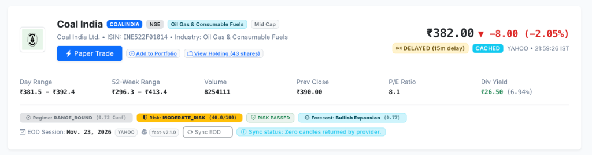
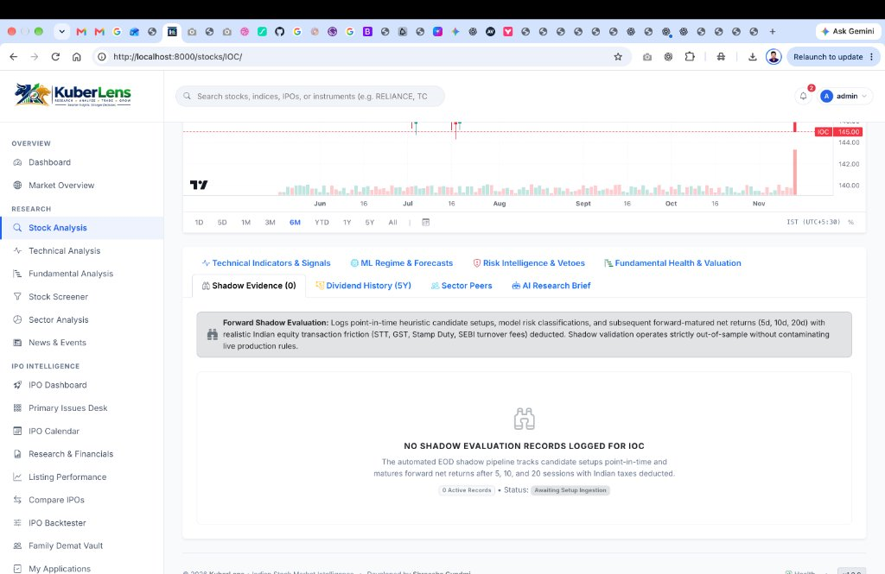

# KuberLens: Visual Page-by-Page Product Guide & Component Manual

**Document ID:** `docs/KUBERLENS_PAGE_BY_PAGE_USER_GUIDE.md`  
**Platform Version:** KuberLens v2.1.0 Institutional Edition  
**Audience:** Equity Research Analysts, Portfolio Managers, Swing Traders, and Engineers  
**Last Updated:** November 2026  

---

## Table of Contents

1. [Platform Overview & Navigation Architecture](#1-platform-overview--navigation-architecture)
2. [Chapter 1: Single-Stock Intelligence Cockpit (`/stocks/<symbol>/`)](#chapter-1-single-stock-intelligence-cockpit)
3. [Chapter 2: Market Overview & Executive Dashboard (`/`)](#chapter-2-market-overview--executive-dashboard)
4. [Chapter 3: Stock Directory & Autocomplete Search (`/stocks/`)](#chapter-3-stock-directory--autocomplete-search)
5. [Chapter 4: Technical Analysis Desk (`/research/technical/`)](#chapter-4-technical-analysis-desk)
6. [Chapter 5: Fundamental Analysis & Valuation Hub (`/research/fundamental/`)](#chapter-5-fundamental-analysis--valuation-hub)
7. [Chapter 6: Multi-Persona AI Stock Research Hub (`/research/ai/`)](#chapter-6-multi-persona-ai-stock-research-hub)
8. [Chapter 7: Quantitative Stock Screener (`/screener/`)](#chapter-7-quantitative-stock-screener)
9. [Chapter 8: Watchlists Manager (`/watchlists/`)](#chapter-8-watchlists-manager)
10. [Chapter 9: Portfolio Holdings & FIFO Capital Gains Ledger (`/portfolio/`)](#chapter-9-portfolio-holdings--fifo-capital-gains-ledger)
11. [Chapter 10: Quantitative Swing Trading & Position Sizing (`/trading/`)](#chapter-10-quantitative-swing-trading--position-sizing)
12. [Chapter 11: Strategy Backtesting Simulation Engine (`/backtesting/`)](#chapter-11-strategy-backtesting-simulation-engine)
13. [Chapter 12: Machine Learning Risk Dashboard & Shadow Validation (`/ml/risk-dashboard/`)](#chapter-12-machine-learning-risk-dashboard--shadow-validation)
14. [Chapter 13: IPO Intelligence Centre & Primary Issues Desk (`/ipo/`)](#chapter-13-ipo-intelligence-centre--primary-issues-desk)
15. [Chapter 14: PaperTrading Virtual Brokerage Terminal (`/papertrading/`)](#chapter-14-papertrading-virtual-brokerage-terminal)
16. [Chapter 15: Corporate News, Announcements & Dividends Calendar (`/news/`)](#chapter-15-corporate-news-announcements--dividends-calendar)
17. [Chapter 16: Django Admin & Automated EOD Pipeline Runner (`/admin/...`)](#chapter-16-django-admin--automated-eod-pipeline-runner)

---

## 1. Platform Overview & Navigation Architecture

KuberLens is structured into a persistent single-page-application (SPA) shell powered by Django and HTMX. The sidebar divides the platform into four primary disciplines:

```
├── OVERVIEW
│   ├── Executive Dashboard (/)
│   └── Market Overview (/markets/)
├── RESEARCH
│   ├── Stock Analysis (/stocks/<symbol>/)
│   ├── Technical Analysis (/research/technical/)
│   ├── Fundamental Analysis (/research/fundamental/)
│   ├── Stock Screener (/screener/)
│   ├── Sector Analysis (/stocks/sectors/)
│   └── News & Events (/news/)
├── IPO INTELLIGENCE
│   ├── IPO Dashboard (/ipo/)
│   ├── Primary Issues Desk (/ipo/desk/)
│   ├── GMP Tracker (/ipo/gmp/)
│   └── IPO Backtester (/ipo/backtest/)
└── TRADING & PORTFOLIO
    ├── Portfolio Holdings (/portfolio/holdings/)
    ├── Swing Trading Setups (/trading/)
    ├── Paper Trading Terminal (/papertrading/)
    └── AI/ML Risk Intelligence (/ml/risk-dashboard/)
```

---

## Chapter 1: Single-Stock Intelligence Cockpit

**URL Pattern:** `http://localhost:8000/stocks/<symbol>/` (e.g. `/stocks/COALINDIA/`, `/stocks/SBIN/`)  
**Target User:** All Users (Investors, Traders, Risk Officers)  
**Primary Purpose:** Unified real-time intelligence for an individual Indian equity, synthesizing live quotes, multi-factor ML regimes, automated risk vetoes, portfolio holdings, and empirical forward shadow evaluation evidence.

### Visual Preview


### Component-by-Component Breakdown

| Visual Zone | UI Element | What it Displays | How It Is Calculated | User Actions |
|---|---|---|---|---|
| **Header Banner** | Ticker & Company Identity | Symbol, legal name, ISIN, sector, and market cap tier. | Ingested from `ExchangeListing` and `Instrument` master tables. | Click **Paper Trade** to open order drawer, or **Add to Portfolio**. |
| **Quote Pill** | Live Tick & Change | Last traded price (LTP), net change, percentage gain/loss, and freshness timestamp. | Auto-refreshes every 15s via HTMX (`/stocks/<symbol>/quote/`). Sourced from Yahoo/Jugaad with caching. | Shows `(•) DELAYED (15m)` during active market or `CACHED` post-close. |
| **Quick Metrics Bar** | 6 Telemetry Tiles | Day Range, 52-Week High/Low, Volume, Previous Close, Trailing P/E, and Dividend Yield. | Aggregated server-side from `HistoricalCandle` and `FundamentalSnapshot`. | Assess valuation and trading range at a glance. |
| **Intelligence Strip** | **Regime Badge** | Market regime classification and confidence gauge (e.g. `RANGE_BOUND (0.72 Conf)`). | `MarketRegimeClassifier` evaluates ADX-14 and short/medium moving average dispersion. | Dictates appropriate strategy style (trend-follow vs mean-revert). |
| **Intelligence Strip** | **Risk Scorecard** | Quantitative risk tier and composite score (e.g. `MODERATE_RISK (40.0/100)`). | Weighted 5-factor risk model: regime stability, volatility, SMA-200 distance, NIFTY relative strength, earnings shock. | Dictates portfolio position sizing. |
| **Intelligence Strip** | **Risk Veto Status** | Hard safety badge (`RISK PASSED` in green or `VETOED` in red). | `MLRiskVetoEngine` tests hard stop conditions (penny volatility, extreme deviation $> 30\%$, structural breakdown). | If vetoed, hover or open Risk Tab to read explicit reasons. |
| **Intelligence Strip** | **Directional ML Forecast** | 10-session probability (e.g. `Forecast: Bullish Expansion (0.77)`). | `StockMLRanker` evaluates normalized multi-factor features (RSI, MACD, Bollinger %B, Volume Z-Score). | Institutional research indicator for swing timing. |
| **Data Provenance Strip** | **EOD Session Timestamp** | Benchmark cutoff date (e.g. `EOD Session: Nov. 23, 2026 [YAHOO]`). | Date of the latest closed daily candle in database. Guarantees 0 lookahead bias for indicators. | Identifies freshness of chart indicators. |
| **Data Provenance Strip** | **[ ↻ Sync EOD ]** | On-demand candle ingestion button with inline spinner. | Triggers `StockSyncEODView` (`POST /stocks/<symbol>/sync-eod/`). Queries Yahoo/Jugaad and appends candles. | Click to bring non-pilot stocks up to yesterday's market close. |
| **Active Portfolio Card** | Position & P&L Banner | Conditionally rendered when user holds shares (e.g. `43 Shares`, `Avg Price`, `Invested`, `Unrealized P&L`). | Matches user's FIFO tax lots against current market price. Calculates position allocation percentage. | Jump to **Position Ledger** or **Record Transaction**. |
| **Interactive Chart** | TradingView Candlestick Engine | Multi-timeframe canvas with volume sub-pane and technical overlays. | TradingView Lightweight Charts (v4.2.1) loaded from `/stocks/<symbol>/chart-data/`. | Toggle SMA (20, 50, 200), EMA (9, 20, 50), VWAP, SuperTrend, Bollinger Bands, and Fibonacci levels. |
| **Deep-Dive Tabs** | 6 Intelligence Panes | Technical Indicators, ML Regimes & Forecasts, Risk Scorecard, Fundamentals, Shadow Evidence, Dividend History. | Detailed breakdowns from each respective analytical engine. | Review full 5-year dividend history and institutional peer valuation. |

### The Shadow Evidence Pane


- **Purpose:** Operates strictly out-of-sample. Displays heuristic candidate setups (`TREND_PULLBACK_HEURISTIC`) logged by the automated EOD pipeline and their matured forward net returns after **5d, 10d, and 20d sessions**.
- **Interactive Trigger:** Features an on-demand **`[ ▶ Run Shadow Evaluation ]`** button wired via HTMX (`POST /stocks/<symbol>/shadow-run/`) that evaluates setups and matures returns on the fly.
- **Transaction Friction:** Every forward return has realistic Indian CNC equity charges (STT, GST, Stamp Duty, SEBI turnover fees, and 0.05% slippage) deducted.

---

## Chapter 2: Market Overview & Executive Dashboard

**URL:** `http://localhost:8000/`  
**Primary Purpose:** Macro-level vantage point of the Indian market session, tracking benchmark indices (NIFTY 50, SENSEX, BANK NIFTY), market breadth (Advances/Declines), top sectoral movers, and user portfolio health.

### Component Breakdown
1. **Ticker Tape Bar:** Rolling ticker displaying real-time index values, point change, and percentage movement for NIFTY 50, NIFTY BANK, SENSEX, and INDIA VIX.
2. **Market Breadth Gauge:** Visual bar indicating the ratio of advancing stocks versus declining stocks across NSE equities for the current session.
3. **Sector Heatmap:** Interactive tiles color-coding major indices (NIFTY IT, NIFTY PHARMA, NIFTY AUTO, NIFTY METAL) by percentage change.
4. **Portfolio Quick Summary:** Shows net portfolio equity, today's P&L, overall unrealized gain, and cash balance.

---

## Chapter 3: Stock Directory & Autocomplete Search

**URL:** `http://localhost:8000/stocks/`  
**Primary Purpose:** Directory of all active tradeable exchange listings with multi-attribute filtering (Sector, Market Cap, Exchange) and fast global header search.

### Component Breakdown
1. **Global Autocomplete Search (`/stocks/search/?q=...`):** Instant search bar in the top navigation supporting ticker symbols, company legal names, display names, and ISIN codes with typo tolerance.
2. **Directory Filter Pills:** Quick filters for Large Cap, Mid Cap, Small Cap, and specific industry sectors.
3. **Listing Cards / Table:** Displays symbol, exchange badge, company name, live price, and 1-day change with 1-click navigation to the Stock Intelligence Cockpit.

---

## Chapter 4: Technical Analysis Desk

**URL:** `http://localhost:8000/research/technical/`  
**Primary Purpose:** In-depth technical indicator workbench for chartists and quant traders.

### Component Breakdown
1. **Trend Strength Matrix:** Evaluates short-term (SMA 20), medium-term (SMA 50), and long-term (SMA 200) trend alignments.
2. **Oscillator Dashboard:** Displays RSI-14, Stochastic RSI (%K / %D), and MACD signal histogram with color-coded overbought/oversold boundaries.
3. **Volatility & Channel Levels:** Bollinger Band width, standard deviation squeeze indicators, and Average True Range (ATR-14).
4. **Pivot Points & S/R Table:** Classic, Fibonacci, and Camarilla support and resistance price levels.

---

## Chapter 5: Fundamental Analysis & Valuation Hub

**URL:** `http://localhost:8000/research/fundamental/`  
**Primary Purpose:** Corporate balance sheet analysis, profitability metrics, valuation multiples, and dividend sustainability.

### Component Breakdown
1. **Valuation Multiples Grid:** Trailing P/E, Forward P/E, Price-to-Book (P/B), EV/EBITDA, and Sector-relative P/E discount/premium.
2. **Profitability & Capital Efficiency:** Return on Equity (ROE %), Return on Capital Employed (ROCE %), Operating Margin %, and Net Profit Margin %.
3. **Solvency & Liquidity:** Debt-to-Equity ratio, Current Ratio, and Interest Coverage.
4. **5-Year Dividend History:** Annualized payout rate, dividend yield %, payout frequency, and historical distribution table.

---

## Chapter 6: Multi-Persona AI Stock Research Hub

**URL:** `http://localhost:8000/research/ai/`  
**Primary Purpose:** AI-driven fundamental and technical research syntheses tailored to three institutional personas.

### Component Breakdown
1. **Persona Switcher:**
   - **Value Investor:** Focuses on moat, free cash flow yield, debt safety, and 3–5 year intrinsic valuation.
   - **Swing Trader:** Focuses on momentum setups, volume spikes, support/resistance breakouts, and risk-reward ratios.
   - **Risk Officer:** Focuses on downside exposure, tail-risk vetoes, beta vs Nifty, and stop-loss placement.
2. **Synthesized Research Brief:** Narrative assessment generated by Google Gemini with deterministic fallback when offline.
3. **Data Quality Audit Footnote:** Lists exact data snapshot timestamps used by the AI to guarantee zero hallucinations.

---

## Chapter 7: Quantitative Stock Screener

**URL:** `http://localhost:8000/screener/`  
**Primary Purpose:** Multi-variable scanning engine filtering across fundamental and technical metrics simultaneously.

### Component Breakdown
1. **Preset Scanners:** One-click institutional presets:
   - *Growth at Reasonable Price (GARP)*
   - *High Dividend Yield Aristocrats*
   - *Oversold Pullback in Bullish Uptrend*
   - *Breakout Above 52-Week High with High Volume*
2. **Custom Multi-Variable Filter Builder:** Sliders and bounds for Market Cap, P/E, ROE, RSI-14, Volume, and SMA crossover filters.
3. **Export Actions:** Download matching candidates directly as CSV or add them to a Watchlist.

---

## Chapter 8: Watchlists Manager

**URL:** `http://localhost:8000/watchlists/`  
**Primary Purpose:** Custom user-defined watchlists with real-time price updates and alert triggers.

### Component Breakdown
1. **Watchlist Tabs:** Group stocks into custom portfolios (e.g., "Core Holdings", "Breakout Radar", "High Yield Energy").
2. **Live Watchlist Table:** Mini candlestick sparklines, current price, change %, day's range, and 1-click removal.
3. **Quick Add Bar:** Instant ticker input to add equities to any active list.

---

## Chapter 9: Portfolio Holdings & FIFO Capital Gains Ledger

**URL:** `http://localhost:8000/portfolio/` & `/portfolio/holdings/`  
**Primary Purpose:** Institutional portfolio management complying with Indian tax laws (FIFO lot matching, short-term vs long-term capital gains classification).

### Component Breakdown
1. **Portfolio Telemetry:** Total Portfolio Value, Invested Capital, Unrealized P&L, Realized P&L, and Cash Balance.
2. **Holdings Ledger Table:** Grouped by symbol showing shares held, weighted average buy price, current market value, and day's change.
3. **Tax Lot Inspector (FIFO):** Drill-down view showing every purchase transaction lot with date, quantity, purchase price, and holding duration.
4. **Dual Recommendation Card:** Action recommendations tailored specifically for existing holders (e.g. *HOLD & ACCUMULATE ON PULLBACK*) versus prospective fresh buyers.

---

## Chapter 10: Quantitative Swing Trading & Position Sizer

**URL:** `http://localhost:8000/trading/`  
**Primary Purpose:** Mathematical trade planning, risk-reward calculation, and fixed-fractional position sizing.

### Component Breakdown
1. **Candidate Setups Desk:** Real-time screener identifying equities qualifying for quantitative setups (Trend Pullback, Volatility Squeeze, Mean Reversion).
2. **Mathematical Position Sizer:** Inputs user capital, account risk % (e.g. 1.0%), and stop-loss price; outputs exact allowable share quantity.
3. **Trade Journal Bridge:** One-click button to record the planned setup into the persistent Trade Journal with an entry checklist.

---

## Chapter 11: Strategy Backtesting Simulation Engine

**URL:** `http://localhost:8000/backtesting/`  
**Primary Purpose:** Point-in-time chronological strategy simulation with zero lookahead bias, incorporating execution slippage and Indian statutory taxes.

### Component Breakdown
1. **Simulation Configuration:** Select strategy logic, universe, date range, initial capital, and friction parameters.
2. **Equity Curve Visualization:** Interactive chart comparing strategy equity curve against the NIFTY 50 benchmark.
3. **Performance Metrics Card:** Total Net Return %, Compound Annual Growth Rate (CAGR %), Maximum Drawdown %, Sharpe Ratio, Win Rate %, and Profit Factor.

---

## Chapter 12: Machine Learning Risk Dashboard & Shadow Validation

**URL:** `http://localhost:8000/ml/risk-dashboard/`  
**Primary Purpose:** Production monitoring cockpit for machine learning models, operational pipeline health, and forward shadow evaluation.

### Component Breakdown
1. **Pipeline Operational Health Banner:** Shows status (`HEALTHY`, `WAITING_FOR_DATA`, `DEGRADED`, `STALE`), active database lease owner, and heartbeat timestamp.
2. **Candidate Extraction Telemetry:** Total candidate setups evaluated, accepted setups, and vetoed setups count.
3. **Empirical Shadow Performance Table:** Aggregated hit rates, average returns, and Sharpe ratios across 5-day, 10-day, and 20-day matured horizons.
4. **Model Drift & Monitoring Events:** Live log of events recorded in `MLMonitoringEvent`.

---

## Chapter 13: IPO Intelligence Centre & Primary Issues Desk

**URL:** `http://localhost:8000/ipo/`  
**Primary Purpose:** Complete 8-stage tracking for Mainboard and SME initial public offerings in India.

### Component Breakdown
1. **IPO Calendar & Pipeline:** Upcoming, open, and recently listed IPOs categorized by issue dates.
2. **Grey Market Premium (GMP) Tracker:** Unofficial market sentiment, trend movement, and estimated listing gain %.
3. **Subscription Telemetry Breakdown:** Real-time subscription multiples across QIB (Qualified Institutional Buyers), NII (Non-Institutional), and Retail categories.
4. **Allotment Probability Estimator:** Mathematical bid optimization calculator estimating retail allotment odds based on subscription multiples.

---

## Chapter 14: PaperTrading Virtual Brokerage Terminal

**URL:** `http://localhost:8000/papertrading/`  
**Primary Purpose:** Zero-risk virtual trading simulation environment with realistic execution friction and live MTM tracking.

### Component Breakdown
1. **Account Header:** Virtual capital balance (₹10,00,000 default), margin utilized, and daily MTM P&L.
2. **Kite-Style Order Drawer:** Sliding offcanvas drawer supporting Market and Limit orders for CNC (Delivery) and MIS (Intraday with leverage).
3. **Live Positions Table:** Real-time mark-to-market valuations, stop-loss triggers, and 1-click square-off.
4. **Friction Accounting:** Deducts statutory STT, GST, Stamp Duty, and exchange turnover fees on every fill.

---

## Chapter 15: Corporate News, Announcements & Dividends Calendar

**URL:** `http://localhost:8000/news/`  
**Primary Purpose:** Exchange filings, dividend declarations, stock splits, bonus issues, and board meetings.

### Component Breakdown
1. **Corporate Action Timeline:** Upcoming Ex-Dates and Record Dates for dividends, bonuses, and splits.
2. **Exchange Filings Feed:** Corporate announcements submitted to NSE/BSE filtered by user watchlists and holdings.
3. **Sentiment Tagging:** Automated sentiment classification (Positive, Neutral, Negative) for incoming market announcements.

---

## Chapter 16: Django Admin & Automated EOD Pipeline Runner

**URL:** `http://localhost:8000/admin/ml_engine/mlshadowpipelinerun/run-pipeline/`  
**Primary Purpose:** Administrative command desk to trigger, parameterize, and inspect end-of-day risk intelligence and shadow pipelines.

### Component Breakdown
1. **Parameter Execution Form:** Configure session date, universe (Pilot 11 or custom list), lookback days, and force execution flags.
2. **Pipeline Runs Change List:** Historical table of all pipeline runs with execution duration, candidate counts, health status, and failure logs.
3. **Direct Database Admin:** Inspection of `MLModelRecord`, `MLShadowEvaluationRecord`, and `MLPipelineLease`.
