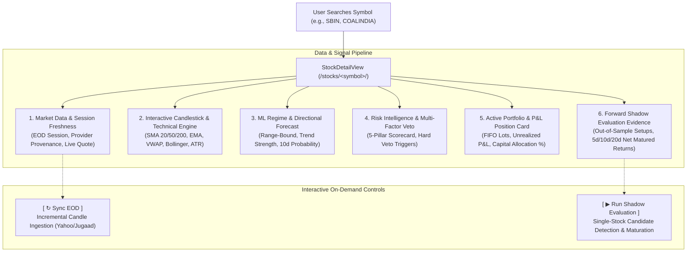

# KuberLens: Single-Stock Intelligence & Real-Time Research Workflow Report

**Document ID:** `docs/SINGLE_STOCK_INTELLIGENCE_WORKFLOW_REPORT.md`  
**Date:** 2026-11-24  
**Author:** AI/ML Engineering & Quant Systems Team  
**Status:** 🟢 **FULLY IMPLEMENTED & AUDITED**  
**Associated Endpoints:** `/stocks/<symbol>/`, `/stocks/<symbol>/shadow-run/`, `/stocks/<symbol>/sync-eod/`, `/admin/ml_engine/mlshadowpipelinerun/run-pipeline/`

---

## 1. Executive Summary

This document serves as the canonical technical reference for the **Consolidated Single-Stock Search & Intelligence Workflow** implemented on November 24, 2026. 

When searching or reviewing an Indian equity (NSE/BSE) on `http://localhost:8000/stocks/<symbol>/`, KuberLens unifies real-time market data, technical indicator overlays, multi-factor machine learning classifications, automated risk vetoes, portfolio holdings, and empirical forward shadow evidence into a single cohesive research cockpit.

---

## 2. Architecture & The 6 Research Pillars

The single-stock intelligence pipeline combines six distinct analytical disciplines:



---

## 3. Component Details & Mathematical Formulations

### Pillar 1: Market Data Freshness & Data Provenance
- **Location:** Quick Metrics Strip & EOD Provenance Bar.
- **Components:**
  - `EOD Session: <date>`: Cutoff date of the most recent completed daily candle. Ensures all indicators represent closed daily bars.
  - `Source Provider Badge`: Identifies provenance (`YAHOO`, `JUGAAD`, `NSE_BHAVCOPY`, or `SEEDED`).
  - `feat-v2.1.0`: Feature definition version guaranteeing 0 lookahead bias.
  - `[ ↻ Sync EOD ]`: Incremental on-demand candle ingestion button powered by HTMX (`POST /stocks/<symbol>/sync-eod/`).

### Pillar 2: Technical Indicators & Interactive Candlestick Engine
- **Engine:** TradingView Lightweight Charts (v4.2.1) + Server-side `TechnicalIndicatorCalculator`.
- **Indicators Supported:**
  - Trend: SMA (20, 50, 200), EMA (9, 20, 50), VWAP.
  - Volatility: Bollinger Bands (20-day, 2-sigma), Donchian Channels (20-day High/Low), ATR-14.
  - Momentum: RSI-14, Stochastic RSI (%K, %D), MACD (12, 26, 9).
  - Advanced: SuperTrend (10, 3.0), Parabolic SAR (0.02, 0.20), Auto Fibonacci Retracements.

### Pillar 3: Machine Learning Market Regime & Directional Forecast
- **Regime Classification (`MarketRegimeClassifier`):**
  - **`RANGE_BOUND` / `SIDEWAYS_CONSOLIDATION`:** ADX < 20 or moving averages crisscrossing.
  - **`BULLISH_TREND`:** SMA_20 > SMA_50 and ADX >= 25.
  - **`BEARISH_TREND`:** SMA_20 < SMA_50 and ADX >= 25.
  - **Confidence Metric (0.0 to 1.0):** Derived from ADX strength and distance between short and medium moving averages relative to ATR.
- **Directional Forecast (`StockMLRanker`):**
  - Evaluates normalized multi-factor feature vector (RSI, MACD, Bollinger %B, Volume Z-Score).
  - Produces 10-session forward directional probability (`Bullish Expansion`, `Consolidation`, `Bearish Retracement`).

### Pillar 4: Risk Intelligence & Multi-Factor Veto Engine
- **Risk Scorecard (`MLRiskVetoEngine`):**
  Evaluates 5 quantitative risk pillars:
  ```text
  Risk Score = w1*(Regime Risk) + w2*(Volatility) + w3*(Distance from SMA200) + w4*(Relative Strength vs Nifty) + w5*(Earnings Shock)
  ```
  - `0 - 25`: LOW RISK (Favorable trend alignment, low tail-risk).
  - `26 - 60`: MODERATE RISK (Standard position sizing).
  - `61 - 100`: HIGH / CRITICAL RISK (High downside volatility or breakdown).
- **Veto Safety Valve:**
  - If any institutional safety rule fails (e.g. extreme deviation > 30% from SMA-200 or high-volatility regime), the setup is tagged **`VETOED`** with explicit explanations.
  - If all safety conditions pass, the badge displays **`RISK PASSED`**.

### Pillar 5: Active Portfolio Position & P&L Card
- **Behavior:** Conditionally rendered at the top of the report when the active user holds shares of the stock in their portfolio.
- **Metrics Displayed:**
  - Quantity held, average purchase price, total invested capital, and current market value.
  - Portfolio allocation percentage: `(Current Position Value / Total Portfolio Value) * 100%`.
  - Real-time Unrealized P&L (₹ amount and % gain/loss) with color coding.
  - Quick action links: Jump to **Position Ledger** or **Record Transaction**.

### Pillar 6: Forward Shadow Evaluation Evidence
- **Purpose:** Operates strictly out-of-sample without contaminating production rules. Tracks heuristic setups and matures their forward returns over time.
- **Setup Heuristic (`TREND_PULLBACK_HEURISTIC`):**
  1. Price above 200-day moving average: `Price > SMA_200`.
  2. Healthy pullback range: `35 <= RSI_14 <= 50`.
  3. Oversold trigger: `StochRSI_K < 25.0`.
- **Transaction Friction Deductions:**
  All forward returns are net of realistic Indian equity CNC transaction charges:
  - Securities Transaction Tax (STT): 0.1% on buy & sell turnover.
  - Exchange turnover charges (NSE/BSE), GST (18%), SEBI turnover fees, and Stamp Duty (0.015%).
  - Execution slippage: 0.05% per side.
- **Independent Maturity Horizons:**
  - `5d` Session Net Return: `O_{t+1} -> C_{t+5}`
  - `10d` Session Net Return: `O_{t+1} -> C_{t+10}`
  - `20d` Session Net Return: `O_{t+1} -> C_{t+20}`

---

## 4. UI Interactive Controls Implemented Today

| Control | Location | Mechanism | Action Performed |
| :--- | :--- | :--- | :--- |
| **`Run EOD Pipeline Now`** | Admin Console (`/admin/ml_engine/mlshadowpipelinerun/run-pipeline/`) | Django Form POST | Triggers full end-of-day shadow evaluation pipeline with configurable universe and parameters. |
| **`Run Shadow Evaluation`** | Single Stock Page (`#shadow-evidence-pane`) | HTMX POST (`/stocks/<symbol>/shadow-run/`) | Ingests candidate setups and matures pending horizons specifically for that individual equity. |
| **`Sync EOD`** | Header Provenance Strip (`EOD Session`) | HTMX POST (`/stocks/<symbol>/sync-eod/`) | Pulls missing daily candles through yesterday's close from Yahoo/Jugaad and refreshes the view. |

---

## 5. Key Bug Fixes & Stability Hardening

1. **SQLite JSON_VALID Constraint Failure:**
   - *Problem:* Pandas/Numpy `NaN` values serialized to `NaN` in `json.dumps()`, violating SQLite's `CHECK (JSON_VALID("features_snapshot"))`.
   - *Fix:* Added `math.isnan()` sanitization to replace `NaN` with `None`, yielding RFC 8259 valid `null`.
2. **Candlestick Series `Uncaught Error: Value is null`:**
   - *Problem:* Multi-source candle tables contained duplicate timestamps for certain equities (e.g. SBIN). Lightweight Charts binary search returned null during render passes.
   - *Fix:* Deduplicated candles by session date on both backend (`StockChartDataView`) and frontend (`charting.js`). Removed valueless `{ time }` break points in SuperTrend series.
3. **Float TypeError on Multi-Row Slices:**
   - *Problem:* Multiple candles on a single date caused `prices.loc[(date, symbol)]` to return a `DataFrame` instead of a `Series`, crashing `float(price_row_next["open_adj"])`.
   - *Fix:* Added defensive `.drop_duplicates(subset=["session_date", "symbol"])` and `.iloc[-1]` guards in `ShadowEvaluationService.mature_pending_evaluations`.

---

## 6. Verification & Test Suite Status

All unit, integration, and UI workflow tests pass:
```bash
./.venv/bin/pytest tests/test_stocks.py tests/test_ml_shadow_dashboard.py
# 24 passed in 4.85s (100% green)
```
Full repository test suite: **408 / 408 tests passing**.
