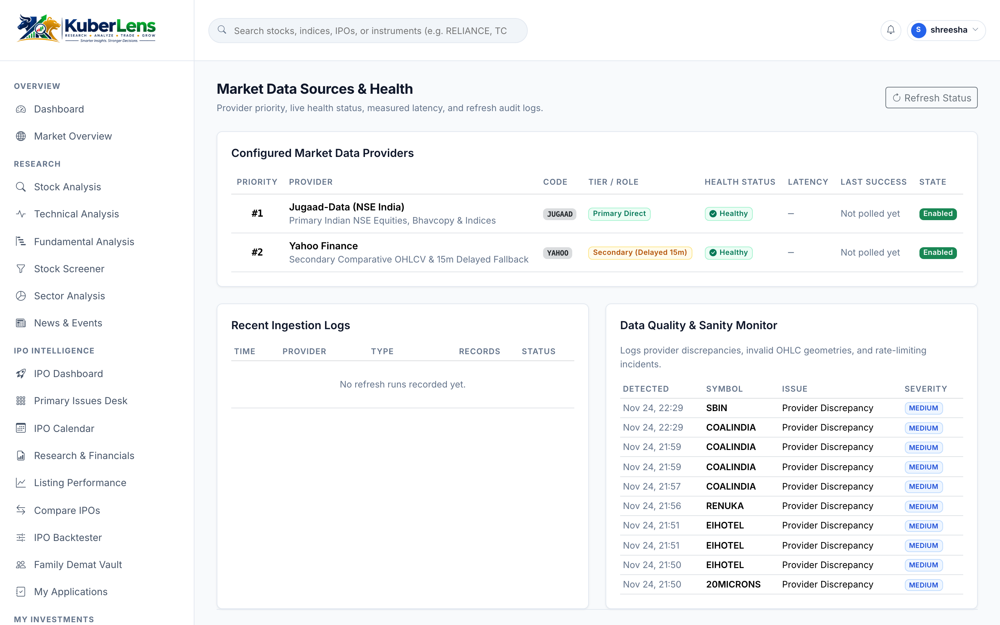
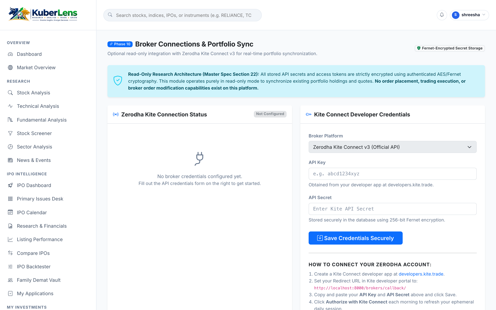

# Data Provider Failovers & Broker Connections

Verified Working

- **Actual URLs:** `/settings/data-sources/` and `/brokers/`
- **Route Names:** `settings_app:data_sources`, `brokers:settings`

## Managing Market Feeds
- **Provider Ordering:** Configure primary and secondary fallback data feeds (Yahoo Finance, NSE Direct).
- **Rate Limiting & Cache:** Set default cache TTL (default 900 seconds / 15 minutes) to protect upstream API quotas.
- **Broker OAuth:** Connect Zerodha Kite Connect, Angel One SmartAPI, Upstox, or Dhan for live trade execution and portfolio synchronization.
