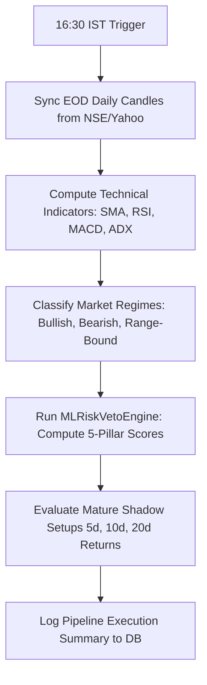

# Batch EOD Shadow Pipeline Runner

<span class="badge-status badge-verified">Verified Working</span>

- **Admin URL:** `/admin/ml_engine/mlshadowpipelinerun/run-pipeline/`
- **CLI Command:** `python manage.py run_shadow_eod_pipeline`

## 1. Operational Overview
The **End-Of-Day (EOD) Shadow Pipeline** is the automated batch process that runs every evening after Indian market close (16:30 IST).



## 2. CLI Execution
To manually trigger the pipeline for the entire stock universe:
```bash
python manage.py run_shadow_eod_pipeline
```

To run for a specific symbol:
```bash
python manage.py run_shadow_eod_pipeline --symbol COALINDIA
```
