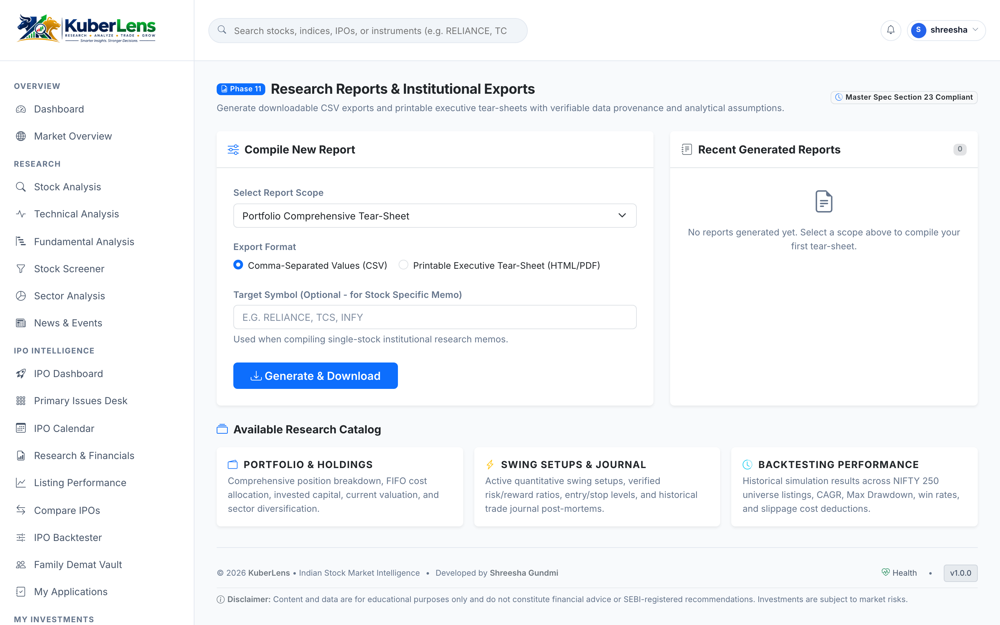

# Reports, Tax P&L & Capital Gains Export

Verified Working

- **Actual URL:** `/reports/`
- **Route Name:** `reports:center`
- **Sidebar Location:** System > Reports & Exports

## Financial Year Statements
- **Tax P&L Statement:** Categorizes Short-Term Capital Gains (STCG, Section 111A) and Long-Term Capital Gains (LTCG, Section 112A).
- **Turnover Audit Report:** Summarizes F&O and intraday turnover for income tax audit compliance.
