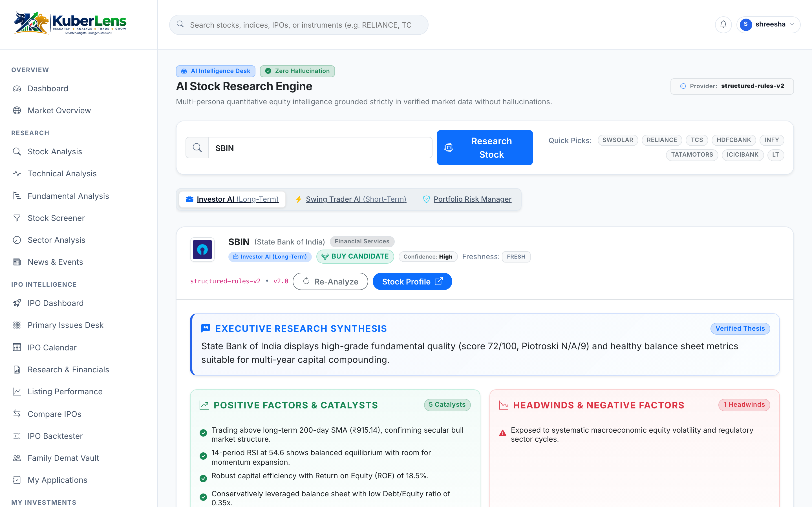

# Multi-Persona AI Stock Research Hub

Verified Working

- **Actual URL:** `/research/ai/?symbol=SBIN&role=INVESTOR`
- **Route Name:** `ai_analysis:hub`
- **Sidebar Location:** Intelligence > AI Stock Research

## 1. Page Purpose
The **AI Stock Research Hub** synthesizes quantitative signals, technical indicators, fundamental balance sheets, and news sentiment into an institutional brief.
- Supports multi-persona viewpoints: **Investor** (long-term fundamentals), **Swing Trader** (momentum & levels), and **Risk Auditor** (downside stress testing).
