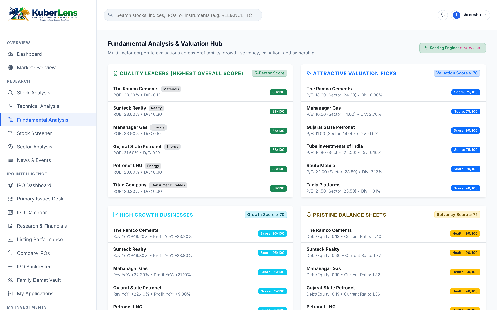

# Fundamental Health & Valuation Hub

Verified Working

- **Actual URL:** `/research/fundamental/`
- **Route Name:** `fundamental_analysis:overview`
- **Sidebar Location:** Research > Fundamental Analysis

## 1. Page Purpose
The **Fundamental Analysis Hub** decodes audited annual and quarterly financial statements into clean institutional valuation ratios.

## 2. Financial Metrics Breakdown
- **Valuation Ratios:** Price-to-Earnings (P/E), Price-to-Book (P/B), Enterprise Value to EBITDA (EV/EBITDA).
- **Profitability Metrics:** Return on Equity (ROE), Return on Capital Employed (ROCE), Operating Profit Margin (OPM %).
- **Solvency & Health:** Debt-to-Equity ratio, Interest Coverage Ratio, Current Ratio.
- **Shareholding Pattern:** Promoter holding %, FII holding %, DII holding %, and Public float.
