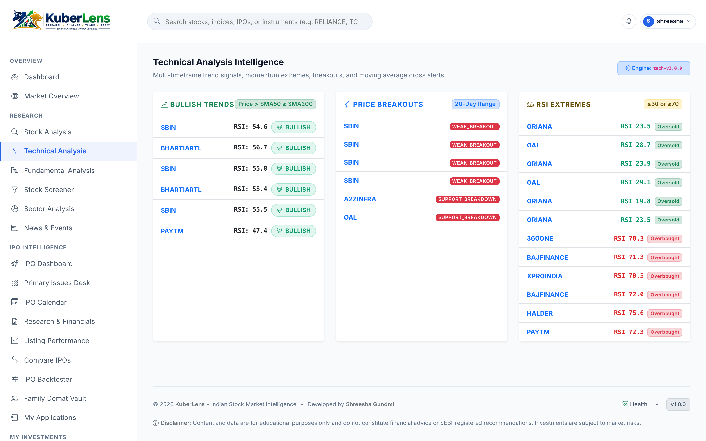

# Technical Analysis Desk

Verified Working

- **Actual URL:** `/research/technical/`
- **Route Name:** `technical_analysis:overview`
- **Sidebar Location:** Research > Technical Analysis

## 1. Page Purpose
The **Technical Analysis Desk** provides an advanced charting workbench designed for momentum, trend-following, and breakout traders.

## 2. Oscillator & Indicator Suite
- **Relative Strength Index (RSI 14):** Evaluates overbought ($> 70$) and oversold ($< 30$) levels.
- **Moving Average Convergence Divergence (MACD 12, 26, 9):** MACD Line, Signal Line, and Histogram.
- **Average Directional Index (ADX 14):** Trend strength gauge. Values $> 25$ indicate a strong trend; $< 20$ indicate sideways range.
- **Stochastic RSI (StochRSI):** Highly sensitive momentum oscillator tracking RSI within its 14-period range.
