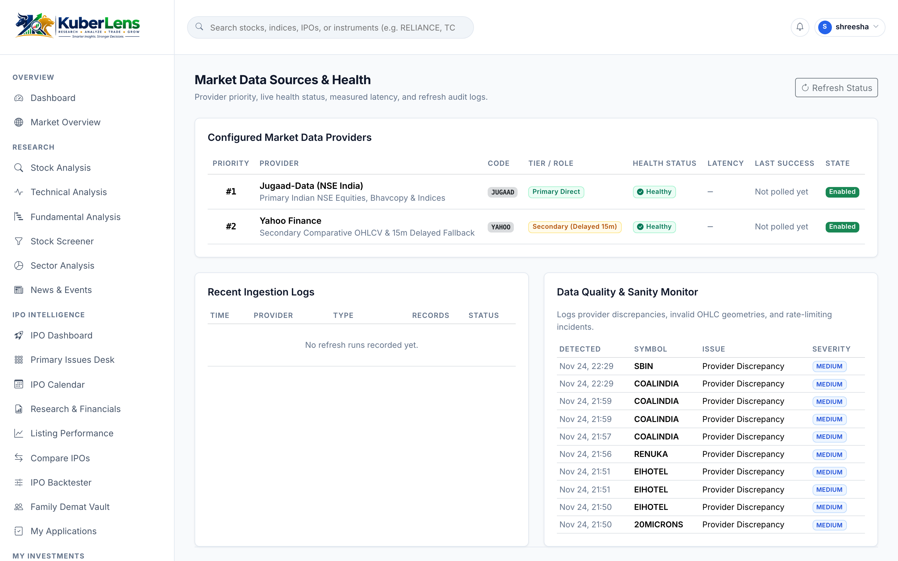
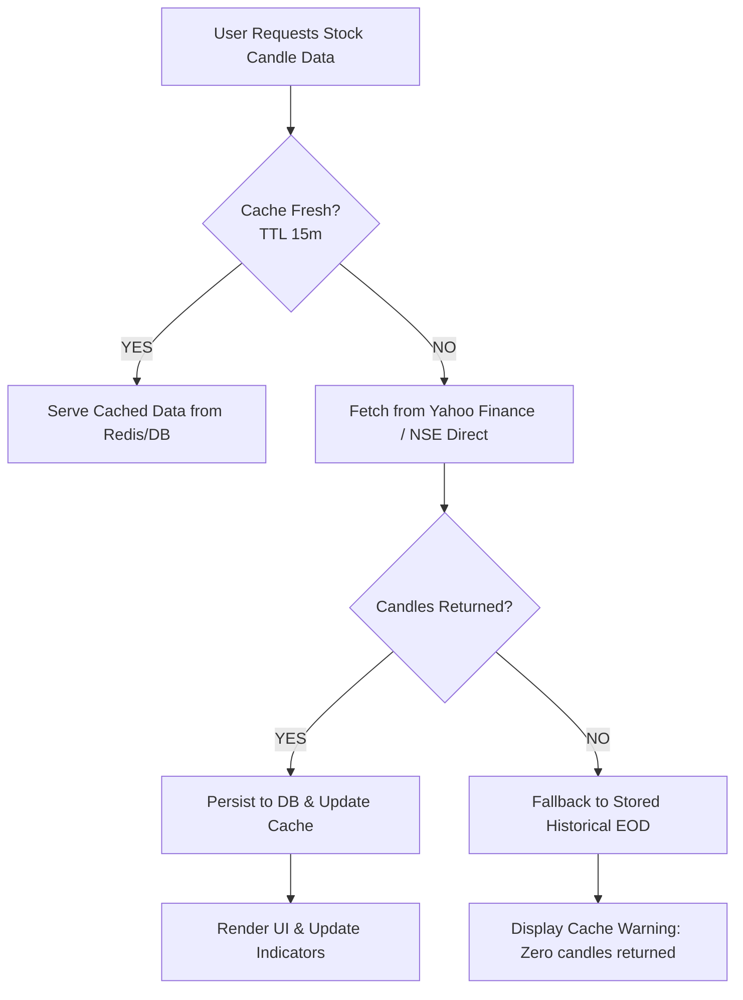

# Market Feeds, Data Sources & EOD Sync

Verified Working

## Data Architecture & Freshness Pipeline

KuberLens utilizes a multi-tiered data fetching architecture:

## Understanding Data Freshness Badges

On the Stock Intelligence header and overview screens, you will encounter the following real-time badges:

1. DELAYED (15m delay): Indicates intraday market prices are delayed by 15 minutes as per standard non-commercial exchange distribution terms.
2. CACHED: Indicates candle data was retrieved from the local database cache within its 15-minute Time-To-Live (TTL) window, avoiding unnecessary external API rate limits.
3. `EOD Session: Nov. 23, 2026`: Displays the mature calendar date of the last completed trading day.
4. `Sync status: Zero candles returned by provider`: Appears when the upstream provider returned no new daily bars (e.g. during market holidays, weekends, or before exchange EOD settlement).

## Manual EOD Synchronization
To manually pull the latest candles and trigger recalculation of moving averages, RSI, and ML regimes:
1. Navigate to the stock detail page (e.g. `/stocks/COALINDIA/`).
2. Click the **Sync EOD** button located in the data diagnostics toolbar.
3. The platform sends an asynchronous background request to refresh candles.
