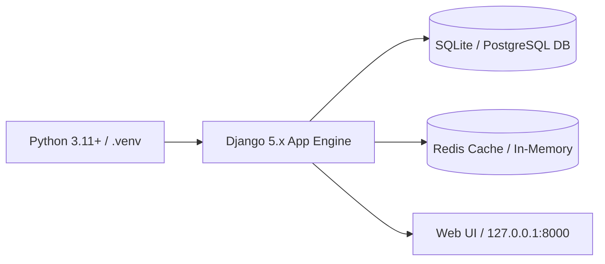

# Quick Start & Platform Installation

<span class="badge-status badge-verified">Verified Working</span>

## Overview & Architecture
KuberLens is a full-stack Django 5.x application engineered for financial analytics, algorithmic market screening, and quantitative machine learning. It runs locally on macOS, Linux, and Windows systems with Python 3.11+.



## System Requirements
- **Python:** Python 3.11 or Python 3.13 (recommended).
- **Virtual Environment:** Dedicated `.venv` isolating dependencies.
- **Database:** SQLite (default for development/local research) or PostgreSQL.
- **Node/Front-end:** Pure vanilla JavaScript with TradingView Lightweight Charts (no Node build step required).

## Step-by-Step Installation

### 1. Environment Activation
Activate the existing virtual environment in the project directory:
```bash
cd stockmarket_analytics_django
source .venv/bin/activate
```

### 2. Dependency Verification
Ensure all required libraries are installed:
```bash
pip install -r requirements/development.txt
```

### 3. Database Migrations
Run Django migrations to initialize the 38 database tables:
```bash
python manage.py migrate
```

### 4. Running the Development Server
Start the local development server:
```bash
python manage.py runserver 127.0.0.1:8000
```
Open your browser and navigate to `http://127.0.0.1:8000/`.

## Operational Verification
To confirm that all apps and data models are functioning:
```bash
python manage.py check
```
