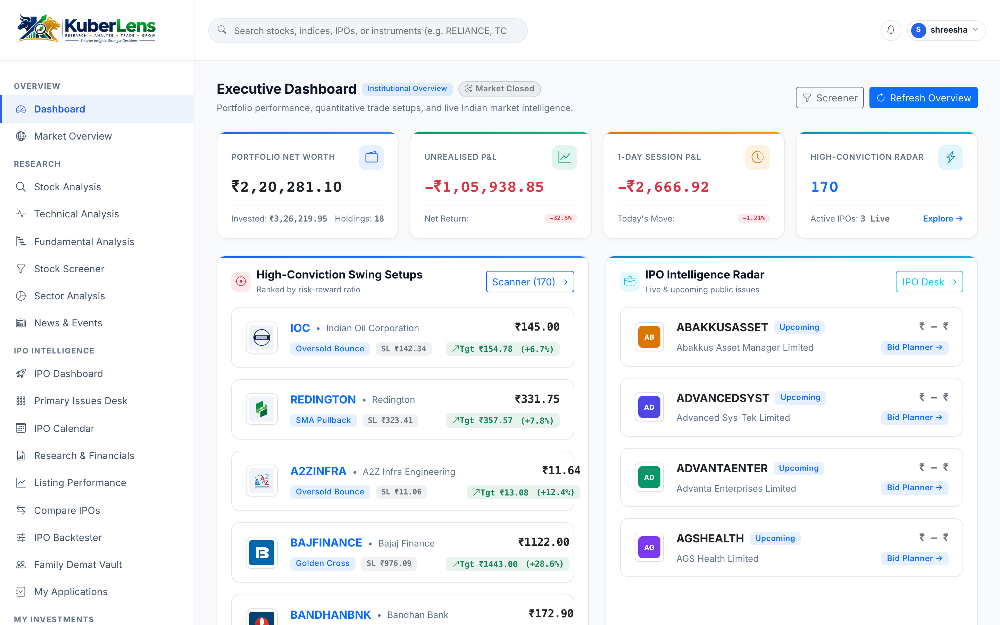

# Platform Interface & Navigation

Verified Working

## Overview
The KuberLens interface is engineered for institutional focus, rapid keyboard-driven navigation, and zero cognitive clutter. The layout consists of three primary zones:

1. **Collapsible Sidebar (Left):** Categorized access to all 38 platform features across 7 operational modules.
2. **Top Navigation Bar:** Global ticker search, live time display (IST), notifications center, and user profile switcher.
3. **Execution Workspace (Main):** Dynamic research desks, interactive charting canvases, and data tables.

## Sidebar Navigation Hierarchy

| Module | Core Pages Included | Target Workflow |
|--------|---------------------|-----------------|
| **Overview** | Market Dashboard, Market Overview | Macro index tracking, market breadth, top movers. |
| **Research** | Stock Directory, Single Stock Cockpit, Technicals, Fundamentals, Screener, Sectors, News | Deep multi-factor equity research. |
| **IPO Intelligence** | Dashboard, Primary Issues Desk, Calendar, RHP Analysis, Backtester, Family Vault | Primary market IPO tracking and subscription management. |
| **My Investments** | Portfolio Overview, Holdings Ledger, Watchlists, Investment Journal | Long-term capital tracking and conviction logging. |
| **Trading** | Paper Trading Terminal, Swing Scanner, Trade Journal, Backtester, F&O Desk, Risk Calculator | Active strategy execution and position sizing. |
| **Intelligence** | AI Stock Research, Recommendations, ML Predictions Engine, Risk Intelligence | Probabilistic machine learning and 5-factor risk scoring. |
| **System** | Data Sources, Broker Integrations, Tax Reports, Profile Settings | Data feeds, API credentials, and financial exports. |

## Quick Action Shortcuts
- <kbd>/</kbd> or <kbd>Cmd</kbd>+<kbd>K</kbd>: Focus Global Stock Search.
- <kbd>Esc</kbd>: Dismiss modal dialogs or dropdown menus.
