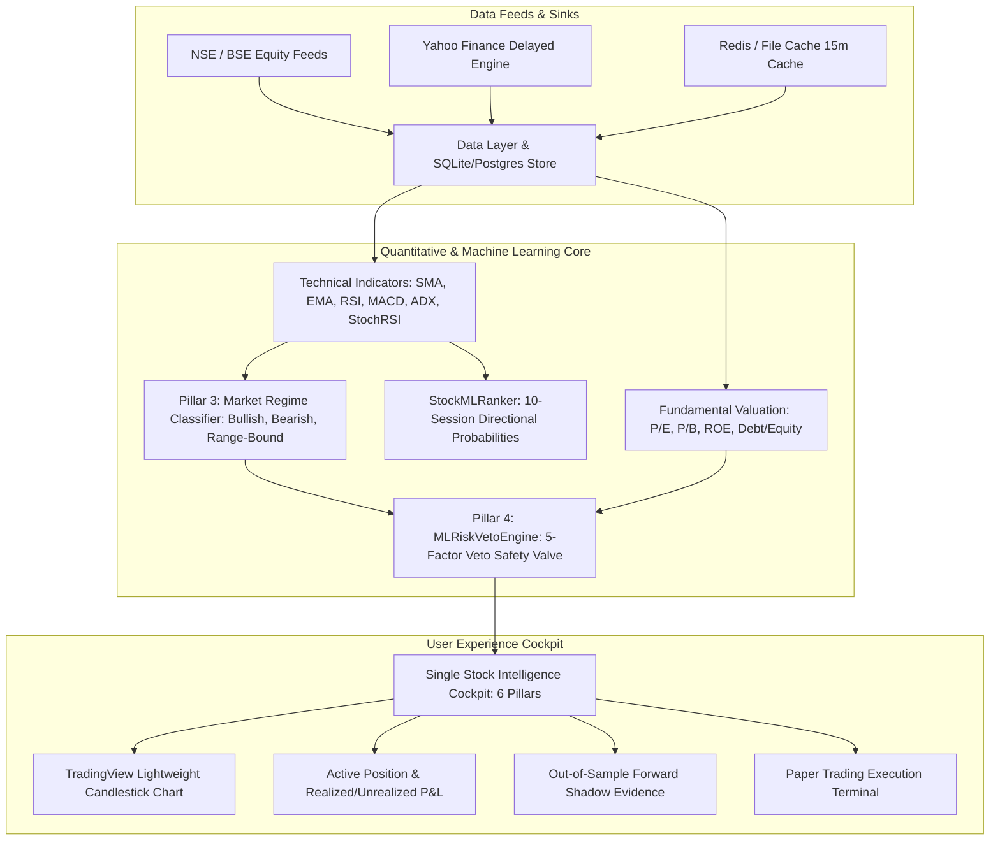

# KuberLens V1.0 User Guide & Documentation

Welcome to the official, verified **KuberLens V1.0 User Guide**. KuberLens is an institutional-grade, multi-factor quantitative equity research, algorithmic screener, and portfolio intelligence platform purpose-built for the Indian equity markets (NSE and BSE).

  <strong>System Version:</strong> KuberLens v1.0.0 (Production Release) 
  <strong>Target Markets:</strong> National Stock Exchange (NSE) & Bombay Stock Exchange (BSE) 
  <strong>Primary Data Feed:</strong> EOD & Intraday Delayed (Yahoo Finance / NSE Direct Feed) 
  <strong>Regulatory Classification:</strong> Pure Quantitative Analytics & Educational Simulation (Non-Advisory)

---

## Platform Architecture at a Glance

KuberLens bridges the gap between raw financial market data, technical chart analysis, fundamental accounting statements, and cutting-edge machine learning models:

---

## How to Navigate This Guide

This documentation is organized into 12 structured operational sections matching the application's actual sidebar navigation:

1. [**A. Getting Started**](getting-started/installation-and-setup.md): Environment requirements, user authentication, and data sync mechanics.
2. [**B. Market Dashboard & Research**](market-research/executive-dashboard.md): Macro indices, breadth monitors, stock directories, screeners, and sector heatmaps.
3. [**C. Single Stock Intelligence**](single-stock/single-stock-cockpit.md): Exhaustive breakdown of the 6-pillar single equity research cockpit.
4. [**D. Technical & Fundamental Analysis**](analysis/technical-analysis-desk.md): Deep-dive into technical overlays, momentum oscillators, and balance sheet metrics.
5. [**E. IPO Intelligence Desk**](ipo/ipo-dashboard-and-issues.md): Primary issues tracking, grey market premium (GMP), RHP analysis, family Demat vault, and listing performance.
6. [**F. Portfolio & Watchlists**](portfolio/portfolio-cockpit.md): Net worth tracking, multi-watchlist monitoring, trade allocation, and investment thesis journaling.
7. [**G. Trading & Execution Desk**](trading/paper-trading-terminal.md): Zero-risk paper trading execution, swing pattern scanning, strategy backtesting, and F&O derivatives.
8. [**H. AI & ML Predictions**](ai-ml/ai-stock-research.md): Multi-persona LLM synthesis, systematic recommendations, and machine learning directional forecasts.
9. [**I. Risk Intelligence & Veto**](risk/risk-veto-card.md): 5-pillar risk scoring scorecard, veto triggers, out-of-sample forward shadow tracking, and friction models.
10. [**J. Tutorials & Practical Workflows**](tutorials/swing-pullback-workflow.md): Step-by-step institutional playbooks for swing setups, portfolio risk audits, and IPO listing evaluation.
11. [**K. Frequently Asked Questions**](faq.md): Troubleshooting common warnings, cache delays, and indicator calculation queries.
12. [**L. Administrator Guide**](admin/eod-pipeline-runner.md): Operational manual for running the batch EOD shadow pipeline, broker API credentials, and tax reports.

---

## Financial Accuracy & Data Integrity Principles

All metrics, displays, and indicators across KuberLens adhere to strict financial accuracy principles:

> [!IMPORTANT] Non-Advisory Quantitative Platform
> KuberLens is a quantitative research and analytics workbench. It does **not** provide SEBI-registered investment advice, stock recommendations, or financial advisory services. All models and forecasts represent probabilistic research signals for educational and simulated analytical purposes only.

> [!NOTE] Historical vs. Live Market Data
> Free feeds (such as Yahoo Finance) operate with an industry-standard **15-minute delay** during trading market hours (`09:15 - 15:30 IST`). End-Of-Day (EOD) daily bars mature upon market close. The platform displays `DELAYED` or `CACHED` indicators so you always know the exact freshness state of the rendered candles.

> [!NOTE] Model Confidence vs. Win Probability
> A Market Regime Confidence of `0.72 Conf` indicates the statistical classification certainty of the model regarding current price structure (e.g. Range-Bound vs. Trending), **not** a 72% probability of making money on a directional trade.
