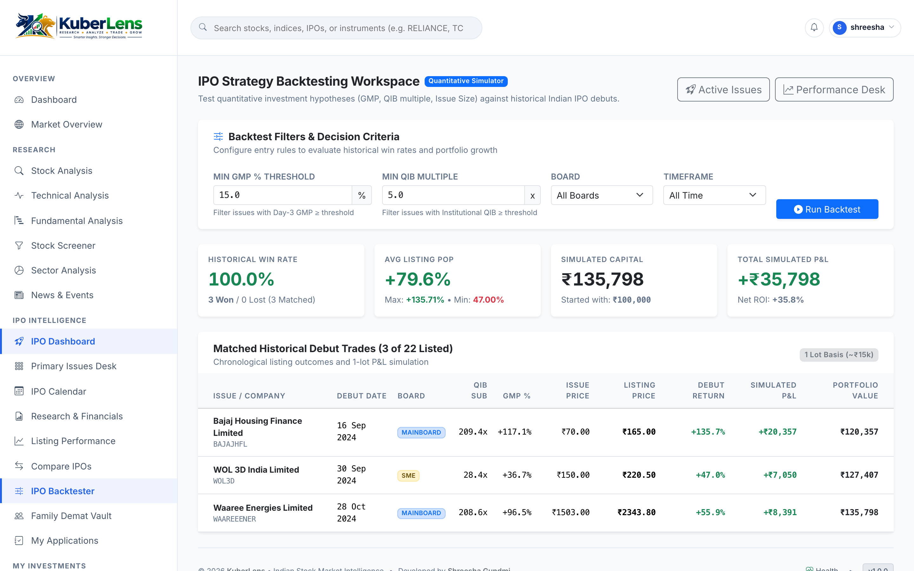

# IPO Strategy Backtester

Verified Working

- **Actual URL:** `/ipo/backtest/`
- **Route Name:** `ipo:backtest`

## 1. Page Purpose
Simulates historical returns of systematic retail IPO application strategies (e.g., applying only when GMP > 20% and QIB subscription > 10x on Day 3).
