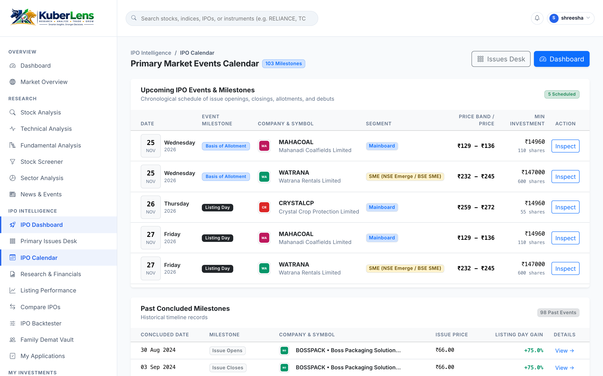

# IPO Interactive Calendar

Verified Working

- **Actual URL:** `/ipo/calendar/`
- **Route Name:** `ipo:calendar`
- **Sidebar Location:** IPO Intelligence > IPO Calendar

## 1. Page Purpose
Interactive timeline view tracking all key IPO milestones:
- Issue Open & Close Dates
- Basis of Allotment Finalization
- Refund Initiation Date
- Credit of Shares to Demat
- Official Listing Date on NSE/BSE
