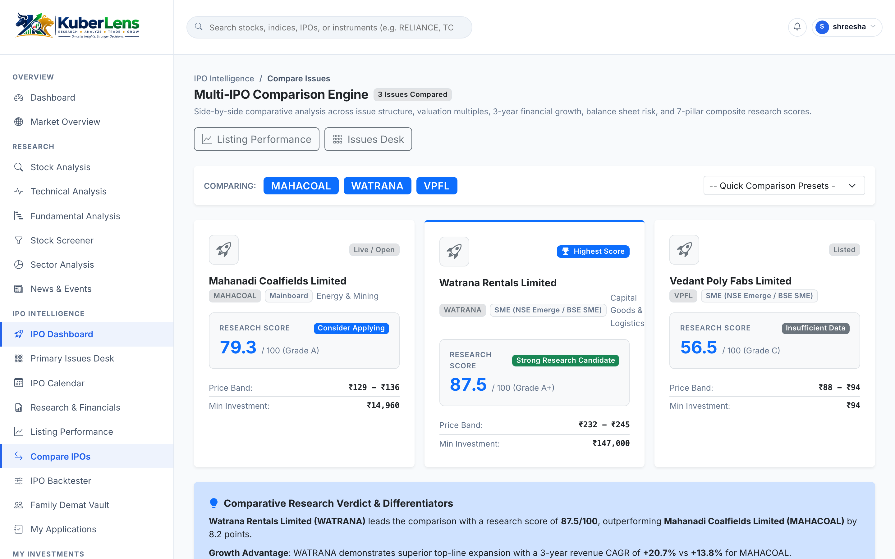

# Compare IPOs Side-by-Side

Verified Working

- **Actual URL:** `/ipo/compare/`
- **Route Name:** `ipo:compare`

## 1. Page Purpose
Allows side-by-side comparative analysis of competing IPO issues across issue size, promoter dilution, P/E multiples, revenue growth, and GMP percentages.
