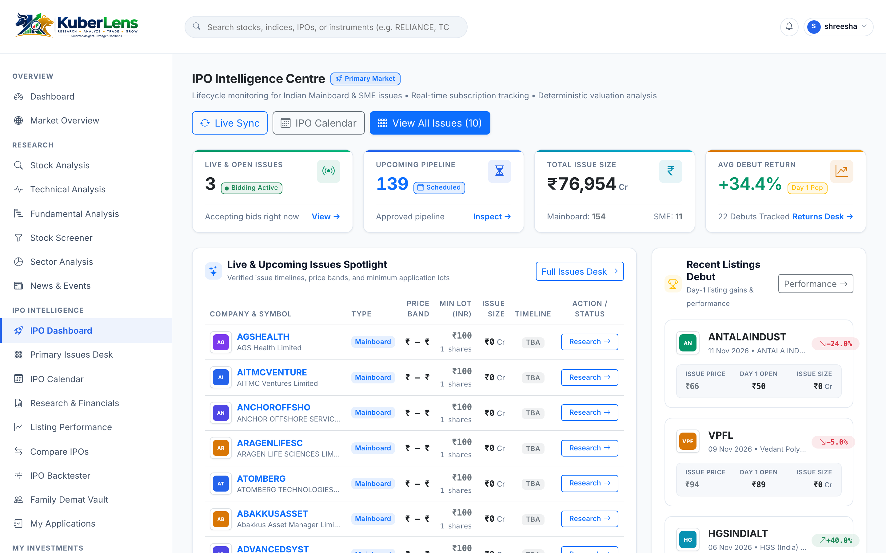
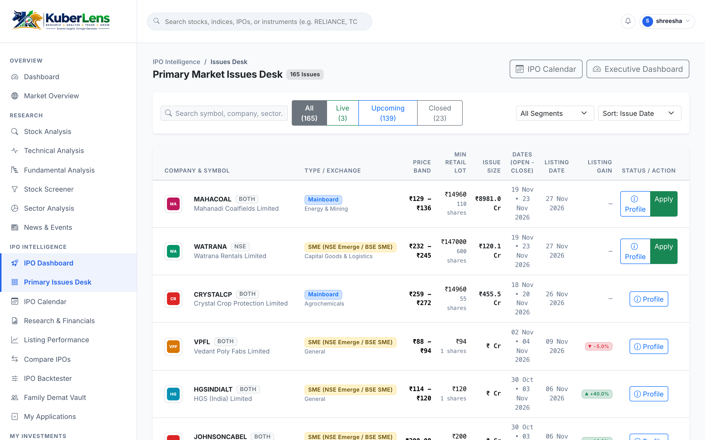

# IPO Dashboard & Primary Issues Desk

Verified Working

- **Actual URLs:** `/ipo/` and `/ipo/issues/`
- **Route Names:** `ipo:dashboard`, `ipo:issues`
- **Sidebar Location:** IPO Intelligence > IPO Dashboard & Primary Issues

## 1. Page Purpose
The **IPO Intelligence Desk** tracks Indian Initial Public Offerings across Mainboard and SME platforms, providing Grey Market Premium (GMP) updates, subscription status, and financial health scores.

## 2. Features
- **Issue Details:** Issue Size (₹ Cr), Price Band, Minimum Lot Size, Retail Quota (35%).
- **GMP Trend Tracker:** Real-time grey market premium estimates with estimated listing gain %.
- **Subscription Demand Matrix:** Day-by-day bidding breakdown across QIB (Qualified Institutional Buyers), NII (Non-Institutional Investors), and RII (Retail Individual Investors).
