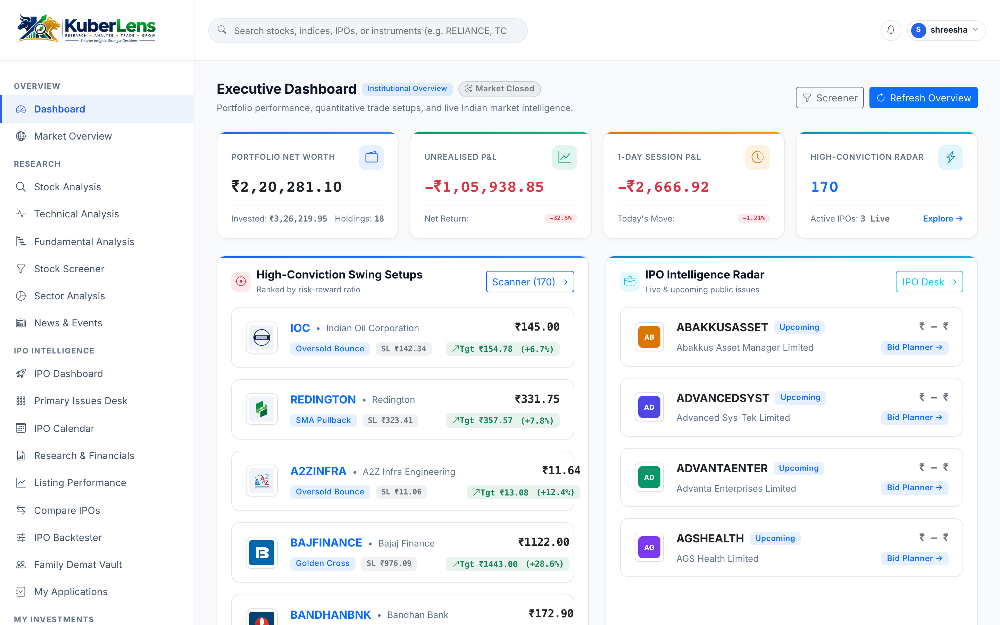

# Market Executive Dashboard

Verified Working

- **Actual URL:** `/` (`/dashboard/`)
- **Route Name:** `dashboard:index`
- **Sidebar Location:** Overview > Dashboard

## 1. Page Purpose
The **Market Dashboard** serves as the primary cockpit upon logging in. It aggregates macro Indian benchmark indices (NIFTY 50, SENSEX, BANKNIFTY), real-time market breadth, top advancing and declining equities, active watchlist movers, and an executive snapshot of personal portfolio performance.

## 2. Numbered Section Breakdown
1. **Benchmark Indices Bar:** Live index values, absolute change, and percentage movement for NIFTY 50, SENSEX, and BANKNIFTY.
2. **Market Breadth Gauge:** Visual ratio of advancing vs. declining stocks across the NSE universe.
3. **Top Gainers & Losers:** Ranked cards showing leading momentum stocks and high-volume pullbacks.
4. **Portfolio At-A-Glance:** Real-time net worth, daily unrealized P&L, and asset allocation pie chart.
5. **Quick Watchlist Monitor:** Top 5 tracked securities with quick jump links to full analysis.

## 3. Step-by-Step Instructions
1. Review the **Benchmark Indices Bar** to assess macro market trend direction.
2. Check the **Market Breadth Gauge**: If Advances > Declines, broad market participation is positive.
3. Click on any ticker in the **Top Gainers** or **Watchlist** tables to navigate directly to its Single Stock Intelligence Cockpit.

## 4. Key Metrics & Indicator Definitions
- **Advances / Declines (A/D):** Ratio of stocks closing higher vs lower. A ratio > 1.5 indicates strong bullish breadth.
- **Day P&L:** Net change in rupee value across your active portfolio holdings since the previous close.

## 5. Practical Usage Scenario
An investor logs in at 09:30 IST. Nifty 50 is up +0.65%, and the Advance/Decline ratio is 38:12. This confirms broad-based buying rather than an isolated heavyweight rally. The investor proceeds to the Swing Scanner to locate high-conviction breakout setups.

## 6. Expected Results
Selecting any stock row immediately redirects to that stock's complete 6-pillar analysis page.
