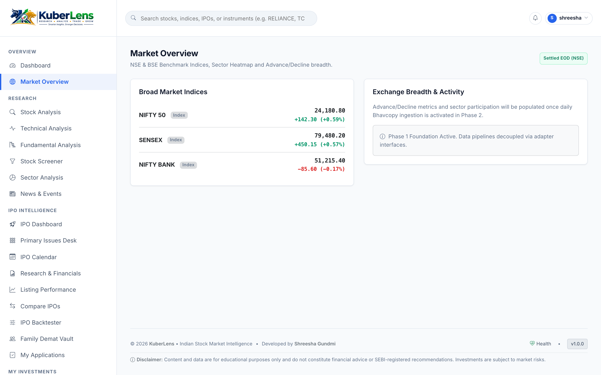

# Market Overview & Breadth Desk

Verified Working

- **Actual URL:** `/market-overview/`
- **Route Name:** `dashboard:market_overview`
- **Sidebar Location:** Overview > Market Overview

## 1. Page Purpose
The **Market Overview Desk** provides macro-economic breadth analysis, sectoral rotation heatmaps, and liquidity distribution across large, mid, and small-cap market segments.

## 2. Numbered Section Breakdown
1. **Sectoral Heatmap:** Color-coded matrix showing 1D, 1W, and 1M percentage returns across NIFTY IT, BANK, AUTO, PHARMA, FMCG, and REALTY.
2. **52-Week High/Low Distribution:** Bar chart tracking how many equities hit 52-week highs versus 52-week lows during the current session.
3. **Institutional Flows Tracker:** Summaries of Foreign Institutional Investors (FII) and Domestic Institutional Investors (DII) cash market net flows.

## 3. Practical Usage Scenario
Before entering swing long positions, an investor checks the 52-week high/low expansion. If new 52-week highs are expanding above 50 stocks while 52-week lows are contracting below 5, it signifies a healthy bull market regime suitable for breakout buying.
