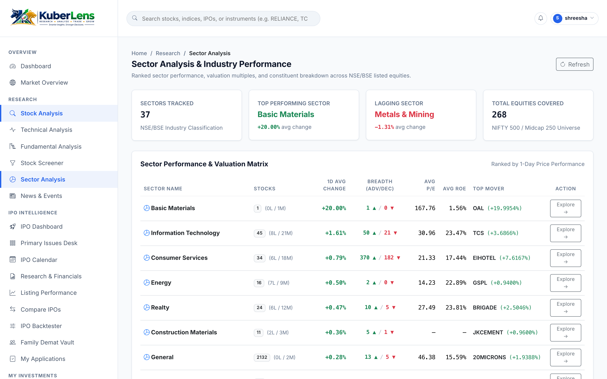

# Sector & Industry Analysis

Verified Working

- **Actual URL:** `/stocks/sectors/`
- **Route Name:** `stocks:sector_analysis`
- **Sidebar Location:** Research > Sector Analysis

## 1. Page Purpose
Enables sector rotation analysis by tracking capital inflows and relative performance across NSE sectoral indices.

## 2. Features
- **Relative Strength vs. Nifty 50:** Identifies which sectors are outperforming the benchmark index over 1-month and 3-month trailing windows.
- **Sector Constituents Breakdown:** Drill-down into any sector to view individual stock weightings, average P/E, and sector-wide profit margins.
