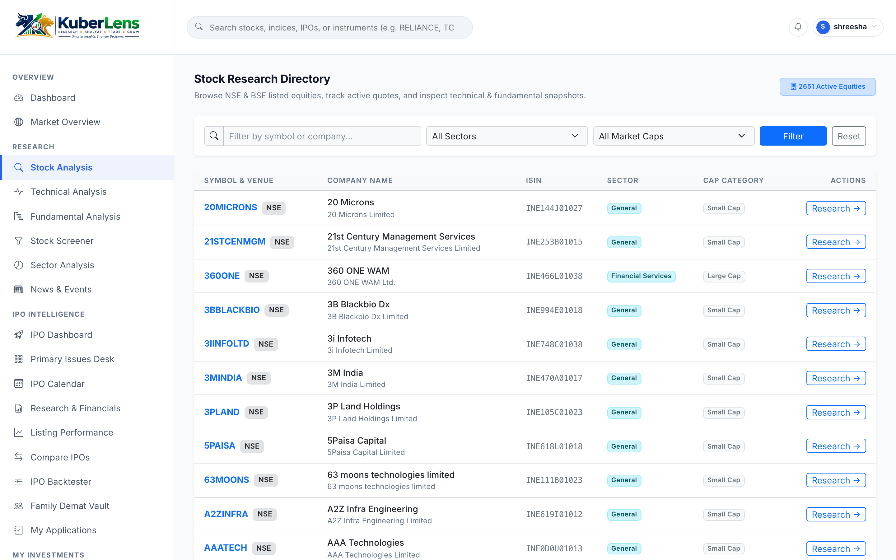

# Stock Directory & Search Hub

Verified Working

- **Actual URL:** `/stocks/`
- **Route Name:** `stocks:stock_list`
- **Sidebar Location:** Research > Stock Analysis

## 1. Page Purpose
The **Stock Directory** is the central searchable catalog of all equities tracked within KuberLens. It provides filtering by industry sector, market capitalization tiers, and real-time volume activity.

## 2. Numbered Section Breakdown
1. **Symbol / Company Search Input:** Real-time search by NSE ticker (e.g. `COALINDIA`, `SBIN`, `TCS`) or full legal company name.
2. **Sector Dropdown Filter:** Filter by specific industries (e.g. Oil Gas & Consumable Fuels, Financial Services).
3. **Market Cap Segment Filter:** Toggle between Large Cap (Top 100), Mid Cap (101-250), and Small Cap (251+).
4. **Equities Grid / Table:** Tabular listing displaying Current Price, Day Change (₹ and %), 52-Week Range Bar, Volume, and Quick Actions.

## 3. Step-by-Step Instructions
1. Enter the ticker symbol in the search bar.
2. Apply Market Cap or Sector filters if narrowing down a research universe.
3. Click on the company name or the **Analyze** button to open the Single Stock Intelligence Cockpit.
