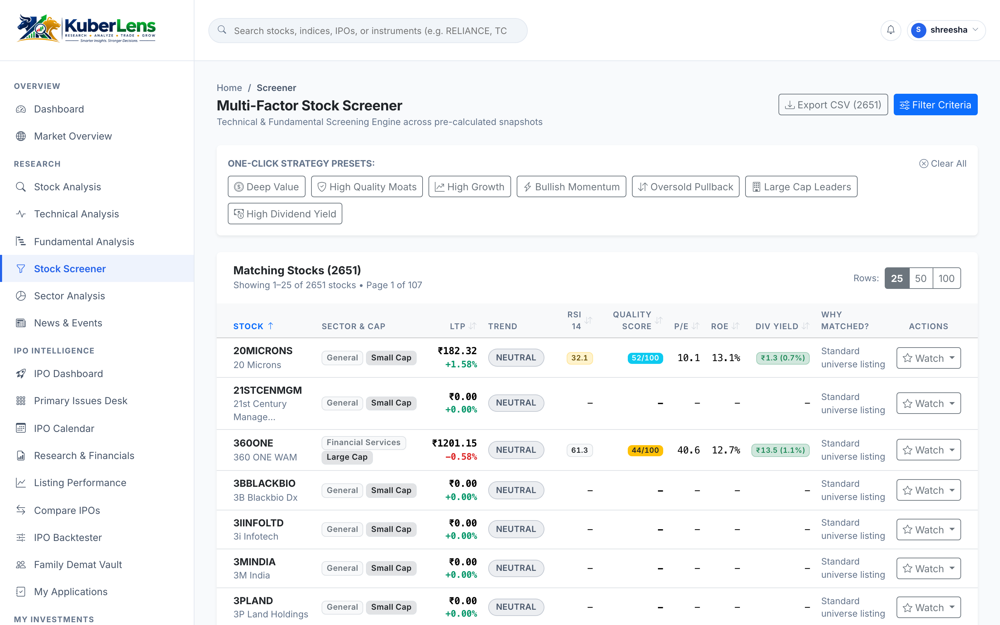

# Quantitative Stock Screener

Verified Working

- **Actual URL:** `/screener/`
- **Route Name:** `screener:index`
- **Sidebar Location:** Research > Stock Screener

## 1. Page Purpose
The **Stock Screener** enables quantitative multi-factor screening across technical momentum, fundamental valuations, and machine learning risk criteria simultaneously.

## 2. Available Filters
- **Technical Filters:** RSI range (e.g., $30 \le 	ext{RSI} \le 50$), Price vs SMA200, MACD Bullish Cross, ADX trend strength.
- **Fundamental Filters:** P/E Ratio $\le 20$, Debt-to-Equity $\le 0.5$, Return on Equity (ROE) $\ge 15\%$, Dividend Yield.
- **ML & Risk Filters:** Regime Classification (`BULLISH_TREND`, `RANGE_BOUND`), Risk Score $\le 40$ (`LOW_RISK` / `MODERATE_RISK`).

## 3. Step-by-Step Instructions
1. Select one of the preset screener templates (e.g., *"Quality Pullback Setup"* or *"Value Growth Champions"*).
2. Or adjust slider parameters manually.
3. Click **Apply Screener Filters**. The results table refreshes dynamically.
4. Export matching symbols to CSV or add them directly to a custom Watchlist.
