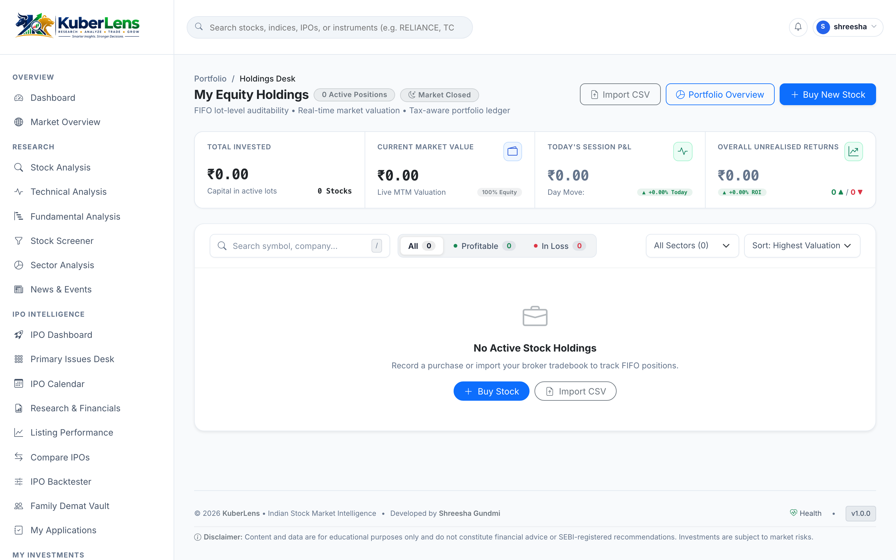

# Holdings & Position Ledger

Verified Working

- **Actual URL:** `/portfolio/holdings/`
- **Route Name:** `holdings:list`
- **Sidebar Location:** My Investments > My Holdings

## 1. Page Purpose
The **Holdings Ledger** lists every open equity position with average buy price, current market price, total value, unrealized gain/loss, and portfolio weighting %.
