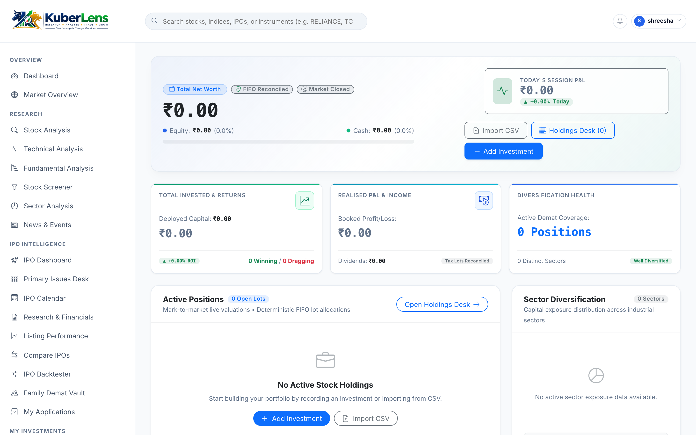

# Portfolio Cockpit & P&L Analytics

Verified Working

- **Actual URL:** `/portfolio/`
- **Route Name:** `portfolio:overview`
- **Sidebar Location:** My Investments > Portfolio Overview

## 1. Page Purpose
Provides comprehensive capital tracking: Total Portfolio Value, Total Invested Amount, Realized P&L, Unrealized P&L, and asset allocation breakdown.
