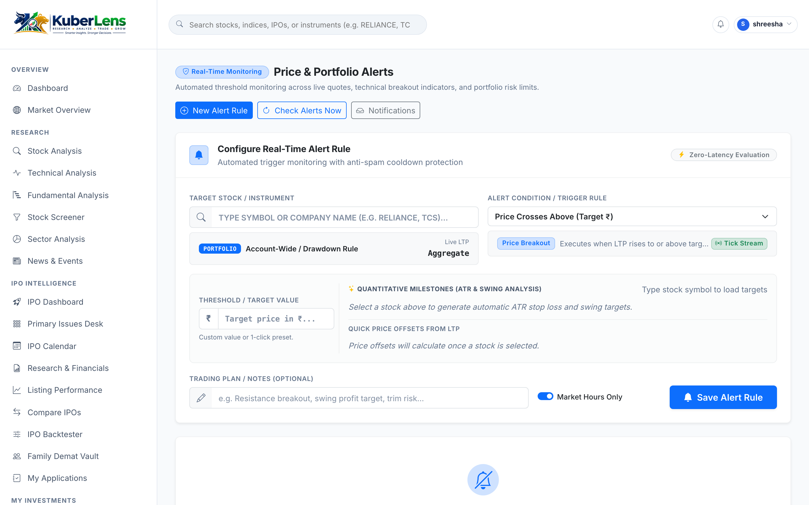

# Real-Time Alerts & Notifications

Verified Working

- **Actual URL:** `/alerts/`
- **Route Name:** `alerts:list`
- **Sidebar Location:** Intelligence > Alerts & Notifications

## 1. Page Purpose
Manages alert triggers for price thresholds, moving average crossovers, RSI overbought/oversold levels, and risk veto warnings.
