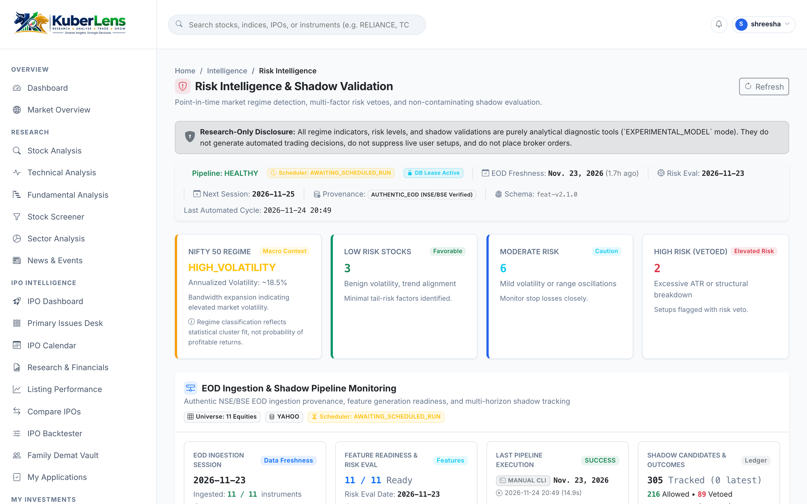

# 5-Pillar Institutional Risk Veto Engine

Verified Working

- **Actual URL:** `/ml/risk-dashboard/`
- **Route Name:** `ml_engine:risk_dashboard`
- **Sidebar Location:** Intelligence > Risk Intelligence

## 1. Page Purpose
The `MLRiskVetoEngine` acts as an institutional safety valve to prevent capital allocation into deteriorating setups.

## 2. The 5 Quantitative Risk Pillars
1. **Regime Risk:** High risk if market regime is in `BEARISH_TREND`.
2. **Volatility Risk:** Evaluates Average True Range (ATR) expansion and Bollinger Band width.
3. **SMA 200 Deviation Risk:** High risk if price is extended $> 30\%$ above or below the 200-day moving average.
4. **Relative Strength vs. Nifty 50:** Evaluates trailing 60-day outperformance.
5. **Earnings Shock Risk:** Flags stocks within 7 days before or after quarterly earnings releases.
