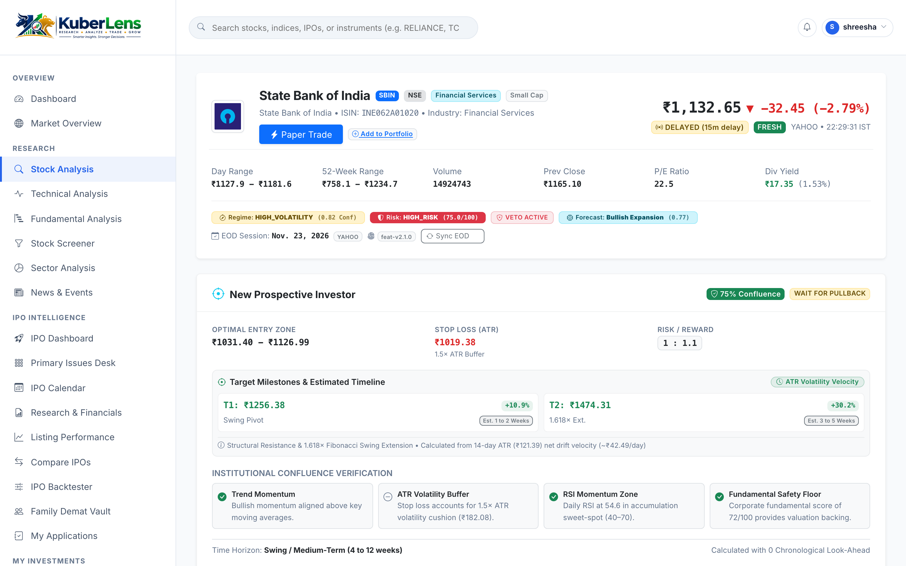

# Interactive Charting & Technical Overlays

Verified Working

## Overview
KuberLens embeds TradingView Lightweight Charts for high-speed, client-side vector rendering of OHLC candlestick bars.

## Technical Indicators Included
1. **Simple Moving Averages (SMA):** 20-day (short), 50-day (medium), 200-day (institutional long-term baseline).
2. **Exponential Moving Average (EMA 9):** Fast trigger line.
3. **Bollinger Bands (20, 2):** Upper band, Basis, Lower band. Identifies volatility squeezes.
4. **Volume Histogram:** Color-matched with candle direction, overlaid with 20-period volume average.
