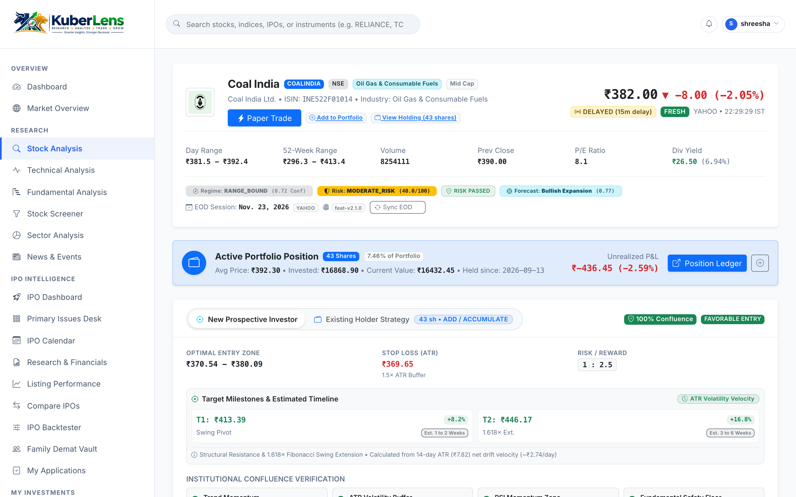
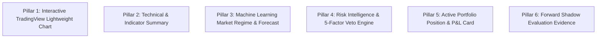

# 6-Pillar Single Stock Intelligence Cockpit

Verified Working

- **Actual URL:** `/stocks/<symbol>/` (e.g. `/stocks/COALINDIA/`, `/stocks/SBIN/`)
- **Route Name:** `stocks:stock_detail`
- **Sidebar Location:** Research > Stock Detail

## 1. Page Purpose
The **Single Stock Intelligence Cockpit** is KuberLens's flagship research interface. It consolidates fundamental valuation, technical price action, real-time portfolio holdings, machine learning regime forecasts, institutional risk veto scoring, and out-of-sample forward shadow tracking into six unified pillars.

## 2. Numbered Section Breakdown (The 6 Pillars)

### Pillar 1: Interactive Candlestick Chart
- Renders high-performance TradingView Lightweight Candlestick charts.
- Supports multi-timeframe toggles (1D, 1W, 1M, 1Y, 5Y).
- Dynamic overlays: 20-day SMA, 50-day SMA, 200-day SMA, and Bollinger Bands.

### Pillar 2: Technical Summary & Key Stats
- Day Range ($381.50 - ₹392.40$), 52-Week Range ($296.30 - ₹413.40$), Volume, Previous Close, P/E Ratio (8.1), Dividend Yield (6.94%).
- Momentum oscillators: RSI (14), StochRSI, MACD Signal Line, ADX Trend Strength.

### Pillar 3: Machine Learning Market Regime & Directional Forecast
- **Regime Classification (`MarketRegimeClassifier`):**
  - `RANGE_BOUND` (e.g. `0.72 Conf`): Moving averages crisscrossing or $	ext{ADX} < 20$.
  - `BULLISH_TREND`: $	ext{SMA}_{20} > 	ext{SMA}_{50}$ and $	ext{ADX} \ge 25$.
  - `BEARISH_TREND`: $	ext{SMA}_{20} < 	ext{SMA}_{50}$ and $	ext{ADX} \ge 25$.
- **Directional Forecast (`StockMLRanker`):**
  - Synthesizes normalized multi-factor feature vectors to project 10-session forward probability (e.g. `Bullish Expansion (0.77)`).

### Pillar 4: Risk Intelligence & Multi-Factor Veto Engine
- **Risk Scorecard (`MLRiskVetoEngine`):**
  $$\text{Risk Score} = w_1(\text{Regime}) + w_2(\text{Volatility}) + w_3(\text{SMA200 Dist}) + w_4(\text{Rel Strength}) + w_5(\text{Earnings Shock})$$
- **Risk Tiers:**
  - `0 - 25`: LOW RISK (Optimal trend alignment, low tail risk).
  - `26 - 60`: MODERATE RISK (Standard position sizing permitted).
  - `61 - 100`: HIGH / CRITICAL RISK (High downside volatility or breakdown).
- **Veto Badge:** Displays RISK PASSED when all institutional rules pass, or `VETOED` with clear explanation when a safety threshold is breached.

### Pillar 5: Active Portfolio Position & P&L Card
- Rendered conditionally when the user holds shares of the stock.
- Displays: Quantity held (e.g. 43 shares), Average Cost Price, Current Market Value, Portfolio Weight %, and Real-time Unrealized P&L.
- Quick buttons: **Paper Trade**, **Add to Portfolio**, **View Holding**.

### Pillar 6: Forward Shadow Evaluation Evidence
- Operates strictly out-of-sample without lookahead bias.
- Setup Heuristic (`TREND_PULLBACK_HEURISTIC`): $\text{Price} > \text{SMA}_{200}$, $35 \le \text{RSI} \le 50$, $\text{StochRSI } K < 25$.
- Deducts realistic Indian equity CNC transaction charges (STT 0.1%, GST 18%, Stamp Duty 0.015%, slippage 0.05%).
- Evaluates 5-day, 10-day, and 20-day mature net returns.

## 3. Practical Usage Scenario
Evaluating **Coal India (COALINDIA)**:
1. Header shows price ₹382.00, P/E 8.1, Div Yield 6.94%.
2. Regime shows `RANGE_BOUND (0.72 Conf)`, Risk is `MODERATE_RISK (40.0/100)`, Veto is `RISK PASSED`.
3. Forecast shows `Bullish Expansion (0.77)`.
4. Position card confirms you hold 43 shares with an unrealized gain.
5. The investor decides to hold the position with stop-loss pegged below the 200 SMA.
