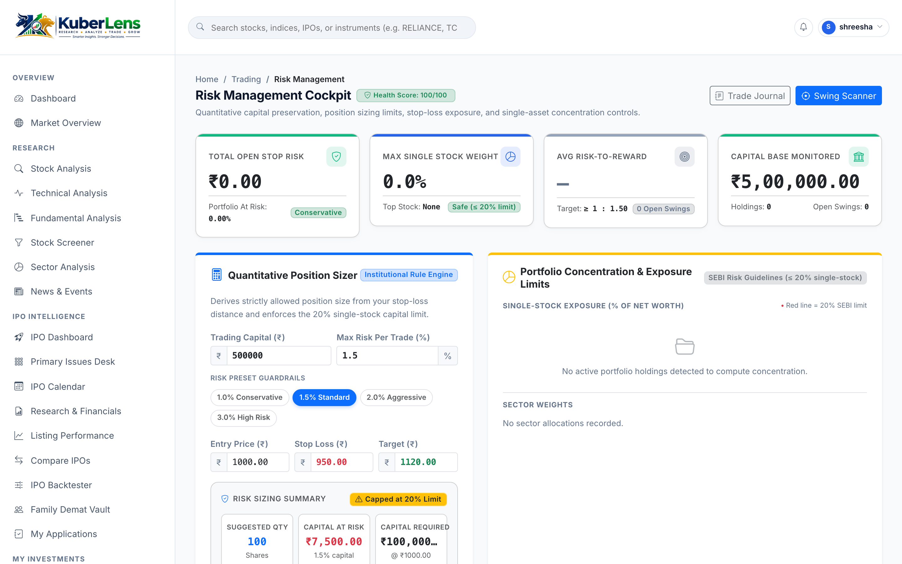

# Risk & Position Sizing Calculator

Verified Working

- **Actual URL:** `/trading/risk-management/`
- **Route Name:** `trading:risk_management`
- **Sidebar Location:** Trading > Risk Management

## 1. Page Purpose
Capital preservation calculator computing exact share quantities based on portfolio risk tolerance (e.g. 1% of equity) and technical stop-loss distance:
$$\text{Position Size} = \frac{\text{Account Capital} \times \text{Risk \%}}{\text{Entry Price} - \text{Stop Loss Price}}$$
