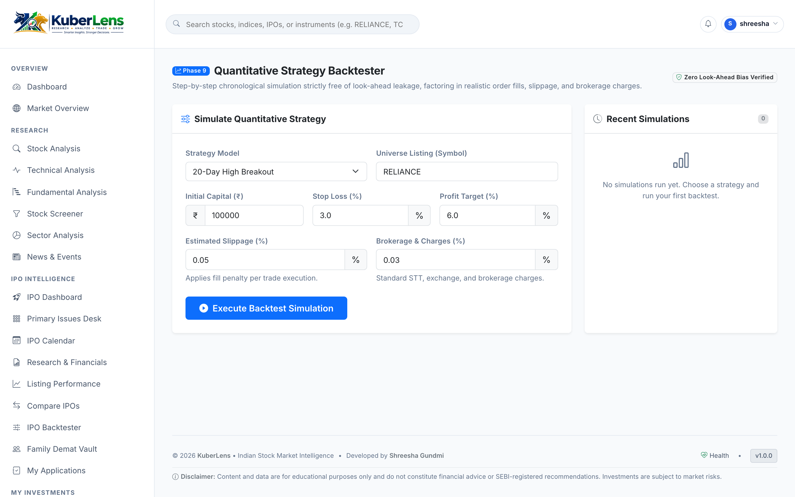

# Quantitative Strategy Backtester

Verified Working

- **Actual URL:** `/backtesting/`
- **Route Name:** `backtesting:dashboard`
- **Sidebar Location:** Trading > Backtesting

## 1. Page Purpose
Backtests technical strategies on historical NSE daily data. Calculates CAGR, Maximum Drawdown, Sharpe Ratio, Profit Factor, and win rate after accounting for brokerage and taxes.
