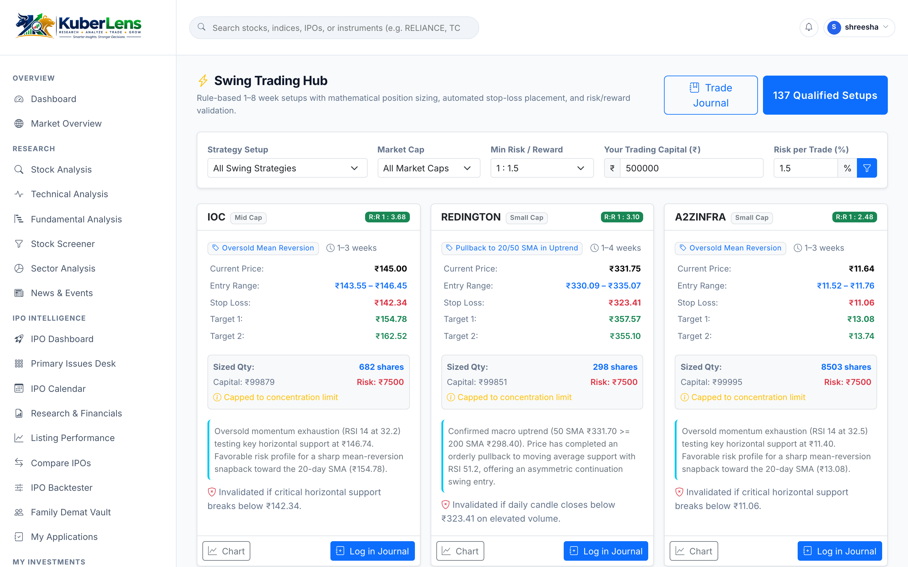

# Algorithmic Swing Trading Scanner

Verified Working

- **Actual URL:** `/trading/`
- **Route Name:** `trading:scanner`
- **Sidebar Location:** Trading > Swing Scanner

## 1. Page Purpose
Algorithmic pattern scanner detecting high-probability swing trading setups:
- Breakout from Consolidation
- Pullback to 20 EMA in Bullish Trend
- Bullish Engulfing Candlestick
- Volatility Contraction Pattern (VCP)
